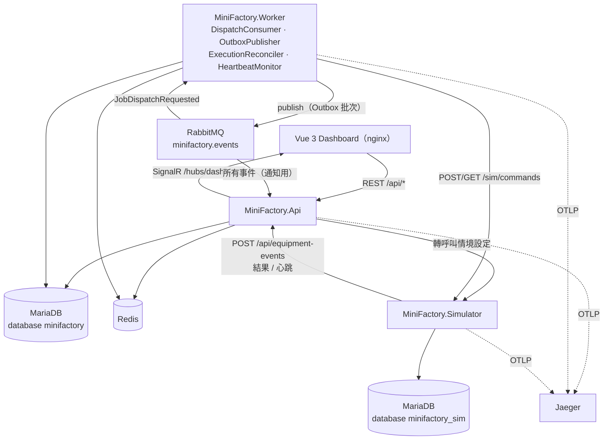
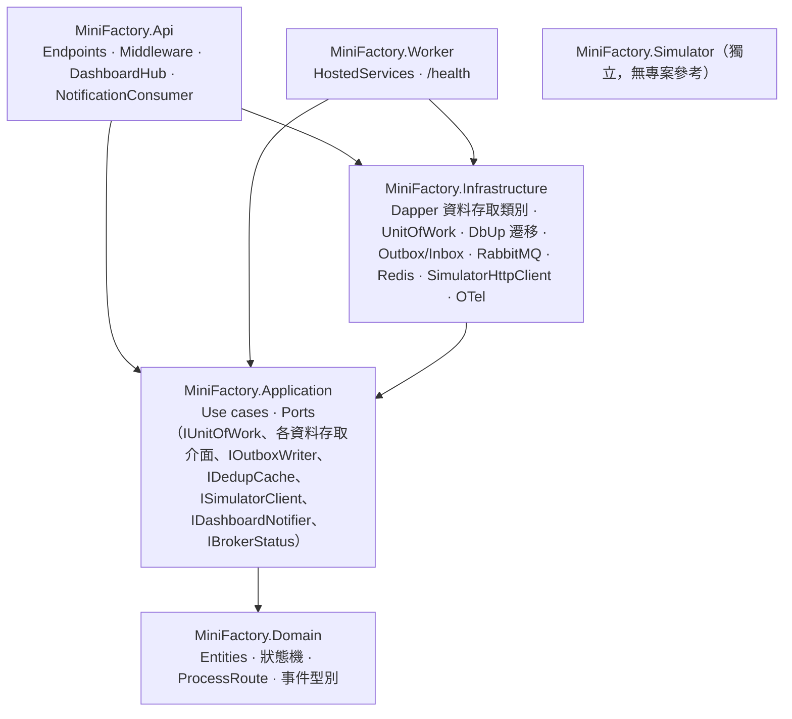
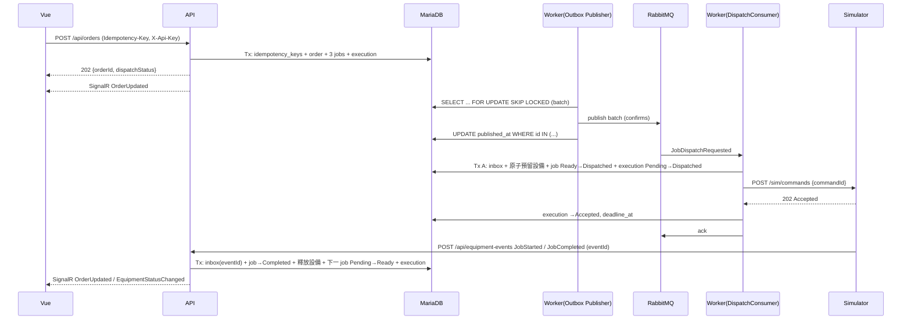
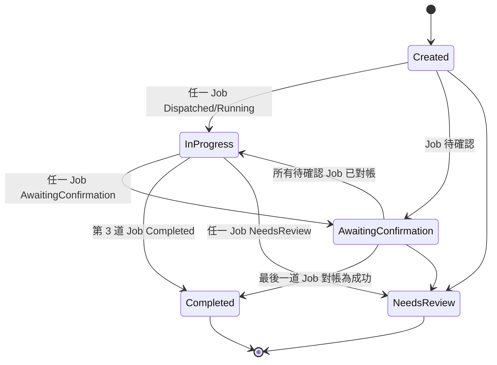
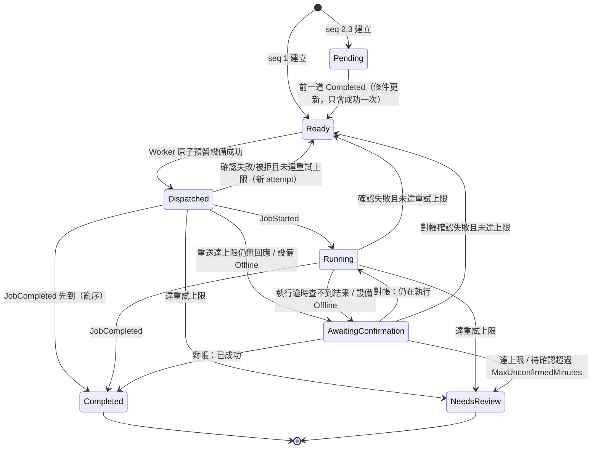
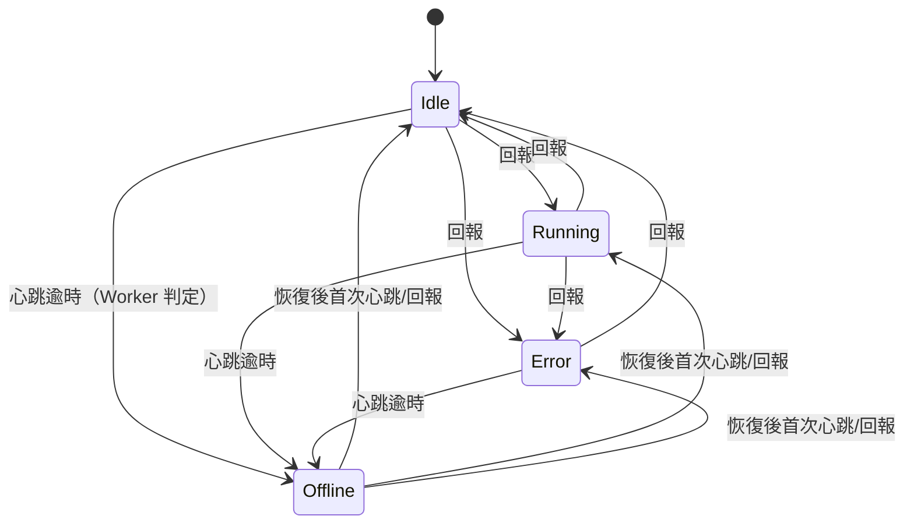
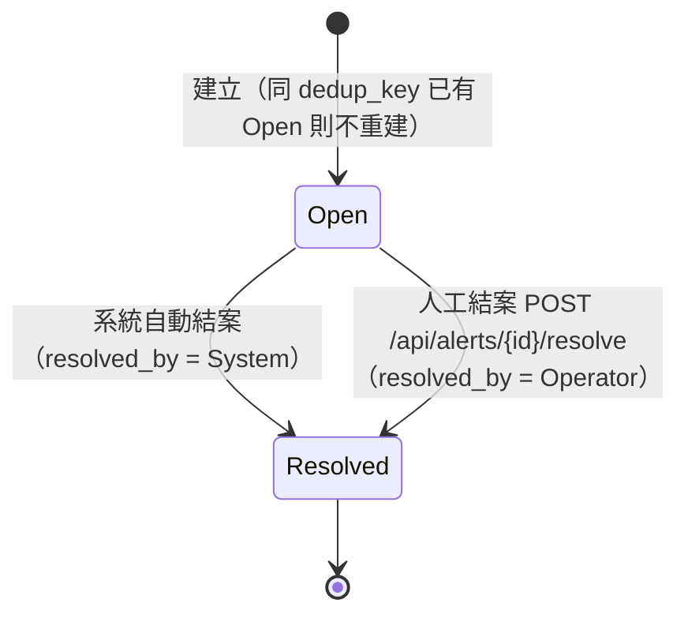
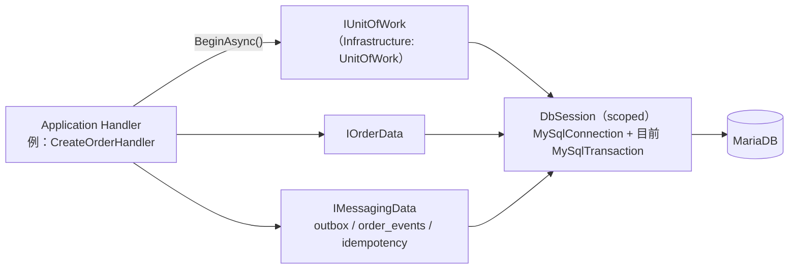

# MiniFactory 系統架構（第一版：Roadmap Phase 1～4）

> 文件狀態：**✅ 已確認（2026-11-11，Wayne）**，可進入 db-engineer / backend-dev / frontend-dev 實作。
> **2026-11-11 資料層變更**：PostgreSQL + EF Core → **MariaDB（目標 10.11，最低 10.7）+ Dapper + MySqlConnector + DbUp**（ADR-016～018；§2.5、§10.7、§19.2.1～19.2.2；偏離與 README 同步清單見 §20、§20.1）。仍標【待確認】者為實作時查證的事實（套件版本、授權、映像 tag）或保留預設值的業務細節，不阻擋開工。
> 依據：`README.md`（以下簡稱「規格」）。規格未明說、由本文件補充的設計標註 **【新增】**；已由 Wayne 拍板者標 **✅ 已確認**；仍待查證者標 **【待確認：...】**。決策與待確認事項彙整於第 21 節；對規格的補充與偏離彙整於第 20 節。
> 相關文件：[database.md](database.md)、[api.md](api.md)、[failure-scenarios.md](failure-scenarios.md)

---

## 1. 系統概觀

MiniFactory 是一個**純軟體**的縮小版生產派工平台，用程式模擬設備，展示 ASP.NET Core、MariaDB、RabbitMQ、Redis、Vue 3 如何處理「重送、重複訊息、搶設備、寫入成功但發送失敗、設備離線」等真實工程問題。不連接真實設備、不是完整 MES。

| 角色 / 系統 | 互動方式 |
|-|-|
| Demo 操作者（面試官 / Wayne） | 瀏覽器開 Vue Dashboard：建立訂單、看進度、看設備、看告警、切換設備情境 |
| ASP.NET Core API | REST + SignalR；接收 Simulator 回報 |
| Dispatch Worker | 消費 RabbitMQ 派工訊息、呼叫 Simulator、逾時對帳、心跳逾時偵測、Outbox 發送 |
| Equipment Simulator | 模擬 Machine-A/B/C，執行命令、去重、回報結果與心跳 |
| MariaDB / RabbitMQ / Redis | 持久資料 / 訊息 / 去重與快取（資料庫原規格為 PostgreSQL，2026-11-11 改為 MariaDB，見 ADR-016） |
| Jaeger【新增】 | 接收 OpenTelemetry Trace，Demo 時查整筆訂單呼叫鏈 |

使用情境（規格）：訂單 `ORD-20260921-001`、`Motor-A`、數量 500、`Line-01`，固定三道工序：

| sequence | operation（識別字） | 中文 | capability | 設備 |
|-|-|-|-|-|
| 1 | `Machining` | 加工 | `Machining` | Machine-A |
| 2 | `Assembly` | 組裝 | `Assembly` | Machine-B |
| 3 | `Inspection` | 檢驗 | `Inspection` | Machine-C |

- 工序路線第一版寫死在 Domain（`ProcessRoute.Default`），不做途程主檔。【待確認：是否需要依 `productCode` 切換路線；本設計假設所有產品同一路線】
- 數量 500 只是批次數量，不模擬逐件流轉（規格）。

### 1.1 規格「第一版要完成什麼」對照

| 規格項目 | 對應設計章節 |
|-|-|
| 建立訂單，依固定工序產生 Job，依順序派工 | §8 訂單流程、§9 狀態機、api.md `POST /api/orders` |
| 3 台以上虛擬設備，回報 Idle/Running/Error/Offline | §6 Simulator、§9.4 設備狀態機、§11 心跳 |
| 保存訂單、Job、執行紀錄、設備狀態歷史、事件、告警 | database.md 全部資料表 |
| RabbitMQ 傳派工事件、Worker 處理、Outbox 防漏送 | §7 訊息拓樸、§10 Outbox |
| 重送派工命令沿用同一識別碼 | §11 命令重送與逾時對帳 |
| Vue Dashboard + SignalR 為主、輪詢 fallback | §13 SignalR、§15 前端 |
| Docker Compose 啟動全部服務 | §16 部署 |
| 結構化日誌、關聯 ID、基本 Trace | §14 可觀測性 |

---

## 2. 技術選型

### 2.1 目標框架：`net10.0`

| 選項 | 判斷 |
|-|-|
| **.NET 10（LTS）** | **採用。** 本機已裝 SDK 10.0.303；.NET 10 為 LTS（支援三年）；資料存取用 Dapper + MySqlConnector（不依賴 EF Core provider 是否跟上 .NET 10，見 ADR-017）；`Guid.CreateVersion7()`、內建 OpenAPI 文件產生、Minimal API 內建驗證皆可用。作品集長期展示不必短期內升級。 |
| .NET 9（STS） | 支援期較短，且本機未裝對應 SDK 的必要性不高，不採用。 |
| .NET 8（LTS） | 仍在支援期，但已較舊、支援期先結束，無理由降版。 |

以 `global.json` 鎖 SDK `10.0.x`（`rollForward: latestFeature`）。

### 2.2 後端套件

版本號一律在實作時取「當下最新穩定版」，以 Central Package Management（`Directory.Packages.props`）鎖定，本文件不寫死版本號以免編造。

| 用途 | 套件 | 使用專案 | 備註 |
|-|-|-|-|
| DB 驅動 | **`MySqlConnector` 2.6.2**（MIT；明確釘版，理由見遷移工具列） | Infrastructure、Simulator | MariaDB / MySQL 的非同步 ADO.NET 驅動；連線字串選項見 §10.7 |
| 資料存取 | **`Dapper` 2.1.89** | Infrastructure、Simulator | 手寫 SQL；不用 EF Core（ADR-017）。注意：Dapper 寫入 enum 參數會轉成**整數**，因此所有存取必須經 `DbSession`（`DbParameters.Prepare` 將 enum 轉為狀態字串），不得直接對連線呼叫 Dapper |
| 遷移工具 | **`dbup-mysql` 6.1.0**（底層為 MySqlConnector） | Infrastructure（腳本與 `DbUpMigrator`）、`MiniFactory.Migrator`、Simulator | SQL 腳本式遷移（ADR-018）。✅ 已查證（Phase 1）：其傳遞相依為 MySqlConnector 2.3.5（有安全公告 GHSA-473q-m89c-ghf8），**必須在 `Directory.Packages.props` 明確釘 `MySqlConnector` 2.6.2** 覆蓋傳遞版本 |
| 訊息 | **`RabbitMQ.Client`（7.x，async API）** | Infrastructure | 二選一理由見 ADR-002 |
| Redis | `StackExchange.Redis` | Infrastructure、Simulator | |
| SignalR Redis Backplane（預留） | `Microsoft.AspNetCore.SignalR.StackExchangeRedis` | Api | 第一版以設定關閉，Phase 5 開啟 |
| 日誌 | `Serilog.AspNetCore` 10.0.0、`Serilog.Formatting.Compact`（或 `Serilog.Sinks.Console` 的 JSON formatter） | Api、Worker、Simulator、Migrator | |
| Trace | `OpenTelemetry.Extensions.Hosting`、`OpenTelemetry.Instrumentation.AspNetCore`、`OpenTelemetry.Instrumentation.Http`、`OpenTelemetry.Exporter.OpenTelemetryProtocol`；DB span 用 MySqlConnector 內建 ActivitySource（`AddSource("MySqlConnector")`）【待確認：實作時確認所用版本已內建】 | Api、Worker、Simulator | Redis instrumentation（`OpenTelemetry.Instrumentation.StackExchangeRedis`）為 beta，選用 |
| 健康檢查 | `AspNetCore.HealthChecks.MySql`（以 MySqlConnector 實作，MariaDB 適用）、`AspNetCore.HealthChecks.Rabbitmq`、`AspNetCore.HealthChecks.Redis` | Api、Worker、Simulator | 【待確認：Rabbitmq health check 版本須相容 RabbitMQ.Client 7.x，否則自寫 `IHealthCheck`（檢查 `IConnection.IsOpen`）】 |
| HTTP 韌性 | `Microsoft.Extensions.Http.Resilience` | Worker、Simulator | 只用 attempt timeout / circuit breaker；**派工命令的重送不交給 Polly 自動重試**，而由 Worker 自己記錄 `send_count`（Demo 要看得到重送紀錄） |
| OpenAPI | `Microsoft.AspNetCore.OpenApi`（內建）＋ `Scalar.AspNetCore`（UI，僅 Development） | Api | 不用 Swashbuckle（.NET 9 起已移出範本） |
| 驗證 | **Application 自寫 validator**（例 `CreateOrderValidator`），回傳欄位錯誤清單，由 API 轉成 `ValidationProblemDetails` | Application、Api | ✅ Phase 1 定案：**不使用** `AddValidation()`（驗證規則屬業務規則，放 Application 才能單元測試、也不受框架繫結行為影響）；不引入 FluentValidation |
| 測試 | **`xunit.v3` 4.0.3**（內建 `Assert`）+ **Microsoft.Testing.Platform**（`global.json` 的 `test.runner` 設定）+ **`coverlet.MTP` 10.1.0** + `Microsoft.Testing.Extensions.TrxReport` | tests/* | ✅ Phase 1 定案：**沒有** Shouldly、NSubstitute、`Microsoft.NET.Test.Sdk`、`coverlet.collector`；Application 單元測試用手寫 fake（`Fakes.cs`）。斷言不用 FluentAssertions（v8 起商業授權） |
| 整合測試 | `Testcontainers.MariaDb` 4.16.0、`Testcontainers.RabbitMq`、`Testcontainers.Redis`、`Microsoft.AspNetCore.Mvc.Testing` | IntegrationTests | `WebApplicationFactory` 的入口型別用 **`ApiAssemblyMarker`**（方案中有多個 `Program` 型別，直接用 `Program` 會衝突） | DB / MQ 斷線情境用 Toxiproxy 容器（Testcontainers 通用 `ContainerBuilder`）【待確認：實作時評估 Toxiproxy 或 Testcontainers pause/stop】 |

**刻意不引入**：MediatR、AutoMapper（2025 年起轉商業授權，且本專案規模手寫即可）、MassTransit（見 ADR-002）、Redis 分散式鎖套件（見 ADR-004）、EF Core 與其 MySQL provider（見 ADR-017：`Pomelo.EntityFrameworkCore.MySql` 在 NuGet 上最新為 9.0.0、沒有 EF Core 10 版；Oracle 官方 provider 不保證支援 MariaDB）。

### 2.3 前端套件（`frontend/minifactory-web`）

| 用途 | 套件 |
|-|-|
| 框架 | `vue`（3.5+）、`typescript`、`vite`、`@vitejs/plugin-vue` |
| 狀態 / 路由 | `pinia`、`vue-router` |
| HTTP | `axios` |
| 即時 | `@microsoft/signalr` |
| 型別檢查 / Lint | `vue-tsc`、`eslint`、`eslint-plugin-vue`、`typescript-eslint`（`@vue/eslint-config-typescript`） |
| UI 元件庫 | **Element Plus**（✅ 已確認 2026-11-11；Toast、Table、Timeline 元件齊全） |
| 單元 / 元件測試 | `vitest`、devDependencies `@vue/test-utils` 2.5.1、`happy-dom` 21.0.4（✅ 已實作）。元件測試檔以 `// @vitest-environment happy-dom` 註解切換環境；`vite` 設定 `test.server.deps.inline` 包含 `element-plus`（避免其相依 async-validator 的預設匯入問題） |
| 時間格式化 | 瀏覽器內建 `Intl.DateTimeFormat`，不引入日期套件 |

Node：本機 v22.14.0，符合 Vite 現行版本需求；Dockerfile 以 `node:22-alpine` 建置、`nginx` 提供靜態檔。

### 2.4 基礎設施映像（版本於實作時鎖 tag）

| 服務 | 建議映像 | 備註 |
|-|-|-|
| MariaDB | **`mariadb:10.11.11`** | ✅ Phase 1 定案，與 NAS 推定版本 10.11.11 一致（§2.5） |
| RabbitMQ | **`rabbitmq:4.4-management-alpine`** | ✅ Phase 1 定案；含管理介面 15672，Demo 可展示佇列 |
| Redis | **`redis:8.10-alpine`** | ✅ Phase 1 定案 |
| Jaeger | `jaegertracing/jaeger`（v2，內建 OTLP 接收） | 【新增】✅ 已確認採用 Jaeger（2026-11-11）；【待確認：確切 tag】 |
| .NET | `mcr.microsoft.com/dotnet/sdk:10.0`（建置）、`mcr.microsoft.com/dotnet/aspnet:10.0`（執行） | 執行映像需額外安裝 `curl` 供 Docker healthcheck 使用 |

### 2.5 MariaDB 版本需求（2026-11-11 新增）

正式環境計畫使用 Synology DS920+ 套件中心內建的「MariaDB 10」。套件中心顯示最新線上版本為 10.11.11-1551、沒有「更新」按鈕，**推定已安裝 10.11.11**（上線前仍須以 `SELECT VERSION();` 確認，§19.2）。**目標版本：MariaDB 10.11。**

本設計用到的功能與最低版本：

| 功能 | 本設計用途 | 最低版本 | 使用狀態 |
|-|-|-|-|
| 原生 `UUID` 型別 | 所有業務 ID（16 bytes 儲存、查詢時顯示標準字串，Demo 查 DB 直接可讀） | **10.7** | **使用**，決定整體最低版本 |
| `SELECT ... FOR UPDATE SKIP LOCKED` | Outbox 批次、對帳租約、心跳逾時掃描（多 Worker 安全） | 10.6 | 使用 |
| `INSERT ... RETURNING` | 可用；本設計 ID 由應用程式先產生，**不依賴**此功能 | 10.5 | 可用、非必要 |
| CHECK 約束（會實際檢查） | 狀態值、數量 > 0、JSON 驗證 | 10.2.1 | 使用 |
| `JSON` 別名（= `LONGTEXT` + `json_valid` 檢查） | payload、response_body | 10.2.7 | 使用 |
| 可建索引的生成欄位（`PERSISTENT`） | 取代 PostgreSQL 部分唯一索引（告警去重） | 10.2 | 使用 |
| `UPDATE ... RETURNING` | — | MariaDB 不支援【待確認：實作時確認 10.11 仍不支援】 | **不使用**：改為「`SELECT ... FOR UPDATE SKIP LOCKED` → `UPDATE`」兩步（§10.7） |

**最低需求：MariaDB 10.7**（因使用原生 UUID）；目標與測試版本 10.11。開發、整合測試、Codespaces 容器用 `mariadb:10.11.11`（✅ Phase 1 定案）。上線前檢查項見 §19.2。

> 原生 UUID ↔ `Guid`：✅ Phase 1 已驗證通過（`UuidRoundTripTests`：寫入讀回相等、UUIDv7 顯示為標準小寫字串且依建立順序排序、字串常值與 Guid 參數可互換）。**不需設定 `GuidFormat`、不註冊 Guid TypeHandler**。`CHAR(36)` 退路不再需要。

---

## 3. 分層架構

執行期元件與通訊（Mermaid，GitHub 原生渲染）：



專案相依（只能往下指）：



相依方向（只能往下）：`Api / Worker → Infrastructure → Application → Domain`；`Api / Worker → Application`。
- Domain 無任何外部套件相依（純 C#）。
- Application 只相依 Domain 與 `Microsoft.Extensions.*` 抽象，**不相依任何資料庫套件**。（2026-11-11 變更：原「Application 直接用 EF Core `IMiniFactoryDb`」因改用 Dapper 而作廢。）
- **資料存取分工**（細節見 §10.7）：
  - Application 定義 `IUnitOfWork` 與**每個聚合一個資料存取介面**，裡面放命令與查詢方法：`IOrderData`、`IJobData`（含 executions）、`IEquipmentData`、`IAlertData`、`IMessagingData`（outbox / inbox / idempotency / order_events），另有唯讀查詢 `IDashboardQueries`。方法名稱表達業務意圖，例如 `TryReserveEquipmentAsync(...) : bool`。
  - Infrastructure 以 Dapper 實作，SQL 寫在各實作類別內，不做泛型 Repository。
  - 所有資料存取類別共用同一個 scoped `DbSession`（同一條 `MySqlConnection` 與目前的 `MySqlTransaction`），所以只要在同一個 `IUnitOfWork` 範圍內呼叫，業務資料、`order_events`、`outbox_messages` 就自然在同一交易寫入。
- Simulator 視為「外部設備」，只透過 HTTP 合約溝通（契約定義在 api.md），**刻意不共用 DTO 專案**，以整合測試驗證合約一致。

---

## 4. 方案與資料夾結構

```text
MiniFactory/
├── MiniFactory.slnx                       # .NET 10 新版方案格式（或 .sln）
├── global.json                            # 鎖 SDK 10.0.x
├── Directory.Build.props                  # Nullable、ImplicitUsings、TreatWarningsAsErrors、LangVersion
├── Directory.Packages.props               # Central Package Management
├── .editorconfig
├── .gitattributes                         # `* text=auto`、`*.sh text eol=lf`（見下方說明）
├── .gitignore                             # 含整個 `.claude/`
├── .env.example                           # 只有變數名稱與假值
├── docker-compose.yml
├── docker-compose.override.yml            # 本機開發：開放 Simulator/DB 管理埠（選用）
├── scripts/
│   ├── cleanup-old-data.sql               # 規格：手動清理 30 天前資料
│   └── demo/                              # Phase 4 故障 Demo 腳本，只做 bash（*.sh；Git Bash / Codespaces / Linux 可執行）
├── .devcontainer/                         # Phase 4：GitHub Codespaces 一鍵啟動（§16.2）
│   ├── devcontainer.json
│   ├── post-create.sh
│   └── post-start.sh
├── src/
│   ├── MiniFactory.Domain/
│   │   ├── Orders/        ProductionOrder, OrderStatus, OrderStateMachine
│   │   ├── Jobs/          ProductionJob, JobStatus, JobExecution, ExecutionStatus, ProcessRoute
│   │   ├── Equipment/     Equipment, EquipmentStatus, EquipmentStatusHistory
│   │   │                  （命名空間為 `MiniFactory.Domain.Equipments`（複數），避免與類別 `Equipment` 同名衝突；資料夾仍為 Equipment/）
│   │   ├── Alerts/        Alert, AlertSeverity, AlertReason, AlertStatus
│   │   ├── Events/        EventTypes, EventEnvelope, 各事件 payload record
│   │   └── Common/        DomainError, Result<T>
│   ├── MiniFactory.Application/
│   │   ├── Orders/        CreateOrderHandler, IdempotencyService, OrderQueries
│   │   ├── EquipmentReports/ ApplyEquipmentReportHandler
│   │   ├── Dispatching/   DispatchJobHandler, JobLifecycleService(重試/NeedsReview), ReservationService
│   │   ├── Monitoring/    ExecutionReconciler, OfflineDetector
│   │   ├── Alerts/        AlertService（建立/自動結案/人工結案）, AlertQueries
│   │   ├── Abstractions/  IUnitOfWork, IOrderData, IJobData, IEquipmentData, IAlertData, IMessagingData,
│   │   │                  IDashboardQueries, IDedupCache, ISimulatorClient,
│   │   │                  IDashboardNotifier, IBrokerStatus, IEquipmentCache
│   │   └── Options/       DispatchOptions, HeartbeatOptions, OutboxOptions ...
│   ├── MiniFactory.Infrastructure/
│   │   ├── Persistence/   DbSession, UnitOfWork, TransactionRunner(死結重試), MySqlErrorTranslator,
│   │   │                  Data/(OrderData, JobData, EquipmentData, AlertData, MessagingData, DashboardQueries),
│   │   │                  TypeHandlers/（狀態字串 ↔ enum）
│   │   ├── Migrations/    DbUpMigrator, Scripts/0001_create_production_orders.sql ...（Embedded Resource）
│   │   ├── Messaging/     RabbitMqConnectionProvider, Topology, OutboxPublisher, RabbitMqConsumerBase,
│   │   │                  TraceContextPropagation
│   │   ├── Caching/       RedisDedupCache, RedisEquipmentCache
│   │   ├── Simulator/     SimulatorHttpClient
│   │   ├── Observability/ OpenTelemetryExtensions, SerilogExtensions, ActivitySources
│   │   └── DependencyInjection.cs
│   ├── MiniFactory.Api/
│   │   ├── Endpoints/     OrderEndpoints, EquipmentEndpoints, AlertEndpoints, EquipmentEventEndpoints,
│   │   │                  SimulatorScenarioEndpoints
│   │   ├── Middleware/    UntrustedTraceContextMiddleware（最先執行）, CorrelationIdMiddleware,
│   │   │                  RateLimiter（在 API Key 之前）, ApiKeyMiddleware + RequireApiKey(ApiKeyKind) metadata, SourceIp 檢查
│   │   ├── Errors/        ProblemTypes, ExceptionToProblemHandler(IExceptionHandler)
│   │   ├── Realtime/      DashboardHub, SignalRDashboardNotifier, NotificationConsumer(HostedService)
│   │   ├── Health/        HealthResponseWriter
│   │   ├── ApiAssemblyMarker.cs   （WebApplicationFactory 的入口型別）
│   │   ├── Properties/launchSettings.json （http profile：localhost:5080、Development；appsettings 不寫 Urls）
│   │   └── Program.cs     （**不含**遷移功能）
│   ├── MiniFactory.Migrator/     # ✅ Phase 1 定案：獨立專案與獨立映像（`mcr.microsoft.com/dotnet/runtime:10.0` 基底，不含 ASP.NET），只跑 DbUp 後結束
│   │   ├── Program.cs     （以 mf_migrator 帳號套用 Infrastructure 內嵌的腳本）
│   │   └── Dockerfile
│   ├── MiniFactory.Worker/
│   │   ├── HostedServices/ DispatchConsumerService, OutboxPublisherService,
│   │   │                   ExecutionReconcilerService, HeartbeatMonitorService
│   │   └── Program.cs     （WebApplication 極簡版，只掛 /health/*）
│   └── MiniFactory.Simulator/
│       ├── Api/           CommandEndpoints, ScenarioEndpoints, EquipmentEndpoints
│       ├── Domain/        SimulatedEquipment, Scenario, SimulatorCommand
│       ├── Persistence/   CommandData（Dapper，database minifactory_sim）、Migrations/Scripts/*.sql（DbUp，啟動時自行套用）
│       ├── Services/      CommandExecutor, HeartbeatSender, ResultReporter, StartupRecovery
│       └── Program.cs
├── tests/
│   ├── MiniFactory.UnitTests/        → Domain, Application（Domain/、Application/ 子資料夾）
│   ├── MiniFactory.IntegrationTests/ → Api, Worker, Infrastructure, Simulator
│   │                                   （Api/、Persistence/、Migrations/、Behavior/、Support/；Phase 3 起加 FailureScenarios/）
│   └── load/                         # Phase 5，第一版只放 README 佔位
├── frontend/minifactory-web/          # 見 §15
├── deploy/
│   ├── mariadb/initdb/01-databases-and-users.sh   # 開發/Codespaces 容器初始化：建 database 與最小權限帳號
│   └── kubernetes/                    # Phase 6，第一版只放 README 佔位
└── .github/workflows/                 # build-and-test.yml / frontend.yml / docker-build.yml
```

**開發環境注意（✅ 定案）**：
- `.gitattributes` 設 `* text=auto` 與 `*.sh text eol=lf`。原因：Wayne 本機 `core.autocrlf=true`，若 `deploy/mariadb/initdb/*.sh`、`scripts/**/*.sh`、`.devcontainer/*.sh` 被轉成 CRLF，容器內執行 `set -eu\r` 會直接失敗。新增任何 shell 腳本都受此規則保護。
- `.gitignore` 加入整個 `.claude/`（Claude Code 個人工具設定與開發過程累積的權限，皆不進版控；2026-11-12 由原本只忽略 `settings.local.json` 擴大）。

| 專案 | 職責 | 參考 |
|-|-|-|
| `MiniFactory.Domain` | 實體、狀態機轉換規則、事件型別、工序路線；**單元測試主要目標（行覆蓋率 ≥ 80%）** | 無 |
| `MiniFactory.Application` | Use case 編排、交易邊界、去重/冪等流程、重試/NeedsReview 決策、Port 介面 | Domain |
| `MiniFactory.Infrastructure` | Dapper 資料存取、Unit of Work、DbUp 遷移腳本、Outbox/Inbox、RabbitMQ、Redis、Simulator HTTP client、Trace 傳遞 | Application, Domain |
| `MiniFactory.Api` | HTTP 端點、API Key middleware、Problem Details、SignalR Hub、通知消費者、健康檢查 | Application, Infrastructure |
| `MiniFactory.Migrator` | 一次性遷移程式（DbUp），compose `migrator` 服務的映像 | Infrastructure（只用遷移腳本與 `DbUpMigrator`） |
| `MiniFactory.Worker` | 派工消費、Outbox 發送、逾時對帳、心跳逾時偵測、健康檢查 | Application, Infrastructure |
| `MiniFactory.Simulator` | 模擬設備：命令去重與執行、情境控制、心跳、結果回報（自有 outbox 式重送） | **無**（獨立） |
| `MiniFactory.UnitTests` | 狀態機、識別碼/去重規則、Idempotency 比對、validator、Application handler（手寫 fake） | Domain, Application |
| `MiniFactory.IntegrationTests` | Testcontainers + WebApplicationFactory（入口 `ApiAssemblyMarker`）、遷移/Schema 檢查、故障情境 | Api, Worker, Infrastructure, Simulator, Migrator |

---

## 5. 模組切分

| 模組 | 職責 | 依賴 |
|-|-|-|
| Orders | 建單（含 Idempotency）、查詢、事件時間線 | Jobs、Outbox |
| Jobs / Dispatching | Job 狀態轉移、派工、原子預留、重試與 NeedsReview | Equipment、Outbox、Simulator client |
| EquipmentReports | 接收 Simulator 回報、eventId 去重、推進 Job/設備狀態、開放下一工序 | Jobs、Equipment、Alerts |
| Equipment | 設備狀態、心跳、狀態歷史、設備快取 | Redis |
| Alerts | 告警建立（同原因去重）、自動結案、人工結案、查詢 | Outbox |
| Messaging | Outbox 寫入/發送、Inbox、RabbitMQ 拓樸 | MariaDB、RabbitMQ |
| Realtime | SignalR Hub、通知消費者 | RabbitMQ |
| Monitoring | 逾時對帳、心跳逾時偵測 | Jobs、Equipment、Simulator client |
| Simulator | 設備模擬（獨立程序） | 自有 database `minifactory_sim`、Redis（選用） |

---

## 6. Equipment Simulator 設計

### 6.1 定位
- 一個 Simulator 程序模擬多台設備（預設 Machine-A/B/C，皆在 `Line-01`），設備清單由設定檔提供，ID 與 MES 端 seed 資料使用**同一組固定 UUID**（見 database.md §5 種子資料）。
- 擁有自己的資料：與 MES 同一個 MariaDB 實例、**獨立 database `minifactory_sim`**、獨立遷移腳本、**獨立最小權限帳號 `mf_sim`**（只對 `minifactory_sim` 有權限，看不到 MES 資料庫）；與 MES 表**沒有外鍵**（MariaDB 允許跨 database 外鍵，但刻意不建）。（2026-11-11 變更：原 PostgreSQL「同 DB 獨立 schema」改為 MariaDB「同實例獨立 database」，MariaDB 的 database 即 schema。）規格 ER 圖中 `job_executions ||--|| simulator_commands` 為**邏輯對應**（以 `command_id` 對帳），不是實體 FK。
- 內部 API 只在 Docker 內部網路開放，不發佈到主機埠（見 §16）。【待確認：是否需要開發模式下對主機開放 5090】

### 6.2 命令處理（Simulator 端去重）
1. `POST /sim/commands`（body 含 `commandId`）→ `INSERT INTO simulator_commands ...`；遇 MariaDB 錯誤 **1062（duplicate key）** 即視為既有命令（MariaDB 沒有 `ON CONFLICT DO NOTHING`；不用 `INSERT IGNORE`，因為它也會把其他錯誤吞成警告）。
2. 新命令且設備可執行 → 狀態 `Accepted`，丟入該設備的執行佇列（每台設備一個 `Channel<T>`，一次只執行一個命令），回 `202`。
3. 已存在的 `commandId` → **不重新執行**，直接回 `200` 與目前狀態（`Accepted/Running/Succeeded/Failed/Rejected`）。可先查 Redis `mf:sim:cmd:{commandId}` 快取，未命中再查 DB。
4. 設備正在執行其他命令 → 寫入 `Rejected`（`error_code=EQUIPMENT_BUSY`），回 `409`。
5. 設備情境為 `Offline` → **不寫入**任何紀錄，回 `503`（模擬「設備連不到」；Worker 可確定命令未被接收）。

### 6.3 情境（Scenario）
| mode | 行為 | 參數 |
|-|-|-|
| `Normal` | 正常執行，`executionDurationMs` 後成功 | `executionDurationMs`（預設 5000【建議值】） |
| `Delay` | **新命令**接受並持久化後，延遲 `ackDelayMs` 才回應 HTTP（造成 Worker 逾時）；重複命令立即回應；也可拉長執行時間 | `ackDelayMs`、`executionDurationMs` |
| `Error` | 接下來 `failNextCount` 個命令執行後回報失敗；設備狀態轉 `Error`，`errorRecoveryMs` 後自動回 `Idle` | `errorCode`、`failNextCount`（預設 1）、`errorRecoveryMs`（預設 3000【建議值】） |
| `Offline` | 停止送心跳；所有 `/sim/*` 對該設備回 `503`；執行中的命令標記為 `Failed`（`error_code=EQUIPMENT_OFFLINE`），**結果暫不回報**，恢復後才回報 | — |

- 恢復上線 = 設回 `Normal`。
- 情境狀態存在記憶體（重啟回到 `Normal`）。【待確認：是否需持久化情境；預設不持久化】
- **Offline 時執行中命令改為 `Failed`（`EQUIPMENT_OFFLINE`），恢復後由 MES 走新 attempt / 新 commandId。** ✅ 已確認（2026-11-11）。不採「暫停、恢復後續跑」；同一 commandId 的延續由 `Delay` 情境展示。

### 6.4 心跳與結果回報
- `HeartbeatSender`：每 `Heartbeat:IntervalMs`（預設 5000【建議值】）對每台非 Offline 設備送 `POST /api/equipment-events`（`eventType=Heartbeat`，帶目前狀態）。
- `ResultReporter`：Simulator 端的「小型 outbox」——命令完成時在同一交易寫入結果與 `result_event_id`；背景迴圈把 `reported_at IS NULL` 的結果送到 API，成功（2xx）才寫 `reported_at`；5xx/逾時以退避重試；4xx 記錄錯誤後停止重送（`report_attempt_count`）。設備 Offline 期間暫停回報。
- `eventId` 在結果產生時就決定並持久化，**重送沿用同一個 eventId**，API 端以此去重。
- 優雅關閉：停止接受新命令（回 503）、停止心跳、等待執行中命令最多 30 秒；重啟時 `StartupRecovery` 將殘留 `Accepted/Running` 命令標為 `Failed`（`SIMULATOR_RESTARTED`）並排入回報。

---

## 7. RabbitMQ 訊息拓樸

| 物件 | 名稱 | 設定 |
|-|-|-|
| Exchange | `minifactory.events` | topic、durable；routing key = `eventType`（例 `JobDispatchRequested`） |
| Queue | `minifactory.worker.dispatch` | durable classic queue；binding `JobDispatchRequested`；`x-dead-letter-exchange=minifactory.dispatch.retry` |
| Exchange + Queue | `minifactory.dispatch.retry` / `minifactory.worker.dispatch.retry` | 延遲重試：`x-message-ttl = Dispatch:ReservationRetryDelayMs`（預設 5000【建議值】），到期 dead-letter 回 `minifactory.events`（保留原 routing key） |
| Queue | `minifactory.worker.dispatch.parking` | 無法處理的毒訊息（反序列化失敗、未知 `eventVersion`）由 Worker 明確轉送後 ack，供人工檢查 |
| Queue | `minifactory.api.notifications.{instanceId}` | **每個 API instance 一個**、exclusive、auto-delete；binding `#`；供 SignalR 推播用。API 不在時遺失的通知無妨（前端重連後會重新查詢） |

- 訊息屬性：`MessageId = eventId`、`Type = eventType`、`CorrelationId = correlationId`、`DeliveryMode = Persistent`、`ContentType = application/json`；headers：`eventVersion`、`traceparent`、`tracestate`。
- 訊息 body 為 §12 的事件 envelope（JSON）。
- Publisher 開啟 **publisher confirms**（RabbitMQ.Client 7 `CreateChannelOptions(publisherConfirmationsEnabled: true, publisherConfirmationTrackingEnabled: true)`），整批 await 完成確認後才標記已發布。
- 連線：`AutomaticRecoveryEnabled = true`、`TopologyRecoveryEnabled = true`；拓樸由 Infrastructure `Topology.DeclareAsync()` 在 API/Worker 啟動時宣告（冪等）。
- Worker：`prefetchCount` 預設 10、並行處理數 `Dispatch:MaxConcurrency` 預設 4【建議值】；手動 ack。

為何只有 Worker 消費 `JobDispatchRequested`：其餘事件（`JobCompleted` 觸發下一工序等）由 API 在處理 Simulator 回報的同一交易內完成（規格流程圖「API→DB：去重、更新 Job、產生下一工序事件」），RabbitMQ 上的其他事件只供 SignalR 推播與未來擴充（例如 Phase 6 AI 唯讀分析）。

---

## 8. 一筆訂單的完整流程



建單交易內容（單一交易）：
1. `idempotency_keys` 插入（有帶 Key 時）。
2. `production_orders`（`Created`）、3 筆 `production_jobs`（seq 1 = `Ready`，seq 2/3 = `Pending`）。**新建實體的 `version` 一律為 0**（含直接以 `Ready` 建立的第 1 道 Job；「建立」不算一次狀態轉換，不遞增 version）。
3. seq 1 的 `job_executions`（`attempt_no=1`、新 `command_id`、`Pending`）——**commandId 在派工前就持久化**，之後任何重送都沿用。
4. `order_events` + `outbox_messages`：`OrderCreated`、`JobDispatchRequested`（同一 `eventId` 同時作為 `order_events.id` 與 `outbox_messages.id`）。

`dispatchStatus`（`POST /api/orders` 回應）：API 本身持有 RabbitMQ 連線（通知消費者用），以 `IBrokerStatus` 回報連線狀態：連線正常回 `Queued`、斷線回 `Pending`。規格只定義了 `Pending`；正常值命名 `Queued` ✅ 已確認（2026-11-11）。

---

## 9. 狀態機

狀態值以英文字串存 DB（`varchar` + CHECK），Domain 以 enum + 轉換表實作，**所有轉換都經過 Domain 的 `CanTransition(from, to)`**，DB 寫入時再以條件更新（`WHERE status IN (...) AND version = @v`）防併發。非法轉換一律拒絕並寫 Warning 日誌，不拋 500。

### 9.1 訂單 `OrderStatus`



- `AwaitingConfirmation`（待確認）對應規格 Demo 第 3 步「訂單等待確認的狀態」。【新增狀態】✅ 已確認（2026-11-11）
- 訂單狀態由 Application 在 Job 狀態變化的同一交易內重新計算（`OrderStatusCalculator`，純函式，可單元測試）。
- 第一版無取消訂單、**無人工處理 NeedsReview 的端點**（✅ 已確認不做）；人工處置只提供「告警結案」（§9.5）。

### 9.2 Job `JobStatus`



規則：
- **設備預留在 Job 離開 `Dispatched/Running/AwaitingConfirmation` 時才釋放**。待確認期間保留預留，避免另一張單派到一台可能仍在執行舊命令的設備。
- `Completed` / `NeedsReview` 為終態，晚到或重複回報不可倒退（規格 §重試 6）。
- `version`：新建實體（訂單、Job、execution、設備 seed）一律為 0，之後每次條件更新 +1（✅ Phase 1 定案）。
- 「回到 `Ready`」時在同一交易：新增 `job_executions`（`attempt_no+1`、新 `command_id`）+ outbox `JobDispatchRequested`。`(job_id, attempt_no)` 唯一約束保證同一 attempt 不會被建兩次。
- 重試上限 `Dispatch:MaxAttempts` = 3。✅ 已確認（2026-11-11）

### 9.3 執行紀錄 `ExecutionStatus`（`job_executions.status`）

| 狀態 | 意義 | 可轉往 |
|-|-|-|
| `Pending` | 已配 commandId，尚未預留設備 | `Dispatched` |
| `Dispatched` | 已預留，命令已送出或送出中，尚未收到 Simulator 確認 | `Accepted`、`Running`、`Succeeded`、`Failed`、`Rejected`、`Unknown` |
| `Accepted` | Simulator 已接收（202/200） | `Running`、`Succeeded`、`Failed`、`Unknown` |
| `Running` | 收到 `JobStarted` | `Succeeded`、`Failed`、`Unknown` |
| `Unknown` | 逾時/設備離線，結果不明，對帳中 | `Accepted`、`Running`、`Succeeded`、`Failed`、`Rejected`、`Abandoned` |
| `Succeeded` | 終態 | — |
| `Failed` | 終態：Simulator 確認失敗（含 `EQUIPMENT_OFFLINE`、`SIMULATOR_RESTARTED`） | — |
| `Rejected` | 終態：Simulator 確認未執行（設備忙） | — |
| `Abandoned` | 終態：待確認過久放棄追蹤，Job → `NeedsReview`（命令**可能**已執行，需人工確認） | — |

「確認未執行或已安全終止」= `Failed` 或 `Rejected`，只有這兩種才建立新 attempt（規格 §重試 5）。

### 9.4 設備 `EquipmentStatus`



- `status` 反映**設備實際回報**；「是否被派工佔用」用另一欄 `reserved_job_id` 表示（見 §10.3），兩者分開避免把邏輯預留與實體狀態混在一起。
- 套用回報前比較 `occurredAt > status_changed_at`，避免較舊的心跳覆蓋較新的狀態。
- 每次實際轉換：寫 `equipment_status_history`、`EquipmentStatusChanged` 事件、清除 Redis 設備快取。

### 9.5 告警 `AlertStatus`



`reason` 與結案規則：

| reason | severity | 建立時機 | 自動結案 | 人工結案 |
|-|-|-|-|-|
| `EQUIPMENT_OFFLINE` | Critical | 心跳逾時判定 Offline | 設備恢復（離開 Offline） | 可 |
| `EQUIPMENT_ERROR` | Warning | 設備回報 Error | 設備回到 Idle | 可 |
| `JOB_UNCONFIRMED` | Warning | Job 進入 AwaitingConfirmation | Job 離開 AwaitingConfirmation | 可 |
| `JOB_NEEDS_REVIEW` | Critical | Job 進入 NeedsReview | 不自動結案 | **可（主要用途）** |
| `OUTBOX_PUBLISH_FAILING` | Warning | outbox 某筆 `attempt_count` 達 `Outbox:AlertThreshold`（預設 10【建議值】） | 該批發送成功 | 可 |

**人工結案（✅ 已確認第一版要做，2026-11-11）**：`POST /api/alerts/{id}/resolve`，需 Operator Key（api.md §5.2）。
- 條件更新 `UPDATE alerts SET status='Resolved', resolved_at=@now, resolved_by='Operator', resolution_note=@note WHERE id=@id AND status='Open'`；affected rows = 0 且告警已是 `Resolved` → 回 200 與目前內容（冪等，不覆寫第一次的結案資訊）。
- 同交易寫 outbox `AlertResolved`（訂單相關告警另寫 `order_events`），commit 後推播 SignalR `AlertResolved`。
- 系統自動結案同樣使用 `WHERE status='Open'` 條件更新，因此人工與自動結案同時發生時只有先成功的一方生效，不互相覆寫。
- **結案只關閉告警，不改變 Job / Order / 設備狀態**：`JOB_NEEDS_REVIEW` 結案後 Job 與 Order 仍是 `NeedsReview`（第一版不提供 NeedsReview 人工處置）。
- 人工結案「條件仍存在」的告警（例：設備仍 Offline 時結案 `EQUIPMENT_OFFLINE`）是允許的；由於告警只在**狀態轉換**時建立，條件持續期間不會重建，下次再發生轉換才會建立新告警。前端結案前顯示確認對話框提醒。

同一 `dedup_key`（例 `EQUIPMENT_OFFLINE:{equipmentId}`）同時只會有一筆 `Open`，避免心跳每次逾時都建一筆告警。MariaDB 沒有部分唯一索引，改用生成欄位 `open_dedup_key = IF(status='Open', dedup_key, NULL)`（PERSISTENT）+ UNIQUE：結案後變 NULL，而 UNIQUE 允許多個 NULL（database.md §3.7）。
severity 值：`Info`、`Warning`、`Critical`。【待確認：規格未定義 severity 值域】

---

## 10. 可靠性機制

### 10.1 Outbox Publisher：放在 **Worker 程序**（`OutboxPublisherService`）

| 考量 | API 內 BackgroundService | **Worker 內 BackgroundService（採用）** |
|-|-|-|
| 職責分離 | API 混入背景發送工作 | API 專心處理 HTTP；Worker 本來就是「訊息處理程序」 |
| 水平擴展 | API 擴成多實例時 publisher 跟著變多 | API 擴展不影響發送者數量 |
| 寫入來源 | Outbox 由 API 與 Worker 兩邊寫入 | 同一張表，發送者放哪都一樣 |
| `dispatchStatus` 判斷 | 可直接知道 | API 以自身 RabbitMQ 連線狀態判斷即可，不需要 publisher 在同程序 |

多 Worker 實例安全（MariaDB 10.6+，READ COMMITTED 交易）：
```sql
-- 於交易內
SELECT id, event_type, event_version, payload, correlation_id, trace_parent, trace_state, occurred_at
FROM outbox_messages
WHERE published_at IS NULL AND dead_lettered_at IS NULL
ORDER BY occurred_at, id
LIMIT @batchSize
FOR UPDATE SKIP LOCKED;          -- 走 ix_outbox_messages_pending (published_at, dead_lettered_at, occurred_at, id)
-- 整批 publish 並等待 confirms
UPDATE outbox_messages SET published_at = @now WHERE id IN @ids;   -- Dapper 會展開 IN 清單
COMMIT;
```
- 失敗：同交易內 `attempt_count = attempt_count + 1, last_error, last_attempt_at` 後 commit（釋放鎖），下個週期整批重試。
- 個別訊息被 broker 退回（nack/return）且 `attempt_count` 超過 `Outbox:MaxAttempts`（預設 20【建議值】）→ 設 `dead_lettered_at` 並告警，避免毒訊息卡住後續（規格「避免卡在同一批拖慢後續訊息」）。Broker 整體斷線不算毒訊息，不會 dead-letter。
- 輪詢間隔 `Outbox:PollIntervalMs` 固定值（預設 1000【建議值】），batch size 預設 200（規格）。動態間隔留第二版。
- 「發送後、標記前中斷」→ 交易回滾、鎖釋放 → 下輪重送同一 `eventId` → 消費端 Inbox 去重（情境 2）。
- 多實例 + SKIP LOCKED 不保證全域順序；消費端不依賴順序（以狀態機與條件更新防倒退）。
- 可用設定 `Outbox:Enabled` 關閉，未來可獨立成單獨程序。

### 10.2 Inbox 與 Worker 派工處理（`DispatchJobHandler`）

處理一則 `JobDispatchRequested`：

```
0. 驗證 envelope / eventVersion；不認得 → 轉 parking queue 後 ack
1. Redis EXISTS mf:dedup:worker.dispatch:{eventId} → 命中且值為 done → ack、略過
2. Tx A（READ COMMITTED）：
   a. INSERT inbox_messages(consumer_name='worker.dispatch', message_id=eventId)
      - 錯誤 1062（已處理過 Tx A）→ 只回滾該語句、交易仍可用 → 跳到步驟 3 依 execution 狀態決定是否補送
   b. 讀 job / 目前 execution；若 job 非 Ready 或 execution 非 Pending/commandId 不符 → commit、ack、略過
   c. 原子預留設備（§10.3）；失敗 → ROLLBACK，nack(requeue=false) → 進延遲重試佇列
   d. job Ready→Dispatched（version 條件更新）、execution Pending→Dispatched、deadline_at = now + AckTimeout
   e. order_events/outbox：JobStatusChanged；必要時 OrderStatusChanged
   COMMIT
3. 依 execution 狀態：Dispatched → POST /sim/commands（同一 commandId）；其他 → 不送
4. 依回應更新 execution（§11）；成功確認後 SET mf:dedup:worker.dispatch:{eventId} done NX EX 24h
5. ack
```

- 為什麼 Inbox 衝突時不直接略過：若在 Tx A commit 之後、送出命令之前當機，重投遞時若直接略過，命令就永遠不會送出。改為「依 execution 狀態續做」，重送的仍是同一 commandId，由 Simulator 去重保證不執行兩次。另外 Reconciler 也會兜底（§11）。
- Redis 標記在**DB 提交且命令確認後**才寫入（不是一開始就 SETNX），避免「先寫 Redis、隨後當機」造成訊息被誤判為已處理而遺失。這是對規格「SETNX 前置檢查」的實作細化。✅ 已確認（2026-11-11）

### 10.3 原子預留設備（條件更新 + version + 唯一索引）

```sql
-- Tx A 內，第 1 層：設備條件更新（主要機制）
UPDATE equipment
SET reserved_job_id = @jobId, version = version + 1, updated_at = @now
WHERE id = @equipmentId
  AND line_id = @lineId
  AND capability = @capability
  AND status = 'Idle'
  AND reserved_job_id IS NULL
  AND version = @expectedVersion;     -- affected rows = 1 才算預留成功

-- 第 2 層：Job 條件更新
UPDATE production_jobs
SET status = 'Dispatched', assigned_equipment_id = @equipmentId, version = version + 1, updated_at = @now
WHERE id = @jobId AND status = 'Ready' AND version = @expectedJobVersion;
```
- **MariaDB 下以 affected rows 判斷**：連線字串設 `UseAffectedRows=true`（MySqlConnector 預設 false，回傳的是「符合 WHERE 的列數」）。另外每個條件更新都會 `version = version + 1`，一定有欄位改變，所以兩種模式結果相同；仍統一設 true，避免日後寫出「值沒變」的更新時誤判。
- InnoDB 在 READ COMMITTED 下，`UPDATE` 讀最新已提交版本並加列鎖；兩個 Worker 同時更新同一列時，後到者等待先到者提交，再重新評估 WHERE → affected rows = 0。
- 第 3 層（最終保證）：`production_jobs.assigned_equipment_id` 一般 **UNIQUE** 索引。MariaDB 沒有部分索引，但 UNIQUE 允許多個 NULL，而 `assigned_equipment_id` 在釋放時會清為 NULL，效果等同 PostgreSQL 的 `WHERE assigned_equipment_id IS NOT NULL` 部分唯一索引——即使程式邏輯出錯，同一設備也不可能同時指派給兩個 Job（規格「唯一的執行中預留紀錄」）。違反時為 MariaDB 錯誤 **1062**，視為預留失敗並回滾。
- 設備挑選：依 `line_id + capability` 找 `Idle` 且未預留者，依 `name` 排序逐一嘗試。第一版一個 capability 一台設備，`JobDispatchRequested.equipmentId` 一律為 `null`（由 Worker 挑選）。【待確認：是否保留此欄位為 null，或由產生事件端先填預選設備】
- 釋放：`UPDATE equipment SET reserved_job_id = NULL, version = version + 1 WHERE id = @eq AND reserved_job_id = @jobId`；同時清 `production_jobs.assigned_equipment_id`（規格：完成或釋放後清空）。
- 不使用 Redis 分散式鎖（規格允許「可降低競爭」但非必要）：Demo 規模下 DB 條件更新足夠，少一個失敗模式。
- 預留失敗（設備非 Idle）在 Worker 內部轉為延遲重試；規格的「409 equipment-unavailable」在第一版只出現在 Simulator 內部 API（設備忙）。【待確認：此 Problem type 第一版無公開端點會回傳】

### 10.4 Redis 去重前置檢查與 DB 唯一約束分層

| 層 | 用途 | 失效時 |
|-|-|-|
| L1 Redis（`mf:dedup:{consumer}:{id}`，TTL 24h，規格） | 快速擋掉高頻重複（重投遞、Simulator 重送回報） | Redis 掛掉/過期/未命中 → 直接走 L2，**只損失效能** |
| L2 DB 唯一約束（違反 = MariaDB 1062） | `inbox_messages (consumer_name, message_id)`、`job_executions.command_id`、`minifactory_sim.simulator_commands.command_id`、`idempotency_keys (scope, idempotency_key)`、`production_orders.order_no`、`(job_id, attempt_no)`、`(order_id, sequence)` | 正確性最終保證 |
| L3 狀態機條件更新 | 終態不可倒退、下一工序 `Pending→Ready` 只會成功一次 | — |

- 寫入 Redis 一律在 DB commit **之後**；Redis 操作失敗只記 Warning，不影響主流程。
- Redis 呼叫設短逾時（例如 200 ms【建議值】），避免 Redis 半掛時拖慢主流程。

### 10.5 建單 Idempotency
- 資料表 `idempotency_keys`（【新增】，見 database.md）。`request_hash` = 正規化後欄位（`orderNo` trim、`productCode`、`quantity`、`lineId`，固定順序序列化）的 SHA-256，不對原始 body 雜湊（避免空白/欄位順序差異誤判）。
- 建單交易的**第一個語句**就是 `INSERT INTO idempotency_keys ...`。InnoDB 在唯一索引上遇到另一個尚未提交、相同 Key 的列時，會等待對方交易結束：對方提交 → 本交易得到 1062；對方回滾 → 本交易插入成功。因此不需要 `InProgress` 中間狀態。（PostgreSQL 版設計用 `ON CONFLICT DO NOTHING`，MariaDB 改為捕捉 1062，行為等效。）
  - 1062 → 讀出既有列，hash 相同 → 回傳儲存的原回應（狀態碼 202、同一 `orderId`），加 header `Idempotent-Replayed: true`。
  - 1062 + hash 不同 → `409 idempotency-conflict`。
  - 之後插入 `production_orders` 遇 1062 → 一定是 `order_no`（主鍵由應用程式產生 UUIDv7，不會重複）→ `409 order-no-conflict`。
- `Idempotency-Key` **選填**：未帶仍可建單，由 `order_no` 唯一約束防重。✅ 已確認（2026-11-11）
- 保留期 `Idempotency:RetentionHours` = 24。✅ 已確認（2026-11-11）。由清理腳本刪除過期資料。

### 10.6 交易與錯誤策略
- 隔離等級：**READ COMMITTED**（以 `BeginTransactionAsync(IsolationLevel.ReadCommitted)` 明確指定），不用 InnoDB 預設的 REPEATABLE READ，也不用 Serializable。理由見 §10.7。
- **連線失敗不自動重試**：DB 斷線時快速失敗回 `503 + Retry-After`，由呼叫端帶同一 Idempotency-Key 重試。Worker 依賴 MQ 重投遞。
- **死結 / 鎖等待逾時才重試**：MariaDB 1213（deadlock，InnoDB 會回滾整個交易）與 1205（lock wait timeout）由 `TransactionRunner` 整段重跑該 Unit of Work，最多 3 次【建議值】，仍失敗則回 503。
- 條件更新 affected rows = 0 → 視為「已被別人處理/狀態不符」，依情境略過或重試，不拋例外。

### 10.7 MariaDB 資料存取設計（Dapper + MySqlConnector，2026-11-11 新增）

#### 10.7.1 Unit of Work 與同交易寫入 Outbox



- `DbSession`（每個 DI scope 一個；HTTP request 一個 scope；Worker 處理一則訊息/一輪背景迴圈時自建 scope）：延遲開啟 `MySqlConnection`，持有目前的 `MySqlTransaction`。
- `IUnitOfWork.BeginAsync()` 以 `IsolationLevel.ReadCommitted` 開交易並放進 `DbSession`；回傳的 scope 提供 `CommitAsync()`，`DisposeAsync()` 時若未提交則回滾。
- 各資料存取類別一律寫成 `connection.ExecuteAsync(sql, param, transaction: session.Transaction)`，不自行開連線或交易。所以只要在同一個 UoW 範圍內，業務表、`order_events`、`outbox_messages`、`inbox_messages`、`idempotency_keys` 都在**同一個 MySqlTransaction** 提交或回滾——這就是 Outbox 模式需要的保證。
- **SignalR 推播、Redis 寫入、HTTP 呼叫一律在 `CommitAsync()` 之後**（Handler 收集「提交後動作」再執行）。
- 範例（建單）：`BeginAsync` → `IMessagingData.InsertIdempotencyKeyAsync`（1062 → 回放/衝突）→ `IOrderData.InsertOrderWithJobsAsync`（1062 → order-no-conflict）→ `IJobData.InsertExecutionAsync` → `IMessagingData.AppendEventsAsync(OrderCreated, JobDispatchRequested)`（同時寫 `order_events` 與 `outbox_messages`）→ `CommitAsync` → 推播。
- 單元測試：Application 只看到介面，以手寫 fake（`UnitTests/Application/Fakes.cs`）模擬，不使用 mock 框架；SQL 正確性由整合測試（Testcontainers MariaDB）驗證。

#### 10.7.2 連線字串（MySqlConnector）

| 選項 | 值 | 理由 |
|-|-|-|
| `UseAffectedRows` | `true` | 條件更新以「實際改變的列數」判斷（§10.3） |
| `GuidFormat` | **不設定**（✅ Phase 1 驗證：原生 `UUID` 欄位直接對應 `Guid`，也不註冊 Guid TypeHandler） | — |
| `DateTimeKind` | `Utc` | 從 `DATETIME(6)` 讀出的值標成 UTC |
| `Pooling` / `MaximumPoolSize` | true / 依程序設定（建議 API 50、Worker 20、Simulator 10【建議值】） | NAS 的 `max_connections` 有限（§19.2） |
| `ConnectionReset` | `true`（預設） | 連線歸還池時重設 session 狀態 |
| `SslMode` | 開發 `None`/`Preferred`；正式【待確認：NAS MariaDB 是否啟用 TLS】 | |
| 帳密 | 只從環境變數 | 不進版控 |

- **例外：Migrator 的連線不套用 `DateTimeKind=Utc`**。DbUp 的 journal 表（`schemaversions`）由 DbUp 以**本機時間**寫入執行時間，這是 DbUp 的行為、不是業務資料，不受「全部 UTC」規則約束；查看 journal 時請注意此差異。

#### 10.7.3 時間
- 欄位一律 `DATETIME(6)`，**存 UTC**。時間值全部由應用程式以 `TimeProvider` 產生並當參數傳入（SQL 中寫 `@now`），**SQL 內不使用 `NOW()`/`CURRENT_TIMESTAMP`**，因此不受 MariaDB 伺服器或 session 時區設定影響，測試也能控制時間。
- 時間欄位不設 DB 預設值，避免「漏傳參數時默默寫入伺服器當地時間」。

#### 10.7.4 隔離層級：改用 READ COMMITTED
| 考量 | REPEATABLE READ（InnoDB 預設） | **READ COMMITTED（採用）** |
|-|-|-|
| 間隙鎖（gap lock） | 範圍掃描與插入會加 gap / next-key lock，`SKIP LOCKED` 範圍掃描、inbox/idempotency 插入較容易互鎖或死結 | 一般情況不加 gap lock，鎖範圍小、死結少 |
| 交易內讀取 | 第一次讀取時建立快照，之後讀不到其他交易已提交的變更（條件更新仍讀最新版本，語意不一致較難推理） | 每個語句看到最新已提交資料，與原 PostgreSQL 設計語意相同 |
| 正確性依據 | — | 本設計的正確性來自**條件更新 + 唯一約束**，不依賴可重複讀 |
- 注意：若 NAS MariaDB 有開 binary log，READ COMMITTED 需要 `binlog_format` 為 `ROW` 或 `MIXED`（`STATEMENT` 會報錯）。列入上線前檢查（§19.2）。
- **多語句唯讀查詢用一致性快照**（✅ Phase 1 定案）：訂單詳情（訂單 + Job + executions，多個 SELECT）以**唯讀一致性快照交易**讀取，確保各語句看到同一時間點的資料，不會出現「訂單已 Completed 但 Job 仍 Running」的拼接結果。實際寫法（✅ 開發確認）：`DbSession.BeginReadOnlySnapshotAsync()` 執行下列 SQL（`SET TRANSACTION` 與 `START TRANSACTION` **合併為一次往返**送出）。規則：**唯讀快照期間不可開寫入交易、寫入交易內不可開快照**，違反時 `DbSession` 丟 `InvalidOperationException`（避免快照語意與 READ COMMITTED 寫入混用）
  ```sql
  SET TRANSACTION ISOLATION LEVEL REPEATABLE READ;
  START TRANSACTION WITH CONSISTENT SNAPSHOT, READ ONLY;
  -- 訂單、Job、executions 的多個 SELECT
  COMMIT;   -- 範圍結束時
  ```
  這是唯讀交易的特例；寫入交易仍一律 READ COMMITTED。

#### 10.7.5 沒有 `UPDATE ... RETURNING` 時的寫法
需要「找出符合條件的列並更新、且知道更新了哪些」的地方，一律改為**同一交易內兩步**：
1. `SELECT ... WHERE <條件> ORDER BY ... LIMIT n FOR UPDATE SKIP LOCKED` 取得並鎖定列（其他 Worker 會跳過這些列）。
2. 對這些 ID 執行 `UPDATE ... WHERE id IN @ids AND <原條件>`，必要時逐列以 affected rows 確認。
用於：Outbox 批次（§10.1）、對帳租約（§11.3）、心跳逾時掃描（§11.4）。

#### 10.7.6 MariaDB 錯誤碼對應

Infrastructure 的 `MySqlErrorTranslator` 將 `MySqlException.ErrorCode` 轉成 Application 看得懂的例外，Application **依「哪一個語句失敗」判斷是哪個約束**，不解析錯誤訊息文字（訊息中的索引名稱只寫進日誌）。

| MariaDB 錯誤 | 轉譯 | 處理 |
|-|-|-|
| 1062 duplicate key | `UniqueConstraintViolationException` | idempotency → 回放或 `409 idempotency-conflict`；`production_orders` → `409 order-no-conflict`；inbox → 視為重複；`alerts` → 已有 Open 告警，略過；`(job_id, attempt_no)` → 已建立，略過；`assigned_equipment_id` / `reserved_job_id` → 預留失敗、回滾。InnoDB 的 1062 **只回滾該語句，交易仍可繼續**（與 PostgreSQL 整個交易失效不同），所以 inbox 1062 後可在同交易續做 |
| 1213 deadlock | `TransientDbException` | InnoDB 已回滾整個交易 → `TransactionRunner` 整段重跑（最多 3 次） |
| 1205 lock wait timeout | `TransientDbException` | 顯式回滾後整段重跑（最多 3 次）；`innodb_lock_wait_timeout` 建議調低（§16、§19.2） |
| 1452 / 1451 外鍵違反 | `ReferenceViolationException` | 程式邏輯錯誤 → 500 並記錄 |
| 4025 CHECK 約束違反 | `ConstraintViolationException` | 程式邏輯錯誤（狀態字串不合法等）→ 500 並記錄 |
| 連線失敗、逾時（`MySqlException.IsTransient` 為 true 且非上列鎖錯誤，或 `MySqlErrorCode.UnableToConnectToHost`） | `DatabaseUnavailableException` | API → `503 service-unavailable` + `Retry-After`；Worker → nack + 暫停消費 |
| 其他未處理的 1062 | — | 全域例外處理器 → `409 conflict`（通用衝突，api.md §2.1） |

#### 10.7.7 Dapper 使用慣例
- 狀態欄位：DB 存字串（`VARCHAR` + CHECK），C# 端用 enum。**讀取**以 Dapper `SqlMapper.TypeHandler` 轉換（集中在 `TypeHandlers/`）；**寫入**時 Dapper 會無視 TypeHandler、把 enum 參數直接轉成整數，因此所有 SQL 一律經 `DbSession` 執行，由 `DbParameters.Prepare` 先把 enum 轉成狀態字串（✅ Phase 1 定案；直接對 `MySqlConnection` 呼叫 Dapper 視為缺陷）。
- JSON 欄位：C# 以 `System.Text.Json` 序列化成字串後寫入；讀出為字串再反序列化。
- `IN` 清單用 Dapper 的 `WHERE id IN @ids` 展開。
- 不使用 Dapper 的動態 SQL 拼接；所有 SQL 為參數化常數字串（防 SQL injection）。

---

## 11. 命令重送、逾時對帳、心跳 / Offline 偵測（責任歸屬）

| 職責 | 負責者 | 說明 |
|-|-|-|
| 產生 commandId | 產生 `JobDispatchRequested` 的一方（API 建單/回報處理、Worker 對帳） | 與 execution 同交易持久化 |
| 送出命令、ack 逾時重送**同一 commandId** | Worker（`DispatchConsumer` 首送、`ExecutionReconciler` 重送） | 每次送出 `send_count++`、`last_sent_at`，寫 `CommandResent` 時間線事件（Demo 第 2 步看得到） |
| 命令去重 | Simulator（`simulator_commands.command_id` 唯一 + Redis 快取） | |
| 執行結果回報 | Simulator → `POST /api/equipment-events` | 自有重送迴圈，eventId 固定 |
| 套用結果、開放下一工序 | API（`ApplyEquipmentReportHandler`） | Reconciler 對帳查到結果時**呼叫同一個 Handler**，以 Simulator 給的 `resultEventId` 作 eventId，與晚到的正式回報自然去重 |
| 結果逾時對帳（查詢） | Worker `ExecutionReconciler` → `GET /sim/commands/{commandId}` | |
| 心跳送出 | Simulator `HeartbeatSender` | |
| 心跳接收、Offline→上線 | API（`Heartbeat` 回報） | 只更新 `last_seen_at` 與狀態，不寫 inbox（避免表膨脹，心跳本身冪等） |
| 心跳逾時判定 Offline | Worker `HeartbeatMonitor` | 條件更新，多實例安全 |

### 11.1 Ack 逾時（命令已送出但沒收到回應）
- `POST /sim/commands` 的 HTTP 逾時 `Dispatch:CommandAckTimeoutMs` 預設 3000【建議值】。
- 逾時 / 連線錯誤 / `503`：execution 維持 `Dispatched`，`deadline_at = now + ResendIntervalMs`（預設 2000【建議值】），ack MQ 訊息。
- `ExecutionReconciler`（每 `Reconciliation:IntervalMs` 預設 2000【建議值】）撈 `status='Dispatched' AND deadline_at < @now` → 以**同一 commandId** 重送 POST。Simulator 對既有命令立即回 200 + 目前狀態，不再執行（情境 4）。
- 重送次數超過 `Dispatch:MaxSendsBeforeUnconfirmed`（預設 5【建議值】）→ execution `Unknown`、Job `AwaitingConfirmation`、告警 `JOB_UNCONFIRMED`，之後改為定期查詢。

### 11.2 結果逾時（已接收但遲遲沒有結果）
- `Accepted/Running/Unknown` 且 `deadline_at < @now`（`Dispatch:ExecutionTimeoutMs` 預設 30000【建議值】）→ `GET /sim/commands/{commandId}`：
  - `404`：Simulator 沒收到 → 回到 §11.1 以同一 commandId 重送。
  - `Accepted/Running`：仍在執行 → 更新狀態、延後 deadline。
  - `Succeeded/Failed/Rejected`：呼叫 `ApplyEquipmentReportHandler` 套用（eventId = `resultEventId`）。
  - `503`/連不到：execution `Unknown`、Job `AwaitingConfirmation`、告警（已存在則不重建）。
- 待確認超過 `Reconciliation:MaxUnconfirmedMinutes`（預設 10【待確認】）→ execution `Abandoned`、Job `NeedsReview`、告警 `JOB_NEEDS_REVIEW`。

### 11.3 多 Worker 下的對帳租約
MariaDB 沒有 `UPDATE ... RETURNING`，改為同一交易兩步（§10.7.5）：
```sql
-- Tx（READ COMMITTED）
SELECT id, command_id, status, job_id, send_count
FROM job_executions
WHERE status IN ('Dispatched','Accepted','Running','Unknown') AND deadline_at < @now
ORDER BY deadline_at
LIMIT @n
FOR UPDATE SKIP LOCKED;              -- 走 ix_job_executions_status_deadline (status, deadline_at)

UPDATE job_executions SET deadline_at = @leaseUntil, updated_at = @now
WHERE id IN @ids;
COMMIT;                               -- 釋放鎖後才對 Simulator 發 HTTP
```
先「租」再處理（租約 = 把 `deadline_at` 推到 `@leaseUntil`），避免兩個 Worker 同時重送同一命令（即使同時重送也安全，只是浪費）。HTTP 呼叫不在交易內進行，避免長時間持鎖。

### 11.4 心跳 / Offline
- `HeartbeatMonitor` 每 `Heartbeat:CheckIntervalMs`（預設 5000）：
  ```sql
  -- Tx（READ COMMITTED）；MariaDB 無 UPDATE ... RETURNING，先鎖再改
  SELECT id, status, reserved_job_id, version
  FROM equipment
  WHERE status <> 'Offline' AND last_seen_at < @offlineBefore      -- @offlineBefore = @now - 門檻
  FOR UPDATE SKIP LOCKED;

  -- 對每一列（舊 status 已由上面 SELECT 取得，寫入狀態歷史用）
  UPDATE equipment SET status = 'Offline', status_changed_at = @now, version = version + 1, updated_at = @now
  WHERE id = @id AND status = @oldStatus AND version = @version;  -- affected rows = 1 才寫歷史/事件/告警
  ```
  `Heartbeat:OfflineThresholdMs` 預設 15000（= 3 次心跳）【建議值】。
- 每筆轉 Offline 的設備在同一交易：狀態歷史、`EquipmentStatusChanged`、告警 `EQUIPMENT_OFFLINE`；其 `reserved_job_id` 指向的 Job 若在 `Dispatched/Running` → `AwaitingConfirmation` + execution `Unknown` + 告警 `JOB_UNCONFIRMED`（情境 5）。
- 恢復：API 收到心跳 → `Offline → (回報狀態)`，自動結案 `EQUIPMENT_OFFLINE`；Reconciler 下一輪查到命令終態 → 推進 Job。

---

## 12. 事件與訊息格式

Envelope（Outbox、RabbitMQ body、`order_events` 共用欄位）：
```json
{
  "eventId": "0192f3a4-...-uuidv7",
  "eventType": "JobDispatchRequested",
  "eventVersion": 1,
  "occurredAt": "2026-09-21T02:15:30.123Z",
  "correlationId": "c0ffee...",
  "payload": { "jobId": "...", "equipmentId": null, "commandId": "...", "attemptNo": 1 }
}
```

| eventType | 來源 | 狀態 | payload |
|-|-|-|-|
| `OrderCreated` | API | 規格 | `orderId`, `orderNo`, `jobIds[]` |
| `JobDispatchRequested` | API / Worker | 規格 | `jobId`, `equipmentId`(v1 為 null), `commandId`, `attemptNo` |
| `JobStarted` | API（收到回報後） | 規格 | `jobId`, `commandId`, `startedAt` |
| `JobCompleted` | API | 規格 | `jobId`, `commandId`, `completedAt`, `nextJobId`(最後一道為 null) |
| `JobFailed` | API / Worker | 規格 | `jobId`, `commandId`, `errorCode`, `attemptNo` |
| `EquipmentStatusChanged` | API / Worker | 規格 | `equipmentId`, `fromStatus`, `toStatus`, `occurredAt` |
| `AlertRaised` | API / Worker | 規格 | `alertId`, `severity`, `reason`, `relatedOrderId`, `relatedEquipmentId` |
| `JobStatusChanged` | API / Worker | 【新增】 | `jobId`, `fromStatus`, `toStatus`, `equipmentId`, `reason`（涵蓋 Dispatched / AwaitingConfirmation / NeedsReview / 重排 Ready 等規格事件未涵蓋的轉換） |
| `OrderStatusChanged` | API / Worker | 【新增】 | `orderId`, `fromStatus`, `toStatus` |
| `CommandResent` | Worker | 【新增】 | `jobId`, `commandId`, `attemptNo`, `sendCount`（時間線用） |
| `AlertResolved` | API / Worker | 【新增】 | `alertId`, `reason`, `resolvedAt`, `resolvedBy`（`System` / `Operator`） |

> 規格寫「型別與版本策略固定」；上述 4 個新增型別是為了事件時間線與推播完整。✅ 已確認採用（2026-11-11）。`AlertResolved` 同時涵蓋系統自動結案與人工結案（payload 帶 `resolvedBy`）。

- 與訂單相關的事件同時寫 `order_events`（時間線）與 `outbox_messages`；`EquipmentStatusChanged` 等非訂單事件只寫 outbox。
- `eventVersion` 第一版固定 1；只加欄位不改型別；消費端遇到未知版本 → parking queue。
- Simulator → API 的「設備回報」（inbound）使用同名 `eventType`（`JobStarted/JobCompleted/JobFailed/EquipmentStatusChanged`，另加 `Heartbeat`），但 payload 為回報格式（不含 `nextJobId`），見 api.md。API 處理後產生的領域事件有自己的 `eventId`。

---

## 13. SignalR

- Hub：`DashboardHub`，路徑 `/hubs/dashboard`；第一版廣播給所有連線（`Clients.All`），群組訂閱（`orders:{id}`）列為擴充點。
- Hub 不需 API Key（唯讀推播）；注意 negotiate 是 `POST /hubs/dashboard/negotiate`，API Key 過濾器**只掛在指定端點**，不影響 Hub。
- 推播來源（兩條路徑）：
  1. API 自己造成的狀態變化（建單、處理設備回報）→ **commit 後**直接呼叫 `IDashboardNotifier`（規格：同一次處理直接推播，不跑背景輪詢）。
  2. Worker 造成的變化（預留、逾時、Offline）→ 透過 outbox 事件 → API `NotificationConsumer`（每實例專屬 queue）→ 推播。
- 路徑 1 的事件也會經 outbox 到達路徑 2，因此**推播為 at-least-once**：payload 帶 `version` / `occurredAt`，前端 store 以版本忽略舊的或重複的推播。
- 推播事件（名稱與 payload 詳見 api.md §7）：`OrderUpdated`、`EquipmentStatusChanged`、`AlertRaised`、`AlertResolved`【新增】。
- Redis Backplane：`SignalR:UseRedisBackplane=false`（第一版），Phase 5 改 `true` 並需處理 sticky session（或前端 `skipNegotiation + WebSockets`）。

---

## 14. 橫切關注點

### 14.1 驗證與授權（規格：第一版不接登入）
| 端點 | 保護 |
|-|-|
| 所有 `GET`、`/health/*`、`/hubs/dashboard`、`/openapi/*` | 不需認證 |
| `POST /api/orders`、`POST /api/simulator/equipment/{id}/scenario`、`POST /api/alerts/{id}/resolve` | `X-Api-Key` = **Operator Key** |
| `POST /api/equipment-events` | `X-Api-Key` = **Simulator Key** + 來源 IP 限制 |

- **兩把 Key**（✅ 已確認 2026-11-11，對規格「一組固定 API Key」的調整）：`Security__OperatorApiKey`（前端操作）與 `Security__SimulatorApiKey`（設備回報），任一外洩不影響另一路；端點只接受指定的那一把，拿錯 Key 一律 `401`。
- Key 來自環境變數，以 `CryptographicOperations.FixedTimeEquals` 比對；不落版控、不寫日誌。
- **實作方式（✅ Phase 1 定案）：`ApiKeyMiddleware` + 端點 metadata `RequireApiKey(ApiKeyKind)`**，不用 endpoint filter。
  - 理由：endpoint filter 在**參數繫結之後**才執行，未帶 Key 但 body 格式錯誤的請求會先得到 400，等於對未授權者洩漏驗證行為；middleware 在繫結之前執行，保證「沒有 Key 一律先 401」。
  - middleware **必須放在 `UseRouting()` 之後**（才讀得到端點 metadata）、端點執行之前；沒有 `RequireApiKey` metadata 的端點直接放行。
  - 未來替換授權模式（§19.2）只需換 middleware 判斷邏輯，端點宣告不變。
- **Key 啟動檢查（✅ Phase 1 定案）**：啟動時驗證兩把 Key，不通過就拒絕啟動（fail fast）：長度至少 32 字元；不得含前後空白；至少 10 個不同字元；拒絕 `change-me` 等占位值；Operator Key 與 Simulator Key 不得相同。錯誤訊息**不揭露 Key 的實際長度或內容**（只說明違反哪條規則）。建議以 `openssl rand -hex 32` 產生。
- **開發規則（✅ 定案，有整合測試守護）**：所有標了 `RequireApiKey` 的端點**必須同時標限流 policy**（寫入端點為 `demo-write`）；整合測試列舉所有端點的 metadata，缺少任一者即失敗，防止新增端點時漏標。
- **前端不把 API Key 打包進 JS**（Vite 環境變數會被編進 bundle，等於公開）：Dashboard 首次執行寫入操作時跳出輸入框，存 `sessionStorage`。✅ 已確認
- 來源限制：Compose 的 `backend` 網路固定子網，Simulator 固定 IP；`Security__EquipmentEventsAllowedIps` 只允許該 IP（比規格的「網段」更嚴，避免主機經 Docker gateway 打進來時也落在同網段）。nginx 對 `/api/equipment-events` 直接回 404，不轉送。不信任 `X-Forwarded-For` 做此判斷。✅ 已確認
- 失敗：未帶/錯誤 Key → `401`；來源不允許 → `403`【新增】。

### 14.2 錯誤處理與統一回應
- `AddProblemDetails()` + 自訂 `IExceptionHandler`；所有錯誤為 RFC 9457 Problem Details，`type` 使用 `https://minifactory.dev/errors/{slug}`，必帶 `traceId`（W3C traceparent 格式，與規格範例一致）。清單見 api.md §2。
- DB 例外依 §10.7.6 對應：連線/逾時類 → `503` + `Retry-After: 5`；未處理的 1062 → `409 conflict`；未預期例外 → `500`，不外洩堆疊。
- JSON：camelCase、enum 以字串、時間一律 UTC ISO-8601（`Z`）。

### 14.3 結構化日誌
- Serilog → Console，Compact JSON；`docker compose logs` 可直接以 `traceId` / `orderNo` 篩選。
- 每筆日誌自動帶 `TraceId`、`SpanId`（Serilog 由 `Activity.Current` 取得）、`CorrelationId`、`Service`；業務處理時以 `BeginScope` 加入 `OrderId`、`OrderNo`、`JobId`、`CommandId`、`EventId`。
- 禁止記錄：API Key、連線字串、完整 request body（只記必要欄位）。

### 14.4 Correlation ID
- HTTP：讀 `X-Correlation-Id`，無則產生（UUID）；回應 header 回寫。
- 建單時將 correlationId 存在 `production_orders.correlation_id`；之後此訂單的所有 outbox 訊息、AMQP `CorrelationId`、送往 Simulator 的 `X-Correlation-Id`、Simulator 回報的 header 都沿用 → 一個 ID 串起整張單。

### 14.5 OpenTelemetry Trace 傳遞
| 段落 | 傳遞方式 |
|-|-|
| 瀏覽器 / 外部 → API | **API 一律開新的 root span**：對外入口不信任外部傳入的 `traceparent`/`tracestate`（✅ 已定案；避免外部偽造 trace id 混入或污染訂單 Trace）。實作為 **`UntrustedTraceContextMiddleware`，排在 pipeline 最前面**：請求帶有外部父層時，改開新的 root Activity，新 root 由**專屬 ActivitySource**（名稱 `MiniFactory.Api`，以開發者實作為準）建立。**Phase 2 接上 OpenTelemetry 時必須 `AddSource("MiniFactory.Api")`**（否則新 root 不會被匯出），且 AspNetCore instrumentation 同樣設定為不採用外部 trace context（例如以 propagator / `EnrichWithHttpRequest` 等方式忽略傳入的 header），否則 instrumentation 會在 middleware 之前接上外部父層。**已知限制（Phase 2 處理）**：ASP.NET Core Hosting 的 "Request starting" 日誌與 `IHttpActivityFeature` 的 Activity 在 middleware 執行前就已建立，仍帶外部 trace id。前端第一版不做 browser tracing。內部呼叫（Simulator → `POST /api/equipment-events`）是否接續 Simulator 帶來的 context，【待開發確認：Phase 2.2 實作時決定是否對該端點例外接受】 |
| API → DB | MySqlConnector 內建 ActivitySource（`AddSource("MySqlConnector")`） |
| API 寫 outbox | 把 `Activity.Current` 的 `traceparent/tracestate` 存入 `outbox_messages.trace_parent/trace_state` 【新增欄位】 |
| Outbox Publisher → RabbitMQ | 以**儲存的** context 為 parent 建立 `publish` span（不是 publisher 輪詢迴圈的 context），再以 W3C propagator 注入 AMQP headers。這也是不依賴 RabbitMQ.Client 內建 instrumentation 的原因：內建的會接到錯的 parent |
| RabbitMQ → Worker | 從 headers 取出 context，建立 `process` span（ActivityKind.Consumer） |
| Worker → Simulator | `HttpClient` 自動帶 `traceparent` |
| Simulator → API 回報 | Simulator 把收到命令時的 trace context 存在命令列，回報時帶 `traceparent` |
| Worker 背景對帳/心跳逾時 | 以 `production_orders.trace_parent` 為 parent（訂單相關）或 link，讓逾時重送也出現在同一條訂單 Trace |

- 結果：一張訂單從建立到三道工序完成大致是**同一條 Trace**，`GET /api/orders/{id}` 回傳 `traceId`，前端提供「在 Jaeger 開啟」連結（Demo 第 4 步）。
- ActivitySource 名稱：`MiniFactory.Api`、`MiniFactory.Worker`、`MiniFactory.Messaging`、`MiniFactory.Simulator`；service.name 同專案名。
- Exporter：OTLP gRPC → `http://jaeger:4317`（`OTEL_EXPORTER_OTLP_ENDPOINT`）。Metrics 第一版只開 runtime/ASP.NET 基本 meter，Prometheus exporter 留 Phase 5。

### 14.6 健康檢查
| 程序 | `/health/live` | `/health/ready` |
|-|-|-|
| API | 程序存活 | MariaDB（`minifactory`）、RabbitMQ、Redis（規格原為 PostgreSQL） |
| Worker | 程序存活 | MariaDB（`minifactory`）、RabbitMQ、Redis |
| Simulator | 程序存活 | MariaDB（`minifactory_sim`，以 `mf_sim` 帳號連線）、Redis（選用則 Degraded） |

MariaDB 檢查用 `AspNetCore.HealthChecks.MySql`（執行 `SELECT 1`），檢查逾時 2 秒【建議值】。

- 回應 JSON 列出各 component 狀態，Dashboard 定期（預設 15 秒【建議值】）呼叫 API `/health/ready` 顯示系統狀態橫幅。
- 注意：規格要求 ready 檢查三者、任一失敗回 503；但規格也要求 RabbitMQ 斷線時 API 仍可建單。Compose healthcheck 用 `live`（規格），所以第一版不衝突；**K8s 階段**若以 ready 決定導流，RabbitMQ 斷線會讓 API 被摘除。建議屆時把 RabbitMQ 對 API 改為 `Degraded`。【待確認，Phase 6 處理】

### 14.7 優雅關閉
- `HostOptions.ShutdownTimeout = 30s`（規格）；Compose `stop_grace_period: 35s`（**必設**，Docker 預設 10 秒就 SIGKILL）。
- Worker 收到 SIGTERM：`BasicCancel` 停止接收 → 等待處理中訊息（計數器）最多 30 秒 → 未完成者不 ack，關閉 channel 讓訊息回佇列；Outbox Publisher 中止目前批次（未標記，下次重送，由去重吸收）；Reconciler/Monitor 停止迴圈。
- Simulator：見 §6.4。API：Kestrel 預設行為 + 關閉通知消費者。

### 14.8 相依服務不可用（規格「降級行為」）
| 狀況 | API | Worker |
|-|-|-|
| MariaDB 掛（規格原文「PostgreSQL 不可用」） | 寫入端點 `503 + Retry-After`；`GET /api/equipment` 回 Redis `last-known` 快照並 `stale: true`；其他查詢 `503` | 處理失敗 → `nack(requeue: true)` 並**暫停消費**（`BasicCancel`），每 5 秒探測 DB，恢復後重新 `BasicConsume`；不 ack 所以不跳過事件 |
| RabbitMQ 掛 | 建單照常（寫 Outbox），`dispatchStatus: "Pending"`；通知消費者自動重連 | Publisher 每週期重試；Consumer 由自動復原重連 |
| Redis 掛 | 設備查詢直接讀 DB；去重走 DB | 去重走 DB；預留本就不依賴 Redis |

設備查詢快取：`mf:equipment:list`（TTL 5 秒【建議值】，狀態變化時刪除）+ `mf:equipment:list:last-known`（無 TTL，每次讀 DB 成功時覆寫，只供 DB 掛掉時使用）。

### 14.9 設定與機密
- 所有機密只從環境變數讀取；`appsettings.json` 只放非機密預設值；`.env` 列入 `.gitignore`，版控只放 `.env.example`。
- 本機開發（非 Docker 跑 .NET）用 `dotnet user-secrets`。

`.env.example`（僅變數名稱與佔位值，**不含真實值**）：
```dotenv
# MariaDB（開發 / Codespaces 容器用；正式環境改連 NAS 內建 MariaDB，帳號由 Wayne 在 NAS 建立）
MARIADB_ROOT_PASSWORD=change-me
# 三個帳號允許的來源 host；開發預設 '%'（理由見架構文件 §16），正式環境必須收斂（§19.2.2）
MF_DB_USER_HOST=%
# 應用程式帳號（只有 minifactory 的 DML 權限）
MF_APP_USER=mf_app
MF_APP_PASSWORD=change-me
# 遷移帳號（minifactory 的 DDL + DML，只給 migrator 使用）
MF_MIGRATOR_USER=mf_migrator
MF_MIGRATOR_PASSWORD=change-me
# Simulator 帳號（只能存取 minifactory_sim）
MF_SIM_USER=mf_sim
MF_SIM_PASSWORD=change-me

# RabbitMQ
RABBITMQ_DEFAULT_USER=minifactory
RABBITMQ_DEFAULT_PASS=change-me

# Redis（第一版可不設密碼；若設定需同步調整連線字串）
REDIS_PASSWORD=

# MiniFactory API Keys（X-Api-Key），兩把分開（architecture.md §14.1）
# Operator：前端建單 / 設定情境 / 告警結案；Simulator：設備回報
MINIFACTORY_OPERATOR_API_KEY=change-me
MINIFACTORY_SIMULATOR_API_KEY=change-me

# 對外埠（選填，未設定用預設）
WEB_PORT=8080
API_PORT=5080
# 基礎設施主機埠（選填；只綁 127.0.0.1。例：某些 Windows 主機 6379 為系統保留埠，可改 REDIS_HOST_PORT=16379）
MARIADB_HOST_PORT=3306
RABBITMQ_AMQP_HOST_PORT=5672
RABBITMQ_MGMT_HOST_PORT=15672
REDIS_HOST_PORT=6379

# 前端「在 Jaeger 開啟」連結的基底網址（Codespaces 由 post-create 自動填入）
JAEGER_UI_URL=http://localhost:16686
```
Compose 內把上述變數組成 `ConnectionStrings__MiniFactory`（api/worker 用 `mf_app`、migrator 用 `mf_migrator`）、`ConnectionStrings__Simulator`（`mf_sim`）、`ConnectionStrings__Redis`、`RabbitMq__Host/Username/Password`、`Security__OperatorApiKey`、`Security__SimulatorApiKey`（API）、`Api__ApiKey`（Simulator，取 Simulator Key）等 ASP.NET Core 設定鍵。Worker 不需要任何 API Key。

### 14.10 主要可調設定（皆有預設值，標【建議值】者非規格數字）
| 設定鍵 | 預設 | 來源 |
|-|-|-|
| `Outbox:BatchSize` | 200 | 規格 |
| `Outbox:PollIntervalMs` | 1000 | 建議值 |
| `Outbox:AlertThreshold` / `Outbox:MaxAttempts` | 10 / 20 | 建議值 |
| `Dedup:TtlHours` | 24 | 規格 |
| `Dispatch:CommandAckTimeoutMs` | 3000 | 建議值 |
| `Dispatch:ResendIntervalMs` | 2000 | 建議值 |
| `Dispatch:MaxSendsBeforeUnconfirmed` | 5 | 建議值 |
| `Dispatch:ExecutionTimeoutMs` | 30000 | 建議值 |
| `Dispatch:MaxAttempts` | 3 | ✅ 已確認 |
| `Dispatch:ReservationRetryDelayMs` | 5000 | 建議值 |
| `Reconciliation:IntervalMs` / `MaxUnconfirmedMinutes` | 2000 / 10 | 建議值 |
| `Heartbeat:IntervalMs`（Simulator） | 5000 | 建議值 |
| `Heartbeat:OfflineThresholdMs` / `CheckIntervalMs`（Worker） | 15000 / 5000 | 建議值 |
| `Idempotency:RetentionHours` | 24 | ✅ 已確認 |
| `Orders:MaxQuantity` | 100000 | ✅ 已實作；【待確認：業務上限】 |
| `Http:MaxRequestBodyBytes` | 65536（64 KB，超過回 413） | ✅ 已實作 |
| `RateLimiting:Enabled` | `false`（不限制） | ✅ 已實作 |
| 限流 `demo-write`（寫入端點） | 每個來源 IP 每分鐘 10 次 | ✅ 已實作；【待確認：數值】 |
| 限流 `public-read`（查詢端點） | 每個來源 IP 每分鐘 120 次 | ✅ 已實作；【待確認：數值】 |
| 限流順序與分區 | **限流排在 API Key 驗證之前**（錯誤 Key 的請求也會被計數，對應 §19.2.3 #2）；分區鍵為 `HttpContext.Connection.RemoteIpAddress` | ✅ 已實作；反向代理 / Cloudflare 之後需先設定 `ForwardedHeaders`（`KnownProxies`）才能取得真實來源 IP【待確認：公開部署時處理】 |
| `Security:OperatorApiKey` / `Security:SimulatorApiKey` | 無（必填） | ✅ 已實作；啟動檢查 ≥ 32 字元、無前後空白、至少 10 個不同字元、拒絕占位字樣、兩把不得相同，錯誤訊息不揭露長度。`.env.example` 的 `MINIFACTORY_OPERATOR_API_KEY` / `MINIFACTORY_SIMULATOR_API_KEY` **須在 Phase 2.6 compose 加入 api 服務時映射**為環境變數 `Security__OperatorApiKey` / `Security__SimulatorApiKey` |
| `MIGRATIONS_JOURNAL_SCHEMA`（Migrator 環境變數） | **必填**；未設定時 Migrator 以結束碼 **2** 結束；compose 設為 `minifactory_migrations` | ✅ 已實作（§16） |
| `HostOptions:ShutdownTimeout` | 30 秒 | 規格 |
| 前端輪詢 fallback：訂單詳情 / 告警 | 3 秒 / 5 秒 | 規格 |
| 前端輪詢 fallback：訂單列表 / 設備 | 5 秒 / 5 秒 | 建議值 |

---

## 15. 前端架構（`frontend/minifactory-web`）

```text
src/
├── main.ts / App.vue
├── router/index.ts            # /orders, /orders/:id, /equipment, /alerts（規格四頁）；/ → /orders
│                              #   具名匯出 `routes` 與 `createAppRouter(history?)`（測試可注入 memory history）
├── api/
│   ├── http.ts                # Axios instance：baseURL '/api'、X-Correlation-Id、POST 時帶 X-Api-Key、
│   │                          #   Problem Details 攔截 → Toast（顯示 title/detail/traceId）、401 → 開 API Key 對話框
│   ├── orders.ts / equipment.ts / alerts.ts / simulator.ts / health.ts
├── realtime/
│   ├── dashboardConnection.ts # HubConnectionBuilder + withAutomaticReconnect(自訂指數退避+jitter，上限 30 秒，無限重試)
│   └── eventHandlers.ts       # OrderUpdated/EquipmentStatusChanged/AlertRaised/AlertResolved → store
├── stores/
│   ├── orders.ts / equipment.ts / alerts.ts   # 規格三個 store；以 id 為 key 快取，依 version 忽略舊推播
│   └── system.ts              # 【新增】連線狀態（Connected/Reconnecting/Disconnected）、健康狀態、API Key
├── composables/
│   ├── usePageVisibility.ts   # visibilitychange：隱藏時停 SignalR 與輪詢，顯示時重連並補抓一次
│   └── usePollingFallback.ts  # 只在 SignalR 非 Connected 時啟動，間隔依頁面
├── views/  OrdersView.vue, OrderDetailView.vue, EquipmentView.vue, AlertsView.vue
├── components/
│   ├── CreateOrderDialog.vue      # Idempotency-Key = `create-order-${orderNo}`，**保留 orderNo 原大小寫**（✅ 定案；Key 區分大小寫，
│                                  #   與 request_hash 中 orderNo 區分大小寫一致，避免不同大小寫的單號共用同一 Key）
│   ├── JobProgress.vue            # 三道工序進度 + 執行紀錄（attempt、commandId、sendCount）
│   ├── OrderEventTimeline.vue     # 規格：訂單詳情內嵌事件時間線
│   ├── EquipmentCard.vue / ScenarioPanel.vue
│   ├── AlertSeverityTag.vue / NavAlertBadge.vue   # 未處理告警數
│   ├── ResolveAlertDialog.vue     # 告警人工結案（確認對話框 + 備註；需 Operator Key）
│   ├── ConnectionBanner.vue       # 「即時連線中斷，改用輪詢更新」（規格文字）
│   ├── SystemHealthBanner.vue     # 依 /health/ready components 顯示
│   └── ApiKeyDialog.vue
├── types/ (api.ts, events.ts)    # 依 api.md 手寫型別；【待確認：是否改用 OpenAPI 產生】
└── utils/datetime.ts             # Intl.DateTimeFormat，瀏覽器時區
```

- 部署：多階段 Dockerfile（node 建置 → nginx 提供）；nginx 反向代理 `/api`、`/hubs`（含 WebSocket upgrade）、`/health` 到 API → 同源，不需要 CORS；開發時 Vite dev server proxy 同樣設定。
- nginx 對 `/api/equipment-events` 回 404。
- **執行期設定**：nginx 容器啟動時由環境變數產生 `/config.json`，前端啟動時讀取；不把環境相關網址或功能開關編進 bundle，同一映像可用於本機、Codespaces、未來公開部署。欄位（✅ 已定案）：
  ```json
  {
    "apiBaseUrl": "/api",
    "jaegerUiUrl": "http://localhost:16686",
    "features": { "alertResolve": false }
  }
  ```
  - `apiBaseUrl`：選填，預設 `/api`（同源）。
  - `jaegerUiUrl`：「在 Jaeger 開啟」連結的基底網址。
  - `features.alertResolve`：控制告警頁「結案」按鈕是否顯示；**Phase 4.1 結案端點完成前為 `false`**，避免前端出現呼叫不存在端點的按鈕。

---

## 16. 部署架構（Docker Compose）

| 服務 | 映像 / 建置 | 主機埠 → 容器埠 | healthcheck | depends_on |
|-|-|-|-|-|
| `mariadb` | `mariadb:10.11.11` | `127.0.0.1:${MARIADB_HOST_PORT:-3306}→3306`（只綁本機，供開發工具連線） | `healthcheck.sh --connect --innodb_initialized`（官方映像內建） | — |
| `rabbitmq` | `rabbitmq:4.4-management-alpine` | `127.0.0.1:${RABBITMQ_AMQP_HOST_PORT:-5672}→5672`、`127.0.0.1:${RABBITMQ_MGMT_HOST_PORT:-15672}→15672` | `rabbitmq-diagnostics -q ping` | — |
| `redis` | `redis:8.10-alpine` | `127.0.0.1:${REDIS_HOST_PORT:-6379}→6379`（部分 Windows 主機 6379 為系統保留埠，改用此變數） | `redis-cli ping` | — |
| `jaeger`【新增】 | jaegertracing/jaeger | `16686→16686`（UI）；4317 僅內部 | （無或 HTTP 檢查） | — |
| `migrator`【新增】 | `src/MiniFactory.Migrator/Dockerfile`（獨立映像，runtime 基底），以 `mf_migrator` 帳號執行 DbUp | — | 一次性，執行完退出 | mariadb: `service_healthy` |
| `api`（Phase 2.6 加入 compose） | `src/MiniFactory.Api/Dockerfile` | `${API_PORT:-5080}→8080` | `curl -f http://localhost:8080/health/live` | mariadb/rabbitmq/redis: `service_healthy`；migrator: `service_completed_successfully` |
| `worker` | `src/MiniFactory.Worker/Dockerfile` | 無（health 只在容器內 8080） | 同上 | 同 api |
| `simulator` | `src/MiniFactory.Simulator/Dockerfile` | 無（內部 8080）【待確認】 | 同上 | mariadb/redis: `service_healthy`；api: `service_healthy` |
| `web` | `frontend/minifactory-web/Dockerfile` | `${WEB_PORT:-8080}→80` | `wget -qO- http://localhost/` | api: `service_healthy` |

`jaeger`、`migrator` 兩個新增服務 ✅ 已確認（2026-11-11）。Phase 1 的 compose 只含 mariadb / rabbitmq / redis / migrator；api、worker、simulator、web、jaeger 於 Phase 2.6 / 4.2 加入。

**API 監聽埠（✅ Phase 1 定案）**：本機 `dotnet run` 時監聽 **5080**，由 `src/MiniFactory.Api/Properties/launchSettings.json` 的 `http` profile（`http://localhost:5080`，`ASPNETCORE_ENVIRONMENT=Development`）決定；**appsettings 不寫 `Urls`**，避免覆蓋容器設定；容器內由 `ASPNETCORE_HTTP_PORTS=8080` 決定，compose 對外映射 `${API_PORT:-5080}→8080`。Phase 2.6 加入 api 服務時統一確認兩者一致（主機端都看到 5080）。本機環境：Docker 28.2.2（Linux engine）、Compose v2.37.1（✅ 已確認可用）。

- 網路：`backend`（固定子網，例 `172.30.0.0/24`【待確認】；api/worker/simulator/基礎設施）、`frontend`（web、api）。Simulator 固定 `ipv4_address`，供 API 來源限制。
- Volume：`mariadb-data`、`rabbitmq-data`（Redis 不持久化，純快取）。
- `worker`、`simulator`：`stop_grace_period: 35s`。
- 兩個 Worker 搶設備的 Demo：`docker compose up -d --scale worker=2`（Worker 不發佈主機埠，所以可擴展）。
- Simulator 的遷移（database `minifactory_sim`）由 Simulator 啟動時以 DbUp 自行執行（單一實例）；MES（database `minifactory`）由 `migrator` 執行（避免 API/Worker 同時遷移的競態）。
- **MariaDB 容器初始化**（只在空 volume 第一次啟動時執行）：`deploy/mariadb/initdb/01-databases-and-users.sh` 掛到 `/docker-entrypoint-initdb.d/`，從環境變數讀密碼，建立：
  - database `minifactory`、`minifactory_sim`、`minifactory_migrations`（`CHARACTER SET utf8mb4 COLLATE utf8mb4_unicode_ci`）
  - `mf_migrator`：`minifactory.*` 與 `minifactory_migrations.*` 的 DDL + DML（CREATE、ALTER、DROP、INDEX、REFERENCES、SELECT、INSERT、UPDATE、DELETE）
  - `mf_app`：`minifactory.*` 的 SELECT、INSERT、UPDATE、DELETE（**無 DDL**）
  - `mf_sim`：`minifactory_sim.*` 的 DDL + DML（Simulator 自行遷移），**對 `minifactory` 沒有任何權限**
  - database **`minifactory_migrations`**（✅ 開發確認）：存放 MES 的 DbUp journal（`schemaversions`）。`mf_migrator` 有 DDL + DML；**`mf_app`、`mf_sim` 沒有任何權限**。
    - 原因：MariaDB 權限只能累加——`mf_app` 已有 `minifactory.*` 的 DML 授權，無法再對單一表（journal）REVOKE；journal 若放在 `minifactory`，`mf_app` 就能改寫遷移紀錄。移到獨立 database 才能讓應用程式帳號完全碰不到。
    - Migrator 讀環境變數 **`MIGRATIONS_JOURNAL_SCHEMA`**（compose 設為 `minifactory_migrations`），**必填**，未設定時以結束碼 2 結束（避免誤把 journal 寫回 `minifactory`）。只有整合測試以程式碼明確選擇「journal 放在目標 database」。
    - **既有開發 volume 需 `docker compose down -v` 重建**，initdb 腳本才會建立新 database 與授權（initdb 只在空 volume 執行）。
  - 帳號 host 由 `MF_DB_USER_HOST` 決定，**開發預設 `'%'`**（✅ Phase 1 定案的取捨）：
    - 主機埠只綁 `127.0.0.1`，外部網路本來就連不到；
    - 但開發者從主機（DBeaver、整合測試以外的工具）經 port mapping 連入時，MariaDB 看到的來源是 Docker gateway，不在容器子網內，若限定子網會連不上；
    - 因此開發環境接受 `'%'`。**正式環境（NAS）必須收斂為 NAS 本機 / Docker bridge 網段**，列入 §19.2.2 上線檢查表。
- MariaDB 啟動參數（`command`）：`--character-set-server=utf8mb4 --collation-server=utf8mb4_unicode_ci --transaction-isolation=READ-COMMITTED --innodb-lock-wait-timeout=10`（後兩者為保險；應用程式本身也會在交易明確指定 READ COMMITTED）。正式環境 NAS 上對應設定列入上線前檢查（§19.2）。
- 環境：第一版只有「本機 Docker Compose（Development/Demo）」與「CI（Testcontainers）」。無正式環境、無部署動作（規格）。

### 16.1 CI（GitHub Actions，規格）
- `build-and-test.yml`：restore → build → `dotnet test`（Testcontainers：MariaDB 10.11、RabbitMQ、Redis；ubuntu runner 直接可用 Docker）→ 上傳 TRX 與 Cobertura 覆蓋率。整合測試第一步即從空資料庫跑全部 DbUp 腳本，驗證遷移可重現。
- `frontend.yml`：`frontend/**` 變更時 `npm ci → lint → type-check → vite build`。
- **Action 釘 SHA（✅ 已實作）**：`actions/checkout` v7.0.1、`actions/setup-dotnet` v6.1.0、`actions/setup-node` v7.1.0、`actions/upload-artifact` v7.0.2，皆以 commit SHA 釘版（註解標版本號）；`checkout` 設 `persist-credentials: false`（不把 token 留在工作目錄）。
- `docker-build.yml`：合併 `main` 時建置 4 個映像推 GHCR（不部署）。
- 測試執行器：**Microsoft.Testing.Platform**（`global.json` 的 `test.runner` 指定），不是 VSTest。
- 覆蓋率（✅ Phase 1 定案）：`dotnet test --coverlet --coverlet-output-format cobertura`（`coverlet.MTP`）。規格與舊版文件寫的 `--collect:"XPlat Code Coverage"` 屬 VSTest + coverlet.collector 的用法，**在 MTP 下已失效**（README 需同步，§20.1）。
- TRX 報告由 `Microsoft.Testing.Extensions.TrxReport` 產生（`--report-trx`）。

### 16.2 GitHub Codespaces 一鍵啟動（`.devcontainer/`，Phase 4.5）

目標：面試官或 Wayne 在 GitHub 上按「Code → Codespaces → Create」，幾分鐘後瀏覽器開出 Dashboard，Demo 資料已就緒。圖表方面，architecture.md / database.md 的 ER 圖、流程圖、狀態機全部是 Mermaid，GitHub 原生渲染，不需另外輸出圖片。

**Docker 方式：採 docker-in-docker（DinD）**

| 方案 | 判斷 |
|-|-|
| **docker-in-docker（採用）** | Compose 的容器跑在 devcontainer 內部，`ports` 發佈到 devcontainer 的 `localhost`，Codespaces `forwardPorts` 可直接轉發；bind mount 路徑就是 workspace 路徑，不需換算；Testcontainers 不需額外設定 host override。代價：啟動較慢、映像層多佔一份磁碟，Demo 規模可接受 |
| docker-outside-of-docker | 共用 Codespace 主機的 Docker daemon，容器不在 devcontainer 內，發佈的埠不在 devcontainer 的 localhost，`forwardPorts` 轉不到；bind mount 需處理主機路徑對應；Testcontainers 需設 `TESTCONTAINERS_HOST_OVERRIDE`。設定變複雜，不採用 |

**`devcontainer.json` 設計要點**

| 項目 | 內容 |
|-|-|
| 基底映像 | `mcr.microsoft.com/devcontainers/dotnet:10.0`【待確認：確切 tag】 |
| features | `ghcr.io/devcontainers/features/docker-in-docker:2`、`ghcr.io/devcontainers/features/node:1`（version 22）【待確認：feature 版本】 |
| hostRequirements | 建議 `cpus: 4`（9 個服務 + 映像建置；2-core 可能建置過慢）【待確認：4-core 會較快消耗 Codespaces 免費額度】 |
| `postCreateCommand` | `bash .devcontainer/post-create.sh`（見下） |
| `postStartCommand` | `bash .devcontainer/post-start.sh`：Codespace 停止後恢復時，DinD 內容器已停，執行 `docker compose up -d` 並等待 healthy（冪等） |
| `forwardPorts` | `8080`（Web，`onAutoForward: openBrowser`）、`5080`（API）、`16686`（Jaeger）、`15672`（RabbitMQ 管理） |
| `portsAttributes` | 各埠加 `label`（Web / API / Jaeger / RabbitMQ）；維持預設 **private** 可見度，不設為 public |
| customizations.vscode.extensions | C# Dev Kit、Vue - Official、ESLint、Docker（選用） |

**`post-create.sh` 流程**
1. 若 `.env` 不存在：從 `.env.example` 複製，並以 `openssl rand -hex 32` 產生**隨機值**取代 `MARIADB_ROOT_PASSWORD`、`MF_APP_PASSWORD`、`MF_MIGRATOR_PASSWORD`、`MF_SIM_PASSWORD`、`RABBITMQ_DEFAULT_PASS`、`MINIFACTORY_OPERATOR_API_KEY`、`MINIFACTORY_SIMULATOR_API_KEY`。若使用者已在 Codespaces Secrets 設了同名變數（環境變數已存在），改用該值。`.env` 已在 `.gitignore`，不會進版控。
2. 寫入 `JAEGER_UI_URL=https://${CODESPACE_NAME}-16686.${GITHUB_CODESPACES_PORT_FORWARDING_DOMAIN}`，讓前端「在 Jaeger 開啟」連結在 Codespaces 也能用。
3. 確認 `jq`、`curl` 存在（Demo 腳本需要，缺少則安裝）；`docker compose up -d --build`，等待 `api` healthy（逾時則印出 `docker compose ps` 與 api 日誌後結束，不無限等待）。
4. 執行 `scripts/demo/seed-demo.sh` 建立 Demo seed 資料（見下）。
5. 在終端機印出：Dashboard 網址、Jaeger 網址、**如何取得 Operator Key**（`grep MINIFACTORY_OPERATOR_API_KEY .env`）。**不把 Key 值印到日誌**（Codespaces 建立日誌可能被分享截圖）。

**Demo seed 資料（`scripts/demo/seed-demo.sh`）**
- 設備（Machine-A/B/C）已由 migration seed，不重複建立。
- 透過**真實 API**（`POST /api/orders` + Operator Key + 固定 `Idempotency-Key`）建立 1～2 張示範訂單並等待完成，讓 Dashboard 一開就有已完成訂單與事件時間線；重複執行不會重複建單（Idempotency + `order_no` 唯一）。
- 示範訂單**不使用** `ORD-20260921-001`（保留給現場 Demo 第 1 步建立）；預設使用 `ORD-DEMO-001`、`ORD-DEMO-002`（`Motor-A`、`Line-01`）。【待確認：編號與數量】

**Codespaces 下的其他注意事項**
- 所有轉發埠預設 private，只有建立者（已登入 GitHub）看得到；要給面試官看需由 Wayne 手動改 public 或使用「分享 Codespace」，不在設定檔預設 public。
- SignalR WebSocket 經 Codespaces 轉發可正常運作；nginx 同源代理不需 CORS。
- 來源 IP 限制在 DinD 的 compose 網路內照常運作。
- Testcontainers 整合測試在 Codespace 中可直接執行（DinD）。
- MariaDB 容器與本機開發相同（`mariadb:10.11.11`、相同 initdb 腳本與啟動參數）；Codespace 內 3306 **不加入** `forwardPorts`。

---

## 17. 技術決策紀錄（ADR 摘要）

| ADR | 決策 | 主要理由 | 不採用的方案 |
|-|-|-|-|
| ADR-001 | 目標框架 `net10.0` | LTS、本機 SDK 已就緒；資料存取改 Dapper 後不受 EF provider 版本限制 | .NET 8（較舊）、.NET 9（STS） |
| ADR-002 | 訊息層用 **RabbitMQ.Client 7.x**，不用 MassTransit | 作品集要展示 Outbox/Inbox/重試/去重的**實作**，MassTransit 把這些包掉反而看不到；只有 1 個消費者、拓樸單純；MassTransit v9 起改商業授權，長期維護有授權風險【實作前再確認最新授權】 | MassTransit（含其 EF Outbox） |
| ADR-003 | 自建 Outbox/Inbox（MariaDB，原 PostgreSQL）＋ **Publisher 放 Worker**、`FOR UPDATE SKIP LOCKED` 批次（MariaDB 10.6+） | 規格要求；多實例安全；API 保持精簡 | Publisher 放 API；CDC（Debezium）過重 |
| ADR-004 | 原子預留 = 設備條件更新（`status='Idle' AND reserved_job_id IS NULL AND version=@v`）＋ `assigned_equipment_id` UNIQUE（允許多個 NULL，等效原部分唯一索引）；affected rows 判斷；不用 Redis 鎖 | DB 是唯一正確性來源（規格）；少一個故障模式 | Redis RedLock、`SELECT FOR UPDATE` 長交易 |
| ADR-005 | Redis 只是 L1 快速去重/快取；標記在 DB commit 後寫入 | 避免 Redis 先寫後當機造成訊息被誤略過 | 一開始 SETNX 佔位 |
| ADR-006 | Simulator 為獨立系統：同 MariaDB 實例的獨立 database `minifactory_sim` + 獨立最小權限帳號、無專案參考、只走 HTTP 合約 | 貼近真實設備邊界，Demo 說服力高 | 共用資料庫存取程式 / 共用 Contracts 專案 |
| ADR-007 | Ack 逾時 → 重送同一 commandId；結果逾時 → 先 GET 查詢對帳；只有 `Failed/Rejected` 才建新 attempt | 規格 §重試 4、5 | 逾時即建新命令 |
| ADR-008 | SignalR 推播雙路徑（API 直接推 + MQ 通知消費者），at-least-once + version 去重 | Worker 無法直接呼叫 Hub；每實例專屬 queue 未來多實例也正確 | Worker 呼叫 API 內部端點；第一版就上 Redis Backplane |
| ADR-009 | Minimal API + 內建 OpenAPI/驗證；不用 MediatR/AutoMapper；Application 定義每聚合一個資料存取介面 + `IUnitOfWork`（2026-11-11 修訂，原為直接用 `IMiniFactoryDb`） | 好維護、少樣板、無授權風險；Application 不相依 DB 套件 | Controllers + MediatR + 泛型 Repository 全套 |
| ADR-010 | 狀態以 `VARCHAR(32)` + CHECK；ID 用 UUIDv7（`Guid.CreateVersion7()`）存 MariaDB 原生 `UUID`；snake_case；時間 `DATETIME(6)` 存 UTC 且由應用程式提供；InnoDB + utf8mb4 | 遷移容易、ID 可排序且可在交易前產生、不受伺服器時區影響 | `ENUM` 型別（改值需 ALTER TABLE 重建）、`AUTO_INCREMENT` 主鍵（需先寫入才拿得到 ID）、`TIMESTAMP`（受 session 時區影響且 2038 上限） |
| ADR-011 | Trace context 存進 outbox 與訂單，手動傳遞到 AMQP；Jaeger 看 Trace；Serilog JSON 到 Console | 讓非同步段落接回同一條 Trace | 只靠自動 instrumentation（outbox 會斷鏈） |
| ADR-012 | 遷移由一次性 `migrator` 服務執行，程式為獨立專案 `MiniFactory.Migrator`、獨立 runtime 映像（工具改 DbUp，見 ADR-018；Phase 1 修訂：原為 API `--migrate` 參數） | 避免多程序同時遷移；API 映像不帶遷移腳本執行能力與 DDL 帳號 | API 啟動時自動遷移；API `--migrate` 參數 |
| ADR-013 | DB 斷線不自動重試、快速 503；Worker 暫停消費；只有死結（1213）/鎖等待逾時（1205）整段重跑最多 3 次（2026-11-11 修訂） | 符合規格降級行為；InnoDB 死結會回滾整個交易，重跑是標準做法 | 對所有錯誤自動重試 |
| ADR-014 | API Key 拆 Operator / Simulator 兩把，走環境變數；前端執行期輸入、不打包 | 打包進 JS 等於公開；兩把分開縮小外洩影響範圍 | 單一 Key（規格原案）、`VITE_API_KEY` |
| ADR-015 | Codespaces 用 docker-in-docker；Demo 機密由 post-create 隨機產生寫入 `.env` | 埠轉發與 bind mount 最單純；版控中沒有任何真實機密 | docker-outside-of-docker；把 Demo Key 寫死在版控 |

| ADR-016 | **資料庫改用 MariaDB**（目標 10.11，最低 10.7） | 正式環境要用 DS920+ 套件中心內建 MariaDB 10（推定 10.11.11），開發/測試/Codespaces 用同系列容器，避免「開發用 A、正式用 B」 | 維持 PostgreSQL（NAS 需另跑容器、多一套要維運的 DB） |
| ADR-017 | **資料存取用 Dapper + MySqlConnector，不用 EF Core** | `Pomelo.EntityFrameworkCore.MySql` NuGet 最新僅 9.0.0、無 EF Core 10 版；Oracle 官方 provider 不保證 MariaDB；本設計大量依賴手寫 SQL（SKIP LOCKED、條件更新、affected rows），Dapper 讓 SQL 一目了然、方便面試說明 | EF Core 9 + Pomelo（被迫降 EF 版本且與 .NET 10 搭配有風險）；Oracle MySQL provider |
| ADR-018 | **遷移工具用 DbUp（MySQL 套件）**，純 SQL 腳本、嵌入資源、`migrator` 服務與 Simulator 啟動時執行 | 見下方比較 | Evolve；EF Migrations（已不用 EF） |

**ADR-018 遷移工具比較**

| 項目 | **DbUp（採用）** | Evolve |
|-|-|-|
| 模式 | 依檔名順序執行未執行過的腳本，記錄在 journal 表 | Flyway 風格：`V1__xxx.sql` 版本腳本 + `R__` 可重複腳本，支援 checksum 驗證 |
| MariaDB 支援 | 有 MySQL 套件 `dbup-mysql` 6.1.0，底層為 MySqlConnector（✅ Phase 1 查證；需另釘 MySqlConnector 2.6.2，§2.2） | 支援 MySQL/MariaDB，接受任意 `DbConnection`（可直接用 MySqlConnector） |
| 維護狀態 | 持續維護中【待確認：實作時查最新 release】 | 近年發版較少【待確認】 |
| 學習 / 交接成本 | 極低：一個 `DeployChanges.To.MySqlDatabase(...)` 呼叫 | 低，但多了命名規則與設定 |
| 缺點 | 不驗證已執行腳本是否被修改 | 維護活躍度風險 |
| 結論 | **採用**：夠用、最單純、社群最大 | 不採用；若日後需要 checksum 驗證再評估 |

DbUp 使用規則（兩個工具都適用的 MariaDB 限制）：
- **MariaDB 的 DDL 會隱含 COMMIT，無法交易性回滾**：遷移中途失敗可能留下部分結構。因此「一個腳本只做一件結構變更」、腳本盡量可重跑（`CREATE TABLE IF NOT EXISTS`、`ADD COLUMN IF NOT EXISTS`、`CREATE INDEX IF NOT EXISTS`，MariaDB 皆支援），並在 CI 中每次從空資料庫跑完整遷移。
- 已上線的腳本不可修改，只能新增。
- 腳本命名：`NNNN_<動詞>_<對象>.sql`（例 `0003_create_job_executions.sql`），設為 Embedded Resource。
- 關閉 DbUp 的變數替換（或避免在 SQL 中使用 `$...$`），防止誤替換。
- MES journal 表在獨立 database **`minifactory_migrations`**（✅ 開發確認；由必填的 `MIGRATIONS_JOURNAL_SCHEMA` 指定，未設定時 Migrator 結束碼 2；只有整合測試以程式碼明確選擇放目標 database），理由是讓 `mf_app` 完全無法存取遷移紀錄（MariaDB 權限只能累加，無法對單表 REVOKE，§16）。Simulator journal 在 `minifactory_sim`【待確認：Phase 2.1 是否比照獨立】。

ADR-001～ADR-018 全部 ✅ 已採用（ADR-001～015：2026-11-11 第一次確認；ADR-016～018 與 ADR-003/004/006/009/010/012/013 修訂：2026-11-11 資料層變更）。

各 ADR 若 Wayne 確認，可再展開為 `docs/adr/ADR-NNN-*.md` 獨立檔案。

---

## 18. 建議實作順序（每步可獨立驗收）

### Phase 1：基本流程（✅ 已實作並審查，文件已於 2026-11-11 同步實作結果）
| 步驟 | 內容 | 驗收 |
|-|-|-|
| 1.1 | 方案骨架、6+2 個專案、`global.json`、`Directory.*.props`、空的 `/health/live` | `dotnet build` 通過；CI `build-and-test.yml` 綠燈 |
| 1.2 | `docker-compose.yml`（mariadb/rabbitmq/redis）、`deploy/mariadb/initdb`（database 與三個最小權限帳號）、`.env.example` | `docker compose up` 三者 healthy；以 `mf_app` 連線無法執行 DDL、`mf_sim` 看不到 `minifactory` |
| 1.3 | Domain：實體、四個狀態機、`ProcessRoute`、事件型別 + 單元測試 | 狀態機單元測試通過，覆蓋率報告產出 |
| 1.4 | Infrastructure：`DbSession` / `UnitOfWork` / `TransactionRunner` / `MySqlErrorTranslator`、Dapper TypeHandlers、全部 MES 表的 DbUp 腳本（0001–0031）、equipment seed 腳本、`MiniFactory.Migrator` 專案與映像；**先驗證 MariaDB 原生 UUID ↔ Guid 讀寫**（§2.5） | `migrator` 在空資料庫成功且可重跑；database.md 的索引/約束/生成欄位皆存在（以 `information_schema` 檢查的整合測試）；UUID 讀寫測試通過 |
| 1.5 | `POST /api/orders`（Idempotency、order_no 唯一、寫 outbox 但尚未發送）、`GET /api/orders`、`GET /api/orders/{id}`、Problem Details、API Key | 整合測試：情境 1（同 Key 重送一張單）、400/401/409 |
| 1.6 | `GET /api/orders/{id}/events`、`GET /api/equipment`、`GET /api/alerts` | 整合測試回應格式符合 api.md |
| 1.7 | 前端骨架：路由四頁、Axios 攔截器、建單、訂單列表/詳情（先用輪詢） | `frontend.yml` 綠燈；可建單看到 3 道 Job |

### Phase 2：模擬與派工
| 步驟 | 內容 | 驗收 |
|-|-|-|
| 2.1 | Simulator：`/sim/commands`（含去重）、情境、執行器、自有 database `minifactory_sim`（DbUp 自行遷移、Dapper 存取） | 整合測試：同 commandId POST 兩次只執行一次 |
| 2.2 | Simulator 心跳 + 結果回報；API `POST /api/equipment-events`（eventId 去重、推進 Job、開放下一工序） | 手動送回報可推進 Job；重複 eventId 回 Duplicate |
| 2.3 | RabbitMQ 拓樸、Worker `OutboxPublisher`（先單批簡版）、`DispatchConsumer`（含條件更新預留） | Compose 全起：建單後三道工序自動完成 |
| 2.4 | Worker `HeartbeatMonitor` | Simulator 設 Offline → 15 秒內設備顯示 Offline + 告警 |
| 2.5 | SignalR Hub、`NotificationConsumer`、前端即時更新、斷線輪詢 fallback、visibility 暫停 | 停掉 API 再啟：前端顯示輪詢橫幅、恢復後自動回 SignalR |
| 2.6 | Compose 加入 api/worker/simulator/web/migrator | 一行 `docker compose up` 可完成 Demo 第 1 步 |

### Phase 3：可靠性
| 步驟 | 內容 | 驗收 |
|-|-|-|
| 3.1 | Outbox 批次 + SKIP LOCKED + `ix_outbox_messages_pending` + attempt_count/告警/dead-letter | 整合測試：情境 2、7；`EXPLAIN` 確認走索引 |
| 3.2 | Worker/API Inbox 完整化、Worker 續做邏輯 | 情境 2 |
| 3.3 | Redis 前置去重（API、Worker、Simulator 命令快取）、Redis 失效回退 | 停 Redis 時流程仍正確（測試） |
| 3.4 | 原子預留完整化（`assigned_equipment_id` / `reserved_job_id` UNIQUE、affected rows、死結重試、延遲重試佇列） | 情境 3 |
| 3.5 | `ExecutionReconciler`：ack 逾時重送、結果逾時查詢、AwaitingConfirmation、重試/NeedsReview、告警與自動結案 | 情境 4、5、6 |
| 3.6 | 降級：503 對應、Worker 暫停消費、`dispatchStatus`、設備 stale 快取 | 情境 7、8 |
| 3.7 | failure-scenarios.md 全部整合測試補齊 | CI 綠燈 |

### Phase 4：展示
| 步驟 | 內容 | 驗收 |
|-|-|-|
| 4.1 | 事件時間線元件、執行紀錄呈現（attempt/sendCount）；**告警人工結案**：`POST /api/alerts/{id}/resolve`（Operator Key）+ 告警頁結案按鈕/對話框，完成後把 `/config.json` 的 `features.alertResolve` 預設改為 `true` | Demo 第 2、4 步畫面可展示；整合測試 `AlertResolutionTests` 通過（failure-scenarios.md §3 情境 12） |
| 4.2 | OpenTelemetry 全鏈路 + Jaeger + `traceId` 連結（`/config.json` 的 `jaegerUiUrl`） | Jaeger 中一張單的 Trace 跨 API/Worker/Simulator |
| 4.3 | `scripts/demo/*.sh` 故障 Demo 腳本（bash，Git Bash / Codespaces / Linux 皆可執行）、`scripts/demo/seed-demo.sh`、`scripts/cleanup-old-data.sql`；補前端 E2E：`el-select` 建立新選項、`el-input-number` 夾回上限（元件測試以 stub 未覆蓋，failure-scenarios.md §4.1） | 腳本一鍵重現 Demo 5 步；上述兩個互動有 E2E 驗證 |
| 4.4 | `docker-build.yml`、README 更新實際執行方式 | 合併 main 產出映像 |
| 4.5 | `.devcontainer/`（devcontainer.json、post-create.sh、post-start.sh）、README 加「Open in GitHub Codespaces」說明 | 全新 Codespace 建立後不需手動指令即可開啟 Dashboard 並看到 seed 訂單；停止再恢復後服務自動回復；版控中無任何真實 Key |

> 與第一版提案相比的變動：4.1 加入告警人工結案、4.3 限定 bash 並加入 seed 腳本、新增 4.5 Codespaces。
> 2026-11-11 資料層變更（MariaDB + Dapper + DbUp）：步驟編號與順序不變，內容調整 1.2、1.4、2.1、3.1、3.4（見各列）；1.4 工作量增加（手寫資料存取類別與 SQL 腳本、UUID 驗證）。

---

## 19. 預留擴充點（不設計細節）

### 19.1 Phase 5～6
- SignalR Redis Backplane：`SignalR:UseRedisBackplane` 設定開關、套件已引入。
- Prometheus/Grafana：OpenTelemetry Metrics 已初始化，加 exporter 即可。
- 負載測試：`tests/load/` 目錄佔位；Outbox 動態輪詢間隔待壓測後決定。
- Kubernetes：健康檢查分 live/ready 已就緒；ready 對 RabbitMQ 的語意需調整（§14.6）。
- AI Incident Assistant：可訂閱 `minifactory.events`（新 queue）並唯讀查 DB/Trace，不需改既有程式。
- JWT 角色（Operator/Viewer/Admin）：API Key 檢查集中在 `ApiKeyMiddleware` + `RequireApiKey` metadata，未來替換為授權 policy 即可。

### 19.2 預留：Synology DS920+ 公開部署（**未定案，非第一版範圍**）

背景：Wayne 有 Synology DS920+（Intel J4125、x86-64、內建 4GB RAM；是否擴充【待確認】），可能經 Cloudflare Tunnel 或 Tailscale Funnel 對外展示（網域方案【待確認】）。此節只記錄現有設計**要保留的彈性**，不設計細節，也不列入 Phase 1～4 驗收。

| 擴充點 | 第一版要保留的彈性 | 屆時要做的事（不在第一版） |
|-|-|-|
| 授權模式 | API Key 檢查集中在 `ApiKeyMiddleware`，端點只宣告 `RequireApiKey(ApiKeyKind)` metadata、不直接讀 header | 新增「公開 Demo 模式」：所有 GET 公開唯讀；寫入端點改為不需 Key 但受限流保護的 Demo 操作（例如只允許建立固定前綴訂單、情境操作有冷卻時間），或維持 Operator Key 只給 Wayne |
| 限流 | ✅ Phase 1 已實作（預設關閉）：`RateLimiting:Enabled=false`；`demo-write` 每 IP 每分鐘 10 次、`public-read` 120 次；排在 API Key 驗證之前；分區鍵 `RemoteIpAddress`；啟用時超量回 `429`（§14.10、api.md §2.1） | 依來源 IP（Cloudflare 時改讀 `CF-Connecting-IP`，需搭配 ForwardedHeaders 的 known proxies）設定 fixed window / token bucket |
| Compose override | 主 `docker-compose.yml` 不寫死環境特定值（埠、網址皆用變數）；前端網址走 `/config.json` | 新增 `docker-compose.prod.yml`：前置反向代理（或由 Tunnel 直連 web），**移除 `mariadb` 服務（改連 NAS 內建 MariaDB）**，移除 api/rabbitmq/redis/jaeger 的主機埠、Jaeger 與 RabbitMQ 管理介面不對外、各服務 `mem_limit`/`cpus`、`restart: unless-stopped` |
| Demo 資料重置 | seed 腳本走真實 API 且冪等（§16.2）；清理腳本已存在 | 每日排程（NAS 工作排程器或容器 cron）：停服務 → 重建 DB（或 TRUNCATE 業務表）→ migrator → seed |
| 記憶體預算 | 各 .NET 服務可用設定調整 GC（`DOTNET_GCHeapHardLimit`、Server GC 關閉）；Redis 不持久化；Jaeger 用記憶體儲存並可設上限 | 4GB 下逐服務配額【待確認：需實測，含 DSM 本身佔用】，必要時移除 Jaeger 或改用取樣、擴充 RAM |
| 觀測 | `/health/ready` 已提供 component 狀態 | 外部監控（Uptime 檢查）走內網或 Tunnel 內部路徑；對外代理封鎖 `/health/*`（§19.2.3 #16） |

#### 19.2.1 正式環境連 NAS 內建 MariaDB（2026-11-11 新增，屬上述預留範圍）

| 項目 | 做法 |
|-|-|
| 資料庫 | 在 NAS MariaDB 建立專用 database `minifactory`、`minifactory_sim`、`minifactory_migrations`（utf8mb4），不與 NAS 上其他應用共用 |
| 帳號 / 最小權限 | 比照 §16 initdb：`mf_app`（DML）、`mf_migrator`（DDL+DML，只在部署遷移時使用）、`mf_sim`（只限 `minifactory_sim`）；host 限定為 Docker bridge 網段或 NAS 本機，不用 `'%'`；不使用 root |
| 網路暴露 | MariaDB 只接受區網 / 容器網段連線；DSM 防火牆限制 3306 來源；**路由器絕不轉發 3306**；Cloudflare Tunnel / Tailscale Funnel 只對 web（必要時 API）開放，**不暴露 DB** |
| 容器連 NAS 主機 DB | 容器以 NAS 區網 IP 或 `host.docker.internal` 等方式連線【待確認：DSM Container Manager 的可行做法、MariaDB 是否已啟用 TCP/IP 連線】 |
| 備份 | Hyper Backup 備份 MariaDB 10 套件資料【待確認：Hyper Backup 對 MariaDB 套件的備份方式】；另可排程 `mariadb-dump` 到共用資料夾作為第二份 |
| 機密 | 連線帳密只放 NAS 上的 `.env`（權限限縮），不進版控 |

#### 19.2.2 上線前檢查項（MariaDB）

| # | 檢查 | 指令 / 方式 | 期望 |
|-|-|-|-|
| 1 | 實際版本 | `SELECT VERSION();` | ≥ **10.7**（原生 UUID）；目標 10.11（推定 10.11.11） |
| 1a | 注意 10.11 的變數名稱 | 隔離層級查 `@@tx_isolation`（10.11 仍用此名）；PERSISTENT 生成欄位在 `information_schema.COLUMNS` 顯示為 `STORED GENERATED` | 依此判讀，不是錯誤 |
| 2 | 預設引擎 | `SELECT @@default_storage_engine;`、`information_schema.TABLES.ENGINE` | InnoDB（DDL 也明確指定） |
| 3 | 字元集 | `SELECT @@character_set_server, @@collation_server;` | utf8mb4（DDL 也明確指定） |
| 4 | SQL 模式 | `SELECT @@sql_mode;` | 含 `STRICT_TRANS_TABLES`（避免資料被默默截斷） |
| 5 | 隔離層級 | `SELECT @@tx_isolation;`（MariaDB 10.11） | 應用程式會在交易明確指定 READ COMMITTED；伺服器預設不影響正確性，建議也設 READ-COMMITTED |
| 6 | Binary log | `SELECT @@log_bin, @@binlog_format;` | 未開，或開啟時 `binlog_format` 為 `ROW`/`MIXED`（READ COMMITTED 需要） |
| 7 | 鎖等待逾時 | `SELECT @@innodb_lock_wait_timeout;` | 建議 ≤ 10 秒（預設 50 秒會讓請求卡住過久） |
| 8 | 連線數 | `SELECT @@max_connections;` | ≥ 各服務連線池上限總和 + 餘裕 |
| 9 | 記憶體 | `SELECT @@innodb_buffer_pool_size;` | 依 4GB 記憶體預算調整【待確認：實測】 |
| 10 | 帳號權限 | `SHOW GRANTS FOR 'mf_app'@'...';` 等 | 與上表一致；`mf_app` 無 DDL |
| 10a | 帳號來源 host（`MF_DB_USER_HOST`） | `SELECT user, host FROM mysql.user WHERE user LIKE 'mf\_%';` | **不得為 `'%'`**（開發預設值），收斂為 NAS 本機 / Docker bridge 網段 |
| 11 | 網路暴露 | 從外網掃 3306；檢查路由器轉發與 DSM 防火牆 | 外網連不到 |
| 12 | 遷移 | 以 `mf_migrator` 對空資料庫跑 `migrator` | 成功，且第二次執行無變更 |
| 13 | 備份與還原演練 | 備份後還原到測試 database | 可還原 |
| 14 | **journal 搬移**（既有開發 volume 與 NAS，若曾以舊版 Migrator 把 journal 寫在 `minifactory`） | **順序：先完成搬移，才部署新版 Migrator**（新版若未設 `MIGRATIONS_JOURNAL_SCHEMA` 會以結束碼 2 安全失敗，不會寫錯位置）。步驟：<br>⓪ **先備份**：`mariadb-dump`（mysqldump）匯出 `minifactory`，或 Hyper Backup（NAS）。<br>①② **以管理帳號執行**（既有 volume / NAS 不會重跑 initdb，必須手動）：`CREATE DATABASE minifactory_migrations CHARACTER SET utf8mb4 COLLATE utf8mb4_unicode_ci;`，再授權 `mf_migrator` 對 `minifactory_migrations.*` 的 DDL+DML。<br>③ 複製 journal（定案寫法）：<br>`CREATE TABLE minifactory_migrations.schemaversions LIKE minifactory.schemaversions;`<br>`INSERT INTO minifactory_migrations.schemaversions SELECT * FROM minifactory.schemaversions;`<br>④ 確認筆數一致後，刪除舊表 `DROP TABLE minifactory.schemaversions;`<br>⑤ 部署新版 Migrator（`MIGRATIONS_JOURNAL_SCHEMA=minifactory_migrations`）並執行一次 | 驗證：<br>• 兩表筆數一致後才刪舊表<br>• 新版 Migrator 執行結果為「無腳本執行」<br>• 以 `mf_app` 登入，`minifactory.schemaversions`（已不存在）與 `minifactory_migrations.schemaversions` 皆無法存取<br>• **journal database 名稱 ≠ 業務 database**（`MIGRATIONS_JOURNAL_SCHEMA` 不得設為 `minifactory`；目前程式未阻擋同名設定，已列為 Phase 2 開工待修）<br>**未搬移就切換 `MIGRATIONS_JOURNAL_SCHEMA`，所有腳本會整批重跑**——腳本設計為可重跑，理論上不會壞，但不應依賴這點 |

#### 19.2.3 公開展示前必做（security-auditor 清單，非第一版範圍）

| # | 項目 | 要求 |
|-|-|-|
| 1 | 限流來源（與 #14 合併為單一決策） | 以真實來源 IP 限流；取得方式依部署拓樸而定，**見 #14** |
| 2 | 401 也限流 | 401（驗證失敗）計入**自己的**限流桶（見 #15），防止暴力嘗試，且不佔用已驗證寫入的額度 |
| 3 | GET 授權模式 | 決定 GET 對網際網路是否維持公開（§14.1 原前提為「區網開放」）。注意 **UUIDv7 含時間序、可被推測，不能當作保密的存取憑證** |
| 4 | 安全標頭 | `Content-Security-Policy: default-src 'self'`（`style-src` 是否需要 `'unsafe-inline'`【待確認：依 Element Plus 實際需求】）、`X-Content-Type-Options: nosniff`、`Referrer-Policy`、`frame-ancestors 'none'`、HSTS |
| 5 | CORS | 維持同源，不開 CORS |
| 6 | Host | `AllowedHosts` 收斂為實際網域 |
| 7 | 健康檢查 | `/health/ready`（含 component 細節）不對外；外部監控只用 `/health/live` |
| 8 | 分頁 | `page` 設上限或改 keyset 分頁，避免大 offset 掃描 |
| 9 | Key | 以 `openssl rand -hex 32` 產生（啟動檢查已要求 ≥ 32 字元、≥ 10 個不同字元）；每次公開展示後輪換 |
| 10 | 基礎設施 | RabbitMQ 管理介面不對外；Redis 設密碼 |
| 11 | Codespaces | 轉發埠維持 Private |
| 12 | 資料清理 | `idempotency_keys` 過期紀錄由 Phase 2 Worker 定期清理（不再只靠手動腳本） |
| 13 | CI 供應鏈 | GitHub Actions 的第三方 action 以 commit SHA 釘版（✅ 已完成，§16.1） |
| 14 | **真實來源 IP 與 ForwardedHeaders（啟用限流前必做；含 #1）** | 否則代理後所有人的 `RemoteIpAddress` 都是代理 IP，共用同一個限流分區。依拓樸二選一：<br>• **經 Cloudflare Tunnel**：nginx 看到的 `$remote_addr` 是 cloudflared，不是使用者。nginx 啟用 **real_ip 模組**：`real_ip_header CF-Connecting-IP;`，`set_real_ip_from` **只限定 cloudflared 的來源位址**；之後 `$remote_addr` 即為真實使用者 IP，再以 `proxy_set_header X-Forwarded-For $remote_addr` 交給 API。<br>• **nginx 直接對外**（無 Tunnel）：`proxy_set_header X-Forwarded-For $remote_addr` **覆寫**（不附加）X-Forwarded-For。<br>兩種情況 API 端都以 `UseForwardedHeaders` + `KnownProxies`/`KnownNetworks` **只信任 nginx**。為此 **nginx 容器需固定 IP**（compose 指定網路 `subnet` 或 nginx 的 `ipv4_address`），KnownProxies/KnownNetworks 才能填。<br>驗證：兩個不同來源 IP 的額度互不影響；偽造 `CF-Connecting-IP` / `X-Forwarded-For` 的請求不能改變分區 |
| 15 | 限流桶分離 | 401（驗證失敗）與已驗證寫入**分開計數**，避免匿名請求耗光操作員的 `demo-write` 額度（目前限流排在 API Key 驗證之前，兩者共用）；IPv6 以 /64 為分區單位；可考慮加 `GlobalLimiter` 作保底 |
| 16 | 健康檢查不對外 | 對外反向代理封鎖 `/health/*`（`/health/ready` 每次都連 DB 且不限流，可被用來打 DB）；外部監控改從內網檢查 |

（#7 與 #16 重疊處以 #16 為準：`/health/live` 也不對外，外部 Uptime 監控需走內網或 Tunnel 內部路徑。）

注意：公開部署會改變 §14.1「GET 對區網開放」的前提（變成對網際網路開放），屆時需重新做一次資安審查（security-auditor）。

---

## 20. 對規格的補充與偏離彙整

| # | 項目 | 規格原文 / 現況 | 本設計 | 狀態 |
|-|-|-|-|-|
| 1 | Outbox 待發送索引 | `(published_at) WHERE published_at IS NULL`（部分索引） | 先改為 `(occurred_at, id) WHERE ...`；**改用 MariaDB 後無部分索引**，再改為一般複合索引 `(published_at, dead_lettered_at, occurred_at, id)`：查詢以 `IS NULL` 等值鎖定前兩欄，再依 `occurred_at, id` 順序取前 n 筆，不需額外排序 | ✅ 已確認（2026-11-11） |
| 2 | Redis 去重 | 寫入前 SETNX | 先 EXISTS 檢查，DB commit 後才 SET NX EX | ✅ 已確認（2026-11-11） |
| 3 | 新增資料表 | — | `idempotency_keys` | ✅ 已確認（2026-11-11） |
| 4 | 新增欄位 | — | `equipment.reserved_job_id/status_changed_at`、`job_executions.equipment_id/send_count/deadline_at/...`、`outbox_messages.trace_parent/dead_lettered_at/...`、`alerts.dedup_key/job_id/resolved_at/resolved_by/resolution_note`、`production_orders.version/correlation_id/trace_parent` 等（見 database.md） | ✅ 已確認（2026-11-11） |
| 5 | 新增狀態 | 規格只提 `NeedsReview` | Order/Job 增加 `AwaitingConfirmation`；Execution 狀態全集 | ✅ 已確認（2026-11-11） |
| 6 | 新增事件型別 | 規格 7 種 | 加 `JobStatusChanged`、`OrderStatusChanged`、`CommandResent`、`AlertResolved` | ✅ 已確認（2026-11-11） |
| 7 | 新增端點 | 規格 7 支 | 加 `GET /api/orders`（列表頁）、`POST /api/alerts/{id}/resolve`（告警人工結案）；Simulator 內部 API | ✅ 已確認（2026-11-11） |
| 8 | 新增服務 | Compose 7 個服務 | 加 `jaeger`、`migrator` | ✅ 已確認（2026-11-11） |
| 9 | 來源限制 | 「Simulator 容器所在網段」 | 限定 Simulator 固定 IP | ✅ 已確認（2026-11-11） |
| 10 | 新增 403 | 錯誤表無 | 來源不允許回 `403 forbidden-source` | ✅ 已確認（2026-11-11） |
| 11 | API Key | 「一組固定的 API Key」 | 拆成 Operator / Simulator 兩把 | ✅ 已確認（2026-11-11） |
| 12 | 新增交付物 | — | `.devcontainer/`（Codespaces 一鍵啟動）、`scripts/demo/seed-demo.sh` | ✅ 已確認（2026-11-11） |
| 13 | 資料庫 | PostgreSQL | **MariaDB**（目標 10.11、最低 10.7；ADR-016） | ✅ 已確認（2026-11-11） |
| 14 | ORM | 「PostgreSQL + EF Core」 | **Dapper + MySqlConnector**，不用 EF Core（ADR-017） | ✅ 已確認（2026-11-11） |
| 15 | 遷移 | 「EF migration」 | **DbUp SQL 腳本**；migrator 服務保留（ADR-018） | ✅ 已確認（2026-11-11） |
| 16 | JSON 欄位 | 「payload 在資料庫中以 JSONB 儲存」 | MariaDB `JSON`（= `LONGTEXT` + `json_valid` CHECK）；無 JSONB 的二進位格式與 GIN 索引，第一版本來就不查 payload 內容，不影響 | ✅ 已確認（2026-11-11） |
| 17 | 部分索引 | 規格提到部分索引 | 全部改寫：可為 NULL 的唯一欄位直接 UNIQUE（允許多個 NULL）；告警去重用 PERSISTENT 生成欄位 + UNIQUE；其他改一般複合索引（database.md §2） | ✅ 已確認（2026-11-11） |
| 18 | Simulator 資料隔離 | ER 圖同一資料庫 | 同 MariaDB 實例的獨立 database `minifactory_sim` + 獨立最小權限帳號 | ✅ 已確認（2026-11-11） |
| 19 | 去重寫法 | — | MariaDB 無 `ON CONFLICT DO NOTHING`，改為 INSERT + 捕捉 1062（InnoDB 只回滾該語句） | ✅ 已確認（2026-11-11） |
| 20 | 清理排程 | 「第二版可用 `pg_cron`」 | MariaDB 對應為 Event Scheduler 或外部排程（第二版再決定） | ✅ 已確認（2026-11-11） |

### 20.1 README 同步清單（已於 2026-11-12 完成）

| # | README 位置 | 目前文字（摘要） | 應改為 | 狀態 |
|-|-|-|-|-|
| 1 | 「架構」Mermaid 圖 | `DB[(PostgreSQL)]` | `DB[(MariaDB)]` | ✅ 已同步 README（2026-11-12） |
| 2 | 「架構」元件表 | `PostgreSQL + EF Core`：持久資料、唯一約束、交易及 Outbox／Inbox | `MariaDB + Dapper（MySqlConnector）`；遷移用 DbUp | ✅ 已同步 README（2026-11-12） |
| 3 | 「一筆訂單的流程」sequenceDiagram | `participant DB as PostgreSQL` | `participant DB as MariaDB` | ✅ 已同步 README（2026-11-12） |
| 4 | 「第一版要完成什麼」Compose 清單 | 「API、Worker、Simulator、Vue、PostgreSQL、RabbitMQ 和 Redis」 | PostgreSQL → MariaDB；可補 Jaeger、migrator | ✅ 已同步 README（2026-11-12） |
| 5 | 「事件與訊息 Payload Schema」共同規則 | 「payload 在資料庫中以 JSONB 儲存」 | 「以 MariaDB JSON（LONGTEXT + json_valid）儲存」 | ✅ 已同步 README（2026-11-12） |
| 6 | 「相依服務不可用時的降級行為」 | 「PostgreSQL 不可用」等 | MariaDB 不可用 | ✅ 已同步 README（2026-11-12） |
| 7 | 「資源清理與資料保留策略」 | 「EF migration seed 指令」「`pg_cron`」 | 「清理 SQL 腳本」「MariaDB Event Scheduler 或外部排程」 | ✅ 已同步 README（2026-11-12） |
| 8 | 「Outbox 批次發送優化」 | 「`(published_at) WHERE published_at IS NULL` 的部分索引」「`UPDATE ... WHERE id IN (...)`」 | 複合索引 `(published_at, dead_lettered_at, occurred_at, id)`；說明 MariaDB 無部分索引 | ✅ 已同步 README（2026-11-12） |
| 9 | 「重試、併發與資料一致性」第 3 點 | 「資料庫條件更新、版本欄位或唯一的執行中預留紀錄」 | 可補：MariaDB 以 affected rows 判斷、UNIQUE 允許多個 NULL | ✅ 已同步 README（2026-11-12） |
| 10 | 「故障情境與驗收」表 | 「PostgreSQL 短暫斷線後恢復」 | 「MariaDB 短暫斷線後恢復」 | ✅ 已同步 README（2026-11-12） |
| 11 | 「測試覆蓋目標」整合測試 | 「API＋真實 PostgreSQL＋RabbitMQ（用 Testcontainers）」 | MariaDB（Testcontainers.MariaDb） | ✅ 已同步 README（2026-11-12） |
| 12 | 「CI/CD」`build-and-test.yml` | 「啟動 Testcontainers（PostgreSQL、RabbitMQ）」 | MariaDB、RabbitMQ、Redis | ✅ 已同步 README（2026-11-12；README 註明 Phase 1 僅 MariaDB，RabbitMQ、Redis 隨 Phase 2 加入） |
| 13 | 「Redis 去重前置檢查」 | 寫入前 SETNX | EXISTS 前置檢查 + commit 後 SET NX（§10.2） | ✅ 已同步 README（2026-11-12） |
| 14 | 「認證與授權」 | 「一組固定的 API Key」 | Operator / Simulator 兩把 | ✅ 已同步 README（2026-11-12） |
| 15 | 「API 草案」表 | 7 支端點 | 補 `GET /api/orders`、`POST /api/alerts/{id}/resolve` | ✅ 已同步 README（2026-11-12） |
| 16 | 「資料模型草案」 | 表與欄位 | 指向 docs/database.md（含新增 `idempotency_keys`、新增欄位） | ✅ 已同步 README（2026-11-12） |
| 17 | 「預計專案結構」 | — | 補 `.devcontainer/`、`scripts/`、`deploy/mariadb/` | ✅ 已同步 README（2026-11-12） |
| 18 | 開頭或「面試 Demo」 | — | 補「Open in GitHub Codespaces」說明（Phase 4.5） | ✅ 已同步 README（2026-11-12） |
| 19 | 「測試覆蓋目標」說明段 | `dotnet test --collect:"XPlat Code Coverage"` | `dotnet test --coverlet --coverlet-output-format cobertura`（Microsoft.Testing.Platform + coverlet.MTP；舊指令已失效） | ✅ 已同步 README（2026-11-12） |
| 20 | 「預計專案結構」 | 無 Migrator | 補 `src/MiniFactory.Migrator/` | ✅ 已同步 README（2026-11-12） |

---

## 21. 決策與待確認事項彙整

### A. 架構決策（全部 ✅ 已確認，2026-11-11，Wayne）
| # | 決策 | 結論 | 章節 |
|-|-|-|-|
| 1 | Order/Job `AwaitingConfirmation` 與 Execution 狀態全集 | ✅ 採用 | §9 |
| 2 | 新增 4 種事件型別 | ✅ 採用 | §12 |
| 3 | Outbox 待發送索引（MariaDB 後為複合索引 `(published_at, dead_lettered_at, occurred_at, id)`） | ✅ 採用 | §10.1、database.md §3.8 |
| 4 | Redis「EXISTS 前置檢查 + commit 後 SET NX」 | ✅ 採用 | §10.2、§10.4 |
| 5 | Outbox Publisher 放 Worker | ✅ 採用 | §10.1 |
| 6 | RabbitMQ.Client、不用 MassTransit | ✅ 採用 | ADR-002 |
| 7 | Simulator 資料隔離、不共用專案（MariaDB 後為獨立 database + 獨立帳號） | ✅ 採用 | §6.1 |
| 8 | Simulator Offline 時執行中命令 → Failed，恢復後新 attempt | ✅ 採用 | §6.3 |
| 9 | API Key 拆 Operator / Simulator；前端執行期輸入 | ✅ 採用 | §14.1 |
| 10 | 來源限制為 Simulator 固定 IP | ✅ 採用 | §14.1 |
| 11 | Compose 加 `jaeger`、`migrator`；Trace UI 用 Jaeger | ✅ 採用 | §16 |
| 12 | `dispatchStatus` 正常值 `Queued` | ✅ 採用 | §8 |
| 13 | `Idempotency-Key` 選填、保留 24 小時 | ✅ 採用 | §10.5 |
| 14 | 告警人工結案端點第一版要做；NeedsReview 人工處置不做 | ✅ 採用 | §9.5、api.md §5.2 |
| 15 | `MaxAttempts = 3`，其餘【建議值】照文件 | ✅ 採用 | §14.10 |
| 16 | ~~Application 直接用 EF Core、不做 Repository~~ → **已被 #22 取代**（改 Dapper 後，Application 定義每聚合一個資料存取介面 + IUnitOfWork） | 🔄 已修訂（2026-11-11） | §3、§10.7 |
| 17 | API 路徑不加 `/v1` | ✅ 採用 | api.md §1 |
| 18 | 前端 UI 元件庫 Element Plus | ✅ 採用 | §2.3 |
| 19 | Demo 腳本只做 bash（`scripts/demo/*.sh`） | ✅ 採用 | §4、§18 |
| 20 | Codespaces 一鍵啟動（docker-in-docker） | ✅ 採用 | §16.2、ADR-015 |
| 21 | 資料庫改 MariaDB（目標 10.11，最低 10.7），開發/測試/Codespaces 用 10.11 系列容器 | ✅ 採用 | §2.5、ADR-016 |
| 22 | 資料存取 Dapper + MySqlConnector，Application 介面 + Infrastructure 實作 + UoW | ✅ 採用 | §3、§10.7、ADR-017 |
| 23 | 遷移工具 DbUp（MySQL），migrator 保留 | ✅ 採用 | ADR-018 |
| 24 | 交易隔離 READ COMMITTED；死結/鎖等待逾時整段重跑最多 3 次 | ✅ 採用（設計建議，隨資料層變更一併確認） | §10.6、§10.7.4 |
| 25 | ID 用 MariaDB 原生 `UUID`（失敗則退回 CHAR(36)） | ✅ 採用（依 2026-11-11 補充事實：目標 10.11 可用原生 UUID） | §2.5、database.md §1 |

### B. 已確認的環境事實
- ✅ Docker 可用：Docker 28.2.2（Linux engine）、Compose v2.37.1（2026-11-11）。
- ✅ NAS MariaDB：套件中心顯示最新線上版本 10.11.11-1551、已啟動、無更新按鈕 → **推定已安裝 10.11.11**（上線前仍以 `SELECT VERSION()` 確認，§19.2.2 #1）。

### B2. Phase 1 實作已定案（✅ 2026-11-11，取代先前的對應【待確認】）
- 映像：`mariadb:10.11.11`、`rabbitmq:4.4-management-alpine`、`redis:8.10-alpine`。
- 套件：`dbup-mysql` 6.1.0（底層 MySqlConnector）+ 明確釘 `MySqlConnector` 2.6.2（避開傳遞相依 2.3.5 的 GHSA-473q-m89c-ghf8）、`Dapper` 2.1.89、`Testcontainers.MariaDb` 4.16.0、`Serilog.AspNetCore` 10.0.0、`xunit.v3` 4.0.3 + MTP + `coverlet.MTP` 10.1.0。
- 原生 UUID ↔ Guid 驗證通過，不需 `GuidFormat`、不註冊 Guid handler。
- Migrator 獨立專案；API Key 用 middleware；validator 自寫；新建實體 version = 0；API 對外入口開新 root trace。

### C. 仍【待確認】（實作時查證或保留預設值，不阻擋開工）
1. 映像 tag：Jaeger、devcontainer 基底映像與 features 版本。
2. 套件：`AspNetCore.HealthChecks.Rabbitmq`（RabbitMQ.Client 7）相容版本；MySqlConnector 內建 tracing 的版本；MariaDB 10.11 確實不支援 `UPDATE ... RETURNING`。
2a. 仍待決：`POST /api/equipment-events` 是否例外接續 Simulator 的 trace context（Phase 2.2）；`Orders:MaxQuantity` 業務上限（預設 100000）；限流數值（demo-write 10/分、public-read 120/分）；反向代理後的 ForwardedHeaders 設定；Simulator journal 是否比照獨立 database；**Phase 2 開工待修：Migrator 應拒絕 `MIGRATIONS_JOURNAL_SCHEMA` 與業務 database 同名**（§19.2.2 #14）。（已回填：`http-{status}` type URI、唯讀快照寫法——✅ 開發確認）
3. 授權現況：MassTransit / MediatR / AutoMapper / FluentAssertions（實作前再查一次）。
4. 業務細節（先用文件預設值）：`orderNo` 格式、`quantity` 上限、`severity` 值域、工序路線是否依產品切換、是否多加同 capability 設備、`JobDispatchRequested.equipmentId` 第一版固定 null。
5. Simulator 開發時是否開放主機埠、情境是否持久化（預設：不開放、不持久化）。
6. 整合測試斷線模擬用 Toxiproxy 或容器 pause。
7. Codespaces `hostRequirements` 用 4-core（建置速度 vs 免費額度）、Demo seed 訂單編號。
8. K8s 階段 `/health/ready` 對 RabbitMQ 的語意（Phase 6）。
9. DS920+ 公開部署：RAM 是否擴充、Cloudflare Tunnel 或 Tailscale Funnel、網域方案（§19.2，非第一版）。
10. NAS MariaDB：是否啟用 TCP/IP 與 TLS、容器連 NAS 主機 DB 的方式、Hyper Backup 對 MariaDB 套件的備份方式、§19.2.2 檢查項實際值。
11. 正式環境（NAS）`MF_DB_USER_HOST` 要收斂成的實際網段（開發已定案為 `'%'`，§16）。
