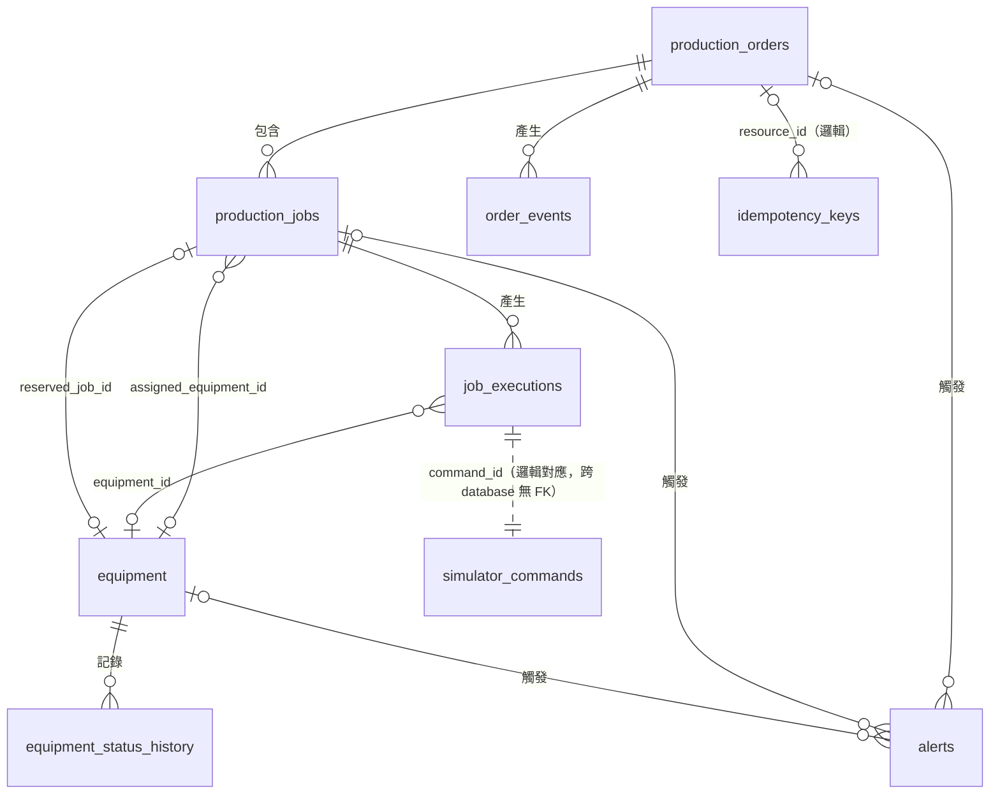

# MiniFactory 資料庫設計（第一版定稿：MariaDB）

> 文件狀態：**✅ 已確認（2026-11-11，Wayne）**。以 `README.md`「資料模型草案」為基礎定稿；規格未列、本文件補上的表或欄位標註 **【新增】**（全部已確認採用）；仍標【待確認】者為實作時查證的事實或保留預設值的業務細節，不阻擋實作。
> **2026-11-11 資料層變更**：資料庫由 PostgreSQL 改為 **MariaDB**（目標 10.11，最低 10.7），資料存取改 **Dapper + MySqlConnector**，遷移改 **DbUp SQL 腳本**（architecture.md ADR-016～018）。本文件已全面改寫為 MariaDB DDL。
> 圖表：ER 圖為 Mermaid，GitHub 原生渲染。
> 相關：[architecture.md](architecture.md)（§2.5 版本需求、§10.7 資料存取、§19.2.2 上線前檢查）、[api.md](api.md)

---

## 1. 共通慣例

| 項目 | 規則 |
|-|-|
| 引擎 / 字元集 | 每張表明確寫 `ENGINE=InnoDB DEFAULT CHARSET=utf8mb4 COLLATE=utf8mb4_unicode_ci`；database 建立時同設定 |
| Database | MES：`minifactory`；Simulator：`minifactory_sim`；遷移紀錄：`minifactory_migrations`（同一 MariaDB 實例、不同 database，**無跨 database 外鍵**） |
| 帳號 | `mf_app`（`minifactory` DML）、`mf_migrator`（`minifactory`、`minifactory_migrations` 的 DDL+DML）、`mf_sim`（只限 `minifactory_sim`）；`mf_app`/`mf_sim` 對 `minifactory_migrations` 無任何權限；見 architecture.md §16 |
| 命名 | 表與欄位 snake_case；索引 `ix_<表>_<欄>`、唯一 `ux_<表>_<欄>`、外鍵 `fk_<表>_<參照表>`、檢查 `ck_<表>_<欄>` |
| 主鍵 / ID | 業務實體用 **MariaDB 原生 `UUID` 型別**（10.7+；16 bytes 儲存，查詢結果顯示標準字串，Demo 直接查 DB 可讀），值由應用程式以 UUIDv7（`Guid.CreateVersion7()`）產生，可在交易前取得 ID。大量追加的歷史表用 `BIGINT UNSIGNED AUTO_INCREMENT` |
| UUID 驗證 | ✅ Phase 1 驗證通過（`UuidRoundTripTests`）：原生 `UUID` 與 MySqlConnector `Guid` 直接對應，**不需 `GuidFormat`、不註冊 Guid TypeHandler**；`CHAR(36)` 退路不再需要 |
| 時間 | `DATETIME(6)`，**存 UTC**；值一律由應用程式（`TimeProvider`）以參數傳入，SQL 不用 `NOW()`；時間欄位**不設 DB 預設值**。不用 `TIMESTAMP`（受 session 時區影響、2038 年上限） |
| 狀態欄位 | `VARCHAR(32)` + `CHECK (col IN (...))`（MariaDB 10.2.1+ 會實際檢查）。不用 `ENUM`：改值要 `ALTER TABLE`、排序依定義順序而非字母，容易出錯 |
| JSON | `JSON` 型別（MariaDB 中為 `LONGTEXT` 的別名，並自動加上 `CHECK (json_valid(col))`；DDL 仍顯式寫出 CHECK 以利閱讀）。不建立 JSON 內容的索引（第一版不查 payload 內容） |
| 樂觀併發 | 有 `version INT UNSIGNED NOT NULL DEFAULT 0` 的表，條件更新一律 `version = version + 1` 並以 affected rows（`UseAffectedRows=true`）判斷 |
| 唯一性 | 違反時 MariaDB 錯誤 **1062**；InnoDB 只回滾該語句，交易仍可用（architecture.md §10.7.6） |
| 刪除行為 | 外鍵一律 `ON DELETE RESTRICT ON UPDATE RESTRICT` |
| 遷移 | DbUp（`dbup-mysql` 6.1.0）腳本 `NNNN_<動詞>_<對象>.sql`，編號連續；一個腳本只做一件結構變更；盡量用 `IF NOT EXISTS`；已執行的腳本不可修改（MariaDB DDL 會隱含 COMMIT，無法交易性回滾）。由 `MiniFactory.Migrator` 以 `mf_migrator` 帳號執行 |
| DbUp journal | 表 `schemaversions`。**MES 的 journal 放在獨立 database `minifactory_migrations`**（✅ 開發確認）：`mf_migrator` 有 DDL + DML，`mf_app`、`mf_sim` 無任何權限。原因：MariaDB 權限只能累加，`mf_app` 已有 `minifactory.*` 的 DML，無法對單一表 REVOKE；放在獨立 database 才能讓應用程式帳號碰不到遷移紀錄。Migrator 依環境變數 `MIGRATIONS_JOURNAL_SCHEMA` 決定位置，**必填**（compose 設 `minifactory_migrations`；未設定時 Migrator 以結束碼 2 結束）；只有整合測試以程式碼明確選擇 journal 放目標 database。既有開發 volume 需 `docker compose down -v` 重建，或依 architecture.md §19.2.2 的 journal 搬移步驟處理。**執行時間由 DbUp 以本機時間寫入**，且 Migrator 連線不套用 `DateTimeKind=Utc`——這是唯一不遵守「全部 UTC」的表，判讀時注意 |
| MariaDB 語法注意（✅ Phase 1 實測） | 外鍵可重跑寫法為 `ADD CONSTRAINT <name> FOREIGN KEY IF NOT EXISTS <name> (col) REFERENCES ...`；10.11 的隔離層級變數為 `@@tx_isolation`；`PERSISTENT` 生成欄位在 `information_schema.COLUMNS.EXTRA` 顯示為 `STORED GENERATED` |

### 1.1 PostgreSQL 部分索引的對應做法（逐一說明）

MariaDB 不支援部分索引（`CREATE INDEX ... WHERE ...`）。原設計中每一個部分索引改寫如下：

| 原 PostgreSQL 部分索引 | 用途 | MariaDB 做法 | 為何等效 |
|-|-|-|-|
| `production_jobs (assigned_equipment_id) WHERE assigned_equipment_id IS NOT NULL` UNIQUE | 同一設備同時只能指派一個 Job（預留最終保證） | 一般 `UNIQUE (assigned_equipment_id)` | UNIQUE 索引允許多個 NULL；釋放時欄位清為 NULL，只有非 NULL 值受唯一限制 |
| `equipment (reserved_job_id) WHERE reserved_job_id IS NOT NULL` UNIQUE | 一個 Job 只預留一台設備 | 一般 `UNIQUE (reserved_job_id)` | 同上 |
| `simulator_commands (result_event_id) WHERE result_event_id IS NOT NULL` UNIQUE | 結果事件 ID 唯一 | 一般 `UNIQUE (result_event_id)` | 同上 |
| `alerts (dedup_key) WHERE status = 'Open'` UNIQUE | 同原因同時只有一筆未處理告警 | 生成欄位 `open_dedup_key VARCHAR(200) AS (IF(status = 'Open', dedup_key, NULL)) PERSISTENT` + `UNIQUE (open_dedup_key)` | Open 時等於 `dedup_key` 受唯一限制；Resolved 後變 NULL，不再佔用，可再建新告警 |
| `outbox_messages (occurred_at, id) WHERE published_at IS NULL AND dead_lettered_at IS NULL` | Publisher 取待發送批次 | 一般複合索引 `(published_at, dead_lettered_at, occurred_at, id)` | 查詢 `WHERE published_at IS NULL AND dead_lettered_at IS NULL ORDER BY occurred_at, id LIMIT n`：InnoDB 對 `IS NULL` 視為等值查找，直接定位到前兩欄皆 NULL 的區段並依索引順序讀取，不需 filesort。代價是索引也包含已發布的列（大小隨歷史成長），但查找成本只隨 B-tree 深度增加，Demo 規模可忽略；已發布資料依清理/封存策略控制 |
| `outbox_messages (published_at) WHERE published_at IS NOT NULL` | 封存/清理 | 由上一個複合索引的前綴 `published_at` 涵蓋（範圍條件 `published_at < @cutoff`） | 不需另建 |
| `job_executions (deadline_at) WHERE status IN (進行中)` | Reconciler 掃描 | 複合索引 `(status, deadline_at)` | `status IN (4 個值) AND deadline_at < @now` 為多段範圍掃描，只觸及進行中的列 |
| `equipment (last_seen_at) WHERE status <> 'Offline'` | 心跳逾時掃描 | 複合索引 `(status, last_seen_at)`（表很小，主要為一致性） | 設備表只有數筆，全表掃描亦可 |
| `production_jobs (status) WHERE status IN (進行中)` | 進行中 Job 查詢 | 一般索引 `(status)` | — |
| `simulator_commands (completed_at) WHERE result_event_id IS NOT NULL AND reported_at IS NULL` | ResultReporter 掃描未回報結果 | 複合索引 `(reported_at, completed_at)`，查詢條件加 `result_event_id IS NOT NULL` | `reported_at IS NULL` 等值定位未回報區段 |

> 生成欄位使用 `PERSISTENT`（實際儲存）而非 `VIRTUAL`，以確保唯一索引行為明確、與 InnoDB 次要索引相容性最穩定。生成欄位不可被 INSERT/UPDATE 直接寫入，Dapper 的 SQL 不得列出它。`PERSISTENT` 是 MariaDB 的同義字，`information_schema` 會顯示為 `STORED GENERATED`。

---

## 2. ER 圖



---

## 3. MES 資料表（database `minifactory`）

> 以下 DDL 是設計定稿，已依此拆成 DbUp 腳本 0001–0031（建表、索引、外鍵、seed 分開，見 §5.1）。若本文件與腳本不一致，以 `SchemaTests` 的預期清單為準並回頭修正本文件。所有表結尾皆為 `ENGINE=InnoDB DEFAULT CHARSET=utf8mb4 COLLATE=utf8mb4_unicode_ci`，以下以 `/* 表選項 */` 簡寫。

### 3.1 `production_orders`

```sql
CREATE TABLE production_orders (
  id              UUID          NOT NULL,
  order_no        VARCHAR(50)   NOT NULL,                 -- 例 ORD-20260921-001
  product_code    VARCHAR(50)   NOT NULL,                 -- 例 Motor-A；無產品主檔
  quantity        INT UNSIGNED  NOT NULL,
  line_id         VARCHAR(32)   NOT NULL,                 -- 例 Line-01；無產線主檔，建單時驗證 equipment 中存在
  status          VARCHAR(32)   NOT NULL,
  version         INT UNSIGNED  NOT NULL DEFAULT 0,       -- 【新增】
  correlation_id  VARCHAR(64)   NOT NULL,                 -- 【新增】
  trace_parent    VARCHAR(55)   NULL,                     -- 【新增】W3C traceparent
  created_at      DATETIME(6)   NOT NULL,
  updated_at      DATETIME(6)   NOT NULL,                 -- 【新增】
  completed_at    DATETIME(6)   NULL,                     -- 【新增】進入 Completed / NeedsReview 時寫入
  CONSTRAINT pk_production_orders PRIMARY KEY (id),
  CONSTRAINT ux_production_orders_order_no UNIQUE (order_no),
  CONSTRAINT ck_production_orders_quantity CHECK (quantity > 0),
  CONSTRAINT ck_production_orders_status CHECK (status IN ('Created','InProgress','AwaitingConfirmation','Completed','NeedsReview'))
) /* 表選項 */;
CREATE INDEX ix_production_orders_created_at ON production_orders (created_at);
CREATE INDEX ix_production_orders_status ON production_orders (status);
```
- `order_no` 使用 `utf8mb4_unicode_ci`（不分大小寫）：`ORD-1` 與 `ord-1` 視為重複 → `409 order-no-conflict`（✅ Phase 1 定案，`CreateOrder_OrderNoDiffersOnlyByCase_Returns409OrderNoConflict`）。
- 注意與 Idempotency 的差異：請求摘要（`request_hash`）中的 `orderNo` **區分大小寫**、`lineId` 使用正規化後的值（api.md §3.1）。因此同一 Idempotency-Key 但 `orderNo` 只差大小寫，會被判為「內容不同」→ `409 idempotency-conflict`。
- 違反 `ux_production_orders_order_no` → 1062 → API `409 order-no-conflict`。

### 3.2 `production_jobs`

```sql
CREATE TABLE production_jobs (
  id                     UUID              NOT NULL,
  order_id               UUID              NOT NULL,
  sequence               SMALLINT UNSIGNED NOT NULL,
  operation              VARCHAR(32)       NOT NULL,
  status                 VARCHAR(32)       NOT NULL,
  assigned_equipment_id  UUID              NULL,          -- 預留時寫入，完成或釋放後清為 NULL（規格）
  current_attempt_no     INT UNSIGNED      NOT NULL DEFAULT 0,  -- 【新增】
  version                INT UNSIGNED      NOT NULL DEFAULT 0,
  created_at             DATETIME(6)       NOT NULL,      -- 【新增】
  updated_at             DATETIME(6)       NOT NULL,      -- 【新增】
  started_at             DATETIME(6)       NULL,          -- 【新增】
  completed_at           DATETIME(6)       NULL,          -- 【新增】
  CONSTRAINT pk_production_jobs PRIMARY KEY (id),
  CONSTRAINT ux_production_jobs_order_id_sequence UNIQUE (order_id, sequence),
  CONSTRAINT ux_production_jobs_assigned_equipment_id UNIQUE (assigned_equipment_id),  -- 允許多個 NULL；預留最終保證
  CONSTRAINT ck_production_jobs_sequence CHECK (sequence >= 1),
  CONSTRAINT ck_production_jobs_operation CHECK (operation IN ('Machining','Assembly','Inspection')),
  CONSTRAINT ck_production_jobs_status CHECK (status IN ('Pending','Ready','Dispatched','Running','AwaitingConfirmation','Completed','NeedsReview')),
  CONSTRAINT fk_production_jobs_production_orders FOREIGN KEY (order_id) REFERENCES production_orders (id)
) /* 表選項 */;
CREATE INDEX ix_production_jobs_status ON production_jobs (status);
-- fk_production_jobs_equipment (assigned_equipment_id → equipment.id) 於 equipment 建立後另以腳本加入
```

### 3.3 `job_executions`

```sql
CREATE TABLE job_executions (
  id               UUID          NOT NULL,
  job_id           UUID          NOT NULL,
  attempt_no       INT UNSIGNED  NOT NULL,
  command_id       UUID          NOT NULL,      -- 建立 execution 時即產生並持久化，重送沿用
  status           VARCHAR(32)   NOT NULL,
  equipment_id     UUID          NULL,          -- 【新增】實際執行的設備（不清空，供歷史查詢）
  send_count       INT UNSIGNED  NOT NULL DEFAULT 0,   -- 【新增】同一 commandId 送出次數
  last_sent_at     DATETIME(6)   NULL,          -- 【新增】
  deadline_at      DATETIME(6)   NULL,          -- 【新增】下次檢查時間 / 對帳租約
  accepted_at      DATETIME(6)   NULL,          -- 【新增】
  started_at       DATETIME(6)   NULL,
  completed_at     DATETIME(6)   NULL,
  error_code       VARCHAR(64)   NULL,          -- EQUIPMENT_OFFLINE / EQUIPMENT_BUSY / SIMULATOR_RESTARTED / 情境自訂碼
  result_event_id  UUID          NULL,          -- 【新增】套用結果的 Simulator eventId
  version          INT UNSIGNED  NOT NULL DEFAULT 0,   -- 【新增】
  created_at       DATETIME(6)   NOT NULL,      -- 【新增】
  updated_at       DATETIME(6)   NOT NULL,      -- 【新增】
  CONSTRAINT pk_job_executions PRIMARY KEY (id),
  CONSTRAINT ux_job_executions_command_id UNIQUE (command_id),
  CONSTRAINT ux_job_executions_job_id_attempt_no UNIQUE (job_id, attempt_no),   -- 【新增】
  CONSTRAINT ck_job_executions_attempt_no CHECK (attempt_no >= 1),
  CONSTRAINT ck_job_executions_status CHECK (status IN ('Pending','Dispatched','Accepted','Running','Unknown','Succeeded','Failed','Rejected','Abandoned')),
  CONSTRAINT fk_job_executions_production_jobs FOREIGN KEY (job_id) REFERENCES production_jobs (id)
) /* 表選項 */;
CREATE INDEX ix_job_executions_status_deadline ON job_executions (status, deadline_at);   -- Reconciler
-- fk_job_executions_equipment (equipment_id → equipment.id) 於 equipment 建立後加入
```

### 3.4 `equipment`

```sql
CREATE TABLE equipment (
  id                 UUID          NOT NULL,      -- seed 固定值，與 Simulator 設定共用
  line_id            VARCHAR(32)   NOT NULL,
  name               VARCHAR(50)   NOT NULL,      -- Machine-A 等
  capability         VARCHAR(32)   NOT NULL,
  status             VARCHAR(32)   NOT NULL,      -- 初始 Offline，收到第一次心跳轉 Idle【待確認】
  last_seen_at       DATETIME(6)   NULL,
  status_changed_at  DATETIME(6)   NOT NULL,      -- 【新增】防止舊回報覆蓋新狀態
  reserved_job_id    UUID          NULL,          -- 【新增】原子預留標記
  version            INT UNSIGNED  NOT NULL DEFAULT 0,
  created_at         DATETIME(6)   NOT NULL,      -- 【新增】
  updated_at         DATETIME(6)   NOT NULL,      -- 【新增】
  CONSTRAINT pk_equipment PRIMARY KEY (id),
  CONSTRAINT ux_equipment_name UNIQUE (name),
  CONSTRAINT ux_equipment_reserved_job_id UNIQUE (reserved_job_id),   -- 允許多個 NULL
  CONSTRAINT ck_equipment_capability CHECK (capability IN ('Machining','Assembly','Inspection')),
  CONSTRAINT ck_equipment_status CHECK (status IN ('Idle','Running','Error','Offline'))
) /* 表選項 */;
CREATE INDEX ix_equipment_line_id_capability ON equipment (line_id, capability);
CREATE INDEX ix_equipment_status_last_seen_at ON equipment (status, last_seen_at);

-- 循環參照：equipment.reserved_job_id ↔ production_jobs.assigned_equipment_id，皆 nullable；建表後分別加 FK
-- 實際腳本採可重跑寫法：ADD CONSTRAINT <name> FOREIGN KEY IF NOT EXISTS <name> (col) REFERENCES ...
ALTER TABLE equipment      ADD CONSTRAINT fk_equipment_production_jobs FOREIGN KEY IF NOT EXISTS fk_equipment_production_jobs (reserved_job_id) REFERENCES production_jobs (id);
ALTER TABLE production_jobs ADD CONSTRAINT fk_production_jobs_equipment FOREIGN KEY IF NOT EXISTS fk_production_jobs_equipment (assigned_equipment_id) REFERENCES equipment (id);
ALTER TABLE job_executions  ADD CONSTRAINT fk_job_executions_equipment FOREIGN KEY IF NOT EXISTS fk_job_executions_equipment (equipment_id) REFERENCES equipment (id);
```

> **外鍵自動建立的索引（✅ Phase 1 實測）**：InnoDB 要求外鍵欄位有索引；若欄位不是任何既有索引的最左欄，MariaDB 會**自動建立一個與外鍵同名的索引**。本設計中有兩個：
> - `job_executions.equipment_id` → 自動索引 **`fk_job_executions_equipment`**
> - `alerts.job_id` → 自動索引 **`fk_alerts_production_jobs`**
>
> 其餘外鍵欄位都已是既有索引的最左欄（例 `production_jobs.order_id` 在 `ux_production_jobs_order_id_sequence`、`assigned_equipment_id` 在其 UNIQUE、`alerts.order_id` 在 `ix_alerts_order_id`），不會另建。上述兩個自動索引不另以 `ix_*` 命名重建（避免重複索引），`SchemaTests.Indexes_MatchDatabaseMd_ExactlyWithPrimaryAndUniqueConstraints` 的預期清單以 `fk_*` 名稱列出。

### 3.5 `equipment_status_history`

```sql
CREATE TABLE equipment_status_history (
  id            BIGINT UNSIGNED NOT NULL AUTO_INCREMENT,
  equipment_id  UUID            NOT NULL,
  from_status   VARCHAR(32)     NULL,           -- 初始紀錄可為 NULL
  to_status     VARCHAR(32)     NOT NULL,
  source        VARCHAR(32)     NOT NULL,       -- 【新增】
  occurred_at   DATETIME(6)     NOT NULL,
  CONSTRAINT pk_equipment_status_history PRIMARY KEY (id),
  CONSTRAINT ck_equipment_status_history_to_status CHECK (to_status IN ('Idle','Running','Error','Offline')),
  CONSTRAINT ck_equipment_status_history_source CHECK (source IN ('Report','Heartbeat','HeartbeatTimeout')),
  CONSTRAINT fk_equipment_status_history_equipment FOREIGN KEY (equipment_id) REFERENCES equipment (id)
) /* 表選項 */;
CREATE INDEX ix_equipment_status_history_equipment_id_occurred_at ON equipment_status_history (equipment_id, occurred_at);
CREATE INDEX ix_equipment_status_history_occurred_at ON equipment_status_history (occurred_at);   -- 清理用
```

### 3.6 `order_events`（事件時間線）

```sql
CREATE TABLE order_events (
  id             UUID              NOT NULL,     -- = eventId，與對應的 outbox_messages.id 相同
  order_id       UUID              NOT NULL,
  event_type     VARCHAR(64)       NOT NULL,     -- architecture.md §12
  event_version  SMALLINT UNSIGNED NOT NULL DEFAULT 1,   -- 【新增】
  payload        JSON              NOT NULL,
  occurred_at    DATETIME(6)       NOT NULL,
  CONSTRAINT pk_order_events PRIMARY KEY (id),
  CONSTRAINT ck_order_events_payload CHECK (json_valid(payload)),
  CONSTRAINT fk_order_events_production_orders FOREIGN KEY (order_id) REFERENCES production_orders (id)
) /* 表選項 */;
CREATE INDEX ix_order_events_order_id_occurred_at ON order_events (order_id, occurred_at, id);
CREATE INDEX ix_order_events_occurred_at ON order_events (occurred_at);   -- 清理用
```

### 3.7 `alerts`

```sql
CREATE TABLE alerts (
  id               UUID          NOT NULL,
  order_id         UUID          NULL,
  job_id           UUID          NULL,          -- 【新增】
  equipment_id     UUID          NULL,
  severity         VARCHAR(16)   NOT NULL,      -- Info / Warning / Critical【待確認值域】
  reason           VARCHAR(64)   NOT NULL,      -- EQUIPMENT_OFFLINE 等（不加 CHECK，方便擴充）
  message          VARCHAR(500)  NULL,          -- 【新增】
  status           VARCHAR(16)   NOT NULL,
  dedup_key        VARCHAR(200)  NOT NULL,      -- 【新增】例 EQUIPMENT_OFFLINE:{equipmentId}
  open_dedup_key   VARCHAR(200)  AS (IF(status = 'Open', dedup_key, NULL)) PERSISTENT,   -- 【新增】取代部分唯一索引
  created_at       DATETIME(6)   NOT NULL,
  resolved_at      DATETIME(6)   NULL,          -- 【新增】
  resolved_by      VARCHAR(16)   NULL,          -- 【新增】System / Operator
  resolution_note  VARCHAR(500)  NULL,          -- 【新增】人工結案備註
  updated_at       DATETIME(6)   NOT NULL,      -- 【新增】
  CONSTRAINT pk_alerts PRIMARY KEY (id),
  CONSTRAINT ux_alerts_open_dedup_key UNIQUE (open_dedup_key),
  CONSTRAINT ck_alerts_severity CHECK (severity IN ('Info','Warning','Critical')),
  CONSTRAINT ck_alerts_status CHECK (status IN ('Open','Resolved')),
  CONSTRAINT ck_alerts_resolved_by CHECK (resolved_by IS NULL OR resolved_by IN ('System','Operator')),
  CONSTRAINT ck_alerts_resolved_at CHECK ((status = 'Resolved') = (resolved_at IS NOT NULL)),
  CONSTRAINT ck_alerts_resolved_by_set CHECK ((status = 'Resolved') = (resolved_by IS NOT NULL)),
  CONSTRAINT fk_alerts_production_orders FOREIGN KEY (order_id) REFERENCES production_orders (id),
  CONSTRAINT fk_alerts_production_jobs FOREIGN KEY (job_id) REFERENCES production_jobs (id),
  CONSTRAINT fk_alerts_equipment FOREIGN KEY (equipment_id) REFERENCES equipment (id)
) /* 表選項 */;
CREATE INDEX ix_alerts_status_created_at ON alerts (status, created_at);   -- 列表、未讀數
CREATE INDEX ix_alerts_order_id ON alerts (order_id);
CREATE INDEX ix_alerts_equipment_id ON alerts (equipment_id);
```

- 建立告警：`INSERT INTO alerts (...)`（不寫 `open_dedup_key`）；1062（`ux_alerts_open_dedup_key`）→ 已有相同原因的 Open 告警，略過。
- 人工結案（✅ 已確認第一版要做）：
```sql
UPDATE alerts
SET status = 'Resolved', resolved_at = @now, resolved_by = 'Operator',
    resolution_note = @note, updated_at = @now
WHERE id = @id AND status = 'Open';
-- affected rows = 0：查詢該筆；不存在 → 404；已 Resolved → 冪等回 200（不覆寫第一次的結案資訊）
```
- 結案後 `open_dedup_key` 自動變為 NULL，同原因下次發生時可再建立新告警。自動結案也用同樣的 `WHERE status = 'Open'` 條件更新（`resolved_by = 'System'`）。

### 3.8 `outbox_messages`

```sql
CREATE TABLE outbox_messages (
  id                UUID              NOT NULL,   -- = eventId = AMQP MessageId
  event_type        VARCHAR(64)       NOT NULL,   -- = routing key
  event_version     SMALLINT UNSIGNED NOT NULL DEFAULT 1,   -- 【新增】
  payload           JSON              NOT NULL,
  aggregate_type    VARCHAR(32)       NOT NULL,   -- 【新增】Order / Job / Equipment / Alert
  aggregate_id      UUID              NOT NULL,   -- 【新增】
  correlation_id    VARCHAR(64)       NULL,       -- 【新增】
  trace_parent      VARCHAR(55)       NULL,       -- 【新增】
  trace_state       VARCHAR(256)      NULL,       -- 【新增】
  occurred_at       DATETIME(6)       NOT NULL,
  published_at      DATETIME(6)       NULL,       -- NULL = 待發送
  attempt_count     INT UNSIGNED      NOT NULL DEFAULT 0,
  last_attempt_at   DATETIME(6)       NULL,       -- 【新增】
  last_error        VARCHAR(1000)     NULL,       -- 【新增】不含機密
  dead_lettered_at  DATETIME(6)       NULL,       -- 【新增】
  CONSTRAINT pk_outbox_messages PRIMARY KEY (id),
  CONSTRAINT ck_outbox_messages_payload CHECK (json_valid(payload))
) /* 表選項 */;
CREATE INDEX ix_outbox_messages_pending ON outbox_messages (published_at, dead_lettered_at, occurred_at, id);
```

發送查詢（Worker，READ COMMITTED 交易內）：
```sql
SELECT id, event_type, event_version, payload, correlation_id, trace_parent, trace_state, occurred_at
FROM outbox_messages
WHERE published_at IS NULL AND dead_lettered_at IS NULL
ORDER BY occurred_at, id
LIMIT @batchSize
FOR UPDATE SKIP LOCKED;

UPDATE outbox_messages SET published_at = @now WHERE id IN @ids;
```
- 規格寫 `(published_at) WHERE published_at IS NULL` 部分索引；MariaDB 無部分索引，改為上述複合索引（§1.1），✅ 已確認（2026-11-11）。
- 實作時以 `EXPLAIN` 確認 `key = ix_outbox_messages_pending` 且 `Extra` 無 `Using filesort`。

### 3.9 `inbox_messages`

```sql
CREATE TABLE inbox_messages (
  consumer_name  VARCHAR(64)  NOT NULL,     -- 例 worker.dispatch、api.equipment-events
  message_id     UUID         NOT NULL,     -- eventId
  processed_at   DATETIME(6)  NOT NULL,
  CONSTRAINT pk_inbox_messages PRIMARY KEY (consumer_name, message_id)
) /* 表選項 */;
CREATE INDEX ix_inbox_messages_processed_at ON inbox_messages (processed_at);
```
- 寫入：一般 `INSERT`；1062 = 重複（MariaDB 無 `ON CONFLICT DO NOTHING`；不用 `INSERT IGNORE`，因其會把截斷等其他錯誤也降為警告）。
- `Heartbeat` 回報**不**寫入 inbox。

### 3.10 `idempotency_keys` 【新增資料表】

規格 §重試 1 要求「持久化的 Idempotency Key 和請求摘要」，資料模型草案未列此表。✅ 已確認新增（2026-11-11）；`Idempotency-Key` header **選填**。

```sql
CREATE TABLE idempotency_keys (
  scope                 VARCHAR(64)        CHARACTER SET ascii COLLATE ascii_bin NOT NULL,   -- 第一版只有 orders.create
  idempotency_key       VARCHAR(128)       CHARACTER SET ascii COLLATE ascii_bin NOT NULL,   -- 1～128 可見 ASCII，區分大小寫
  request_hash          CHAR(64)           CHARACTER SET ascii COLLATE ascii_bin NOT NULL,   -- SHA-256 hex
  response_status_code  SMALLINT UNSIGNED  NOT NULL,     -- 202
  response_body         JSON               NOT NULL,     -- 第一次的回應，重送原樣回傳
  resource_id           UUID               NULL,         -- production_orders.id（邏輯關聯，不加 FK）
  created_at            DATETIME(6)        NOT NULL,
  expires_at            DATETIME(6)        NOT NULL,     -- created_at + 24h（✅ 已確認）
  CONSTRAINT pk_idempotency_keys PRIMARY KEY (scope, idempotency_key),
  CONSTRAINT ck_idempotency_keys_response_body CHECK (json_valid(response_body))
) /* 表選項 */;
CREATE INDEX ix_idempotency_keys_expires_at ON idempotency_keys (expires_at);
```
- 建單交易的**第一個語句** `INSERT INTO idempotency_keys`。並行相同 Key：InnoDB 讓後到者等待先到者交易結束，先到者提交 → 後到者 1062 → 讀出比對 hash（相同回放 202、不同 `409 idempotency-conflict`）；先到者回滾 → 後到者成功插入。
- 只有成功建單才會留下紀錄（驗證失敗、order_no 衝突時整個交易回滾）。
- 過期資料由清理腳本刪除；過期後同 Key 視為新請求（仍受 `order_no` 唯一約束保護）。
- 使用 `ascii_bin`：Key 區分大小寫且比較精確；索引長度小。

---

## 4. Simulator 資料表（database `minifactory_sim`，帳號 `mf_sim`）

### 4.1 `simulator_commands`

```sql
CREATE TABLE simulator_commands (
  command_id            UUID           NOT NULL,   -- 規格：唯一
  equipment_id          UUID           NOT NULL,   -- 與 MES seed 相同值，無 FK
  job_id                UUID           NOT NULL,   -- 【新增】
  attempt_no            INT UNSIGNED   NOT NULL,   -- 【新增】
  operation             VARCHAR(32)    NOT NULL,   -- 【新增】
  request_payload       JSON           NOT NULL,   -- 【新增】
  status                VARCHAR(16)    NOT NULL,
  result                JSON           NULL,       -- 規格
  error_code            VARCHAR(64)    NULL,       -- 【新增】
  result_event_id       UUID           NULL,       -- 【新增】結果產生時決定，回報重送沿用
  accepted_at           DATETIME(6)    NOT NULL,   -- 【新增】
  started_at            DATETIME(6)    NULL,       -- 【新增】
  completed_at          DATETIME(6)    NULL,       -- 【新增】
  reported_at           DATETIME(6)    NULL,       -- 【新增】
  report_attempt_count  INT UNSIGNED   NOT NULL DEFAULT 0,   -- 【新增】
  last_report_error     VARCHAR(1000)  NULL,       -- 【新增】
  correlation_id        VARCHAR(64)    NULL,       -- 【新增】
  trace_parent          VARCHAR(55)    NULL,       -- 【新增】
  updated_at            DATETIME(6)    NOT NULL,   -- 【新增】
  CONSTRAINT pk_simulator_commands PRIMARY KEY (command_id),
  CONSTRAINT ux_simulator_commands_result_event_id UNIQUE (result_event_id),   -- 允許多個 NULL
  CONSTRAINT ck_simulator_commands_status CHECK (status IN ('Accepted','Running','Succeeded','Failed','Rejected')),
  CONSTRAINT ck_simulator_commands_request_payload CHECK (json_valid(request_payload)),
  CONSTRAINT ck_simulator_commands_result CHECK (result IS NULL OR json_valid(result))
) /* 表選項 */;
CREATE INDEX ix_simulator_commands_equipment_id_status ON simulator_commands (equipment_id, status);
CREATE INDEX ix_simulator_commands_unreported ON simulator_commands (reported_at, completed_at);
```
- 接收命令：`INSERT`；1062（PK `command_id`）→ 既有命令，回傳目前狀態，不重新執行。
- ResultReporter：`WHERE reported_at IS NULL AND result_event_id IS NOT NULL ORDER BY completed_at LIMIT n`。
- 情境（Scenario）存於記憶體，不建表。【待確認：預設不持久化】

---

## 5. 種子資料

| 表 | 內容 |
|-|-|
| `equipment` | `Machine-A`（Machining）、`Machine-B`（Assembly）、`Machine-C`（Inspection），皆 `line_id = 'Line-01'`、`status = 'Offline'`、固定 UUID |

- 由 DbUp 腳本 **`0031_seed_equipment.sql`** 以 `INSERT ... ON DUPLICATE KEY UPDATE id = id` 寫入（可重跑；此處只為冪等 seed，不用於業務去重）。時間欄位使用固定的種子時間 `2026-11-11 00:00:00.000000`（遷移不依賴伺服器時鐘），`version = 0`。
- **固定 UUID（✅ Phase 1 已產生，Phase 2.1 Simulator 設定檔必須沿用同一組）**：

| name | capability | id |
|-|-|-|
| Machine-A | Machining | `01a1c7fc-2938-7775-9d83-762b1a40f2ed` |
| Machine-B | Assembly | `01a1c7fc-2943-77c3-88ed-d3e28c659891` |
| Machine-C | Inspection | `01a1c7fc-294d-7f72-a080-cd8cbc0c6912` |

### 5.1 遷移腳本分組（MES，`src/MiniFactory.Infrastructure/Migrations/Scripts/`）

| 編號 | 內容 |
|-|-|
| 0001–0010 | 建表：`production_orders`、`equipment`、`production_jobs`、`job_executions`、`equipment_status_history`、`order_events`、`alerts`、`outbox_messages`、`inbox_messages`、`idempotency_keys`（主鍵、UNIQUE、CHECK、生成欄位隨表建立） |
| 0011–0020 | 建立各表的一般索引（每表一支腳本） |
| 0021–0030 | 加外鍵（每個外鍵一支腳本，含循環參照；`FOREIGN KEY IF NOT EXISTS`） |
| 0031 | 設備 seed |

新增腳本從 0032 起接續；`MigrationTests.Scripts_AreNamedNnnnVerbObject_WithConsecutiveUniqueNumbers` 會檢查命名與編號連續。
- 是否多加一台同 capability 設備（例 `Machine-A2`）【待確認；預設不加】。
- **Demo 訂單資料不放在遷移腳本**：由 `scripts/demo/seed-demo.sh` 透過真實 API 建立（冪等），供 Codespaces 與本機 Demo 使用（architecture.md §16.2）。

---

## 6. 資料保留與清理（`scripts/cleanup-old-data.sql`，手動執行）

依規格「資源清理與資料保留策略」；以 `mariadb` 用戶端、`mf_app` 帳號執行：

| 對象 | 條件 |
|-|-|
| `order_events` | `occurred_at < @cutoff` 且 `order_id IN (SELECT id FROM production_orders WHERE status IN ('Completed','NeedsReview') AND completed_at < @cutoff)` |
| `equipment_status_history` | `occurred_at < @cutoff` |
| `alerts` | `status = 'Resolved' AND resolved_at < @cutoff`；`Open` 不動 |
| `idempotency_keys` | `expires_at < @now`（Phase 2 起由 Worker 定期清理，手動腳本保留作備援；architecture.md §19.2.3 #12） |
| `outbox_messages` / `inbox_messages` | 第一版**不清理**（規格：日後搬移至封存表，避免影響去重依據）【待確認是否第一版就建 `*_archive` 表】 |

- `@cutoff = UTC_TIMESTAMP(6) - INTERVAL 30 DAY`（清理腳本是唯一允許在 SQL 內取時間的地方，使用 `UTC_TIMESTAMP()` 而非 `NOW()`）。
- 分批刪除：單表 `DELETE ... WHERE ... ORDER BY <索引欄> LIMIT 5000`（MariaDB 單表 DELETE 支援 `LIMIT`），重複執行直到 `ROW_COUNT() = 0`；以小型 bash 迴圈或 stored procedure 驅動【待確認：採哪一種】。
- 第一版不排程（規格；PostgreSQL 版提到的 `pg_cron` 在 MariaDB 對應為 Event Scheduler，第二版再決定）。
- 未來公開部署（DS920+，未定案）的「每日重置 Demo 資料」是另一機制（重建 database → migrator → seed），不是本清理腳本的職責（architecture.md §19.2）。

---

## 7. 交給 db-engineer 的重點檢查清單（Phase 1 已全部以整合測試落實，Phase 2 起新增腳本時沿用）
1. ✅ MariaDB 原生 `UUID` ↔ MySqlConnector `Guid` 讀寫已驗證（`UuidRoundTripTests`）。
2. 每張表 `SHOW CREATE TABLE` 確認 InnoDB、utf8mb4、CHECK 約束與生成欄位存在；整合測試以 `information_schema.STATISTICS` / `TABLE_CONSTRAINTS` 自動檢查索引與約束清單。
3. `EXPLAIN` 檢查：Outbox 待發送查詢、Reconciler 掃描、告警列表皆走預期索引、無 filesort。
4. 驗證生成欄位唯一索引：同 `dedup_key` 兩筆 Open → 第二筆 1062；結案後可再插入。
5. 驗證 UNIQUE 允許多個 NULL：多個 `assigned_equipment_id = NULL` 的 Job 可並存。
6. 循環 FK 的建立順序（先建表、後加 FK 的獨立腳本）。
7. CHECK 約束值與 Domain enum 一致（單元測試比對 enum 名稱集合與遷移腳本中的字串）。
8. 所有遷移腳本可在空資料庫依序執行，且再次執行 migrator 無變更（DbUp journal 生效）。
9. 確認 `mf_app` 無 DDL 權限、`mf_sim` 無法存取 `minifactory`。
