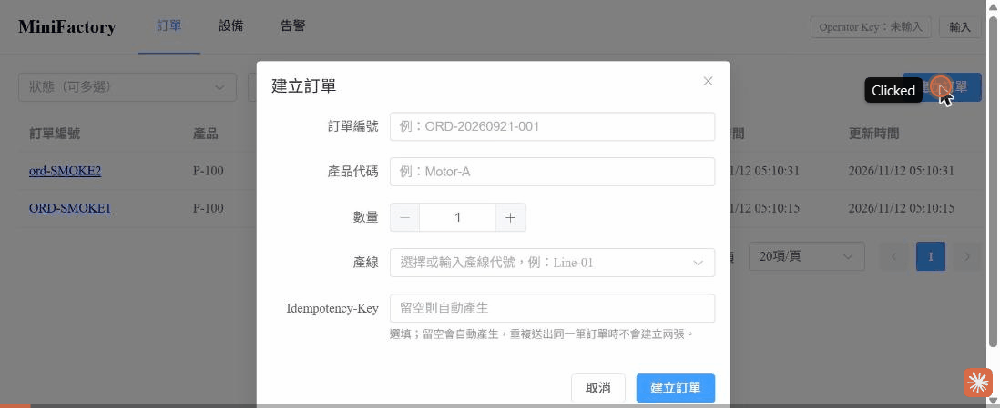

# Phase 1 總結與 Phase 2 交接

> 文件日期：2026-11-12
> 讀者：接手 Phase 2 的開發者（backend-dev / frontend-dev / db-engineer / tester）與 Wayne（專案負責人）。
> 讀完本文件即可開工；設計細節不在此重抄，一律以連結指向 [architecture.md](../architecture.md)、[database.md](../database.md)、[api.md](../api.md)、[failure-scenarios.md](../failure-scenarios.md)。
> 圖例：【待確認】= 尚無依據，不可自行當成定案。

---

## 1. 摘要

- Phase 1（architecture.md §18 步驟 1.1～1.7）已完成：方案骨架、compose 基礎設施、Domain、資料存取與遷移、建單與查詢 API、前端骨架。
- 經兩輪審查修正，code-reviewer 與 security-auditor 兩輪複審皆無 🔴；security 結論為「**有條件通過**」，條件是公開展示或上線 NAS 前完成 [§19.2.2](../architecture.md)、[§19.2.3](../architecture.md) 清單。
- 後端與前端自動化測試全數通過（數字見 §2.2），覆蓋率達標。
- 目前 Worker 與 Simulator 只是只有 `/health/live` 的空殼，派工、模擬、SignalR 都還沒有，這就是 Phase 2 的範圍。
- Phase 1 收尾已修正 R5（§5.1）。
- **Phase 2 開工第一件事是處理 §5.2 的遺留項目 A～E**（另有 🟢 F 註解清理）。
- 注意：`SimulatorMigrator.cs` 存在，但 Simulator 的 `Program.cs` 尚未呼叫它（只有整合測試呼叫）；與 ADR-018「Simulator 啟動時執行 DbUp」不符，2.1 需接線。

---

## 2. Phase 1 成果與驗收證據

### 2.1 對照 1.1～1.7

| 步驟 | 內容 | 主要位置 | 狀態 |
|-|-|-|-|
| 1.1 | 方案骨架、`global.json`、`Directory.*.props`、`/health/live` | `MiniFactory.slnx`、`src/*`、`global.json`、`Directory.Packages.props` | 完成 |
| 1.2 | compose（mariadb / rabbitmq / redis / migrator）、initdb、`.env.example` | `docker-compose.yml`、`deploy/mariadb/initdb/01-databases-and-users.sh` | 完成 |
| 1.3 | Domain：實體、狀態機（architecture.md §18 1.3 寫「四個狀態機」未計入 Alert，程式共 5 個：Order、Job、Execution、Equipment、Alert）、`ProcessRoute`、事件型別 | `src/MiniFactory.Domain/` | 完成 |
| 1.4 | `DbSession` / `UnitOfWork` / `TransactionRunner` / `MySqlErrorTranslator`、Dapper TypeHandlers、DbUp 腳本 0001–0031、Migrator | `src/MiniFactory.Infrastructure/`、`src/MiniFactory.Migrator/` | 完成 |
| 1.5 | `POST /api/orders`（Idempotency、order_no 唯一、寫 outbox 不發送）、`GET /api/orders`、`GET /api/orders/{id}`、Problem Details、API Key | `src/MiniFactory.Api/Endpoints/OrderEndpoints.cs`、`src/MiniFactory.Application/Orders/` | 完成 |
| 1.6 | `GET /api/orders/{id}/events`、`GET /api/equipment`、`GET /api/alerts` | `Endpoints/EquipmentEndpoints.cs`、`AlertEndpoints.cs` | 完成 |
| 1.7 | 前端骨架：四頁路由、Axios 攔截器、建單、列表/詳情（輪詢） | `frontend/minifactory-web/` | 完成 |

> 端點現況：`GET /api/orders/{id}/events` 已在 1.6 實作（tester 經 Vite proxy 實測回 200）。`POST /api/alerts/{id}/resolve` **尚未實作**，屬 Phase 4.1；前端以 `/config.json` 的 `features.alertResolve=false` 隱藏結案按鈕。

### 2.2 驗收數字

| 項目 | 結果 | 來源 |
|-|-|-|
| 後端 `dotnet test` | 733 支全過、0 失敗、0 略過 | 2026-11-12，R5 修正後由主對話重跑 `dotnet test` 確認（R5 修正前為 732 通過、1 略過） |
| 前端 Vitest | 16 檔 120 支全過 | 主對話驗收紀錄（本文件撰寫者未重跑） |
| 覆蓋率 | Domain 98.0%、Application 92.7%、Infrastructure 96.6%、Api 93.4%、Migrator 100%（README 目標 Domain ≥ 80%） | 主對話驗收紀錄 |
| 兩輪審查 | code-reviewer、security-auditor 皆無 🔴；security「有條件通過」 | 主對話驗收紀錄 |

目前沒有略過的測試（R5 的 Skip 已移除，見 §5.1）。

### 2.3 瀏覽器實際操作檢查（2026-11-12）

主對話用瀏覽器實際操作前端（Vite dev server 對真實 API）：

- 訂單列表可顯示。
- 建單對話框：ElSelect 可選 `Line-01`；訂單編號前後空白被正確 trim；自動產生的 `Idempotency-Key` 為 `create-order-ORD-UI-001`（保留大小寫）；按送出時跳出 Operator API Key 輸入框；取消不報錯。
- 訂單詳情：`version` 為 0、3 道 Job，第 1 道有 attempt 1 且尚未派送。
- 設備頁：3 台設備皆 Offline，UTC 轉台北時區顯示正確。
- 告警頁：空清單。
- 瀏覽器 console 無錯誤。

**限制**：依全域規則（`CLAUDE.md`）不讀取金鑰檔，所以沒有在 UI 實際輸入 Key 完成建單。建單 API 已由 tester 以 HTTP 經 Vite proxy 實測通過。



此 GIF（`docs/assets/phase1-ui-check.gif`，約 2.4 MB）是**內部驗收紀錄**，含 Claude 浮水印與操作標籤；Phase 4 作品集展示用的 Demo 影片/GIF 會另行錄製，不要拿這個檔案當展示素材。

### 2.4 兩輪修正重點（歸納，非逐項）

| 輪次 | 範圍 | 主題 |
|-|-|-|
| 第 1 輪 | 後端 18 項 | 資料存取一律經 `DbSession`、交易與隔離層級（READ COMMITTED）、MariaDB 錯誤碼對應、Idempotency 比對、Problem Details 與 413/400 行為、API Key 啟動檢查與 middleware 順序、限流預留、請求大小上限、Actions 以 SHA 釘版（S9）、`.gitignore` 金鑰檔規則（S8）等 |
| 第 1 輪 | 前端 11 項 | 輸入 trim、Idempotency-Key 規則、API Key 只存 sessionStorage、輪詢與頁面可見性、錯誤顯示 |
| 第 2 輪 | 後端 R1～R8 | 第 2 輪 code-reviewer / security-auditor 複審後的後端修正項：journal 獨立 database 與 Migrator 必填環境變數（結束碼 2）、外部 `traceparent` 不信任、限流漏標守護（R7）、`.claude/` 的 `.gitignore`（R8，2026-11-12 擴大為忽略整個目錄）等；R5 見 §5.1 |
| 第 2 輪 | 前端 P1～P3 | 表單與錯誤處理細節 |

編號來源：`tests/MiniFactory.IntegrationTests/Api/RepoConfigurationTests.cs` 中 B6、S8、S9 是第 1 輪（security-auditor 等）的項目編號，R8 是第 2 輪項目。各項的細部歸屬以原始審查紀錄為準；逐項審查紀錄沒有放進 repo【待確認：是否補存】。

---

## 3. 定案決策與偏離 README 處

完整清單見 [architecture.md §17 ADR](../architecture.md)、[§20 偏離彙整](../architecture.md)、[§21 決策彙整](../architecture.md)。Phase 2 開發者必須知道的重點：

| 主題 | 決策 | 依據 |
|-|-|-|
| 資料庫 | **MariaDB 10.11**（NAS DS920+ 內建 10.11.11，為推定，§19.2.2 #1 上線前以 `SELECT VERSION()` 確認），不是 README 寫的 PostgreSQL；dev 映像 `mariadb:10.11.11` | ADR-016 |
| 資料存取 | **Dapper + MySqlConnector**，不是 EF Core（Pomelo 無 EF Core 10 版）。所有 SQL 手寫，**所有 Dapper 存取必須經 `DbSession`** | ADR-017、§10.7 |
| 遷移 | **DbUp**，純 SQL 內嵌資源，由獨立 `MiniFactory.Migrator` 執行；已上線腳本不可改，只能新增 | ADR-012、ADR-018 |
| 資料庫帳號 | 三個最小權限帳號：`mf_app`（minifactory DML）、`mf_migrator`（DDL+DML）、`mf_sim`（只限 `minifactory_sim`） | [§16](../architecture.md) |
| 遷移紀錄 | DbUp journal 放獨立 database `minifactory_migrations`，`mf_app` 完全碰不到；由必填環境變數 `MIGRATIONS_JOURNAL_SCHEMA` 指定 | ADR-018、§19.2.2 #14 |
| 認證 | 兩把 API Key（Operator / Simulator），各至少 32 字元、至少 10 種不同字元、兩把不得相同；以 `ApiKeyMiddleware` + `RequireApiKey` metadata 實作 | [§14.1](../architecture.md) |
| 限流 | 已預留，**預設關閉**（`RateLimiting:Enabled=false`） | §14.10 |
| Trace | 外部傳入的 `traceparent` **不信任**，API 一律開新 root trace | [§14.5](../architecture.md) |
| ID 與時間 | UUIDv7（`Guid.CreateVersion7()`）存 MariaDB 原生 `UUID`；時間 `DATETIME(6)` 存 UTC，由應用程式提供 | ADR-010 |
| 訊息層 | RabbitMQ.Client 7.x，不用 MassTransit；自建 Outbox/Inbox | ADR-002、ADR-003 |
| 套件版本 | 以 `Directory.Packages.props` 為準（例如明確釘 `MySqlConnector` 2.6.2、`dbup-mysql` 6.1.0、`Dapper` 2.1.89） | [§21 B2](../architecture.md) |

README 尚未同步（共 20 處，architecture.md §20.1 記為 Wayne 之後處理）：見 [architecture.md §20.1](../architecture.md)。**以 architecture.md 為準，不要依 README 的 PostgreSQL / EF Core 寫法實作。**

---

## 4. 現況快照

### 4.1 專案結構

```text
src/
  MiniFactory.Domain/          實體、狀態機、ProcessRoute、事件型別（無外部相依）
  MiniFactory.Application/     handler、Port 介面（Abstractions/）、Options
  MiniFactory.Infrastructure/  Dapper 資料存取、UoW、DbUp 腳本、DI
  MiniFactory.Api/             Minimal API、middleware、Problem Details、限流、健康檢查
  MiniFactory.Migrator/        一次性遷移程式與 Dockerfile
  MiniFactory.Worker/          空殼（只有 /health/live）
  MiniFactory.Simulator/       幾乎空殼（/health/live；SimulatorMigrator 與 2 支 DbUp 腳本存在，但 Program.cs 尚未呼叫；csproj 尚未引用 Dapper）
tests/
  MiniFactory.UnitTests/       Domain、Application（手寫 fake）
  MiniFactory.IntegrationTests/ Testcontainers + WebApplicationFactory
frontend/minifactory-web/      Vue 3 + Element Plus + Pinia + Vue Router + Axios
deploy/mariadb/initdb/         建 database 與三個帳號
docs/                          architecture / database / api / failure-scenarios / handoff / assets
```

預計的完整結構（Phase 2 起要新增的檔案位置）見 [architecture.md §4](../architecture.md)。

Worker 與 Simulator 為空殼，依 architecture.md §18 屬 Phase 2 範圍（2.6 加入 compose）。目前 compose 只有 `mariadb`、`rabbitmq`、`redis`、`migrator` 四個服務；`api`、`worker`、`simulator`、`web`、`jaeger` 尚未加入。Dockerfile 目前只有 `src/MiniFactory.Migrator/Dockerfile`，API、Worker、Simulator 與前端（web Dockerfile、nginx.conf）皆尚未建立。

### 4.2 本機啟動方式

**前置條件**

- Docker Desktop 須已啟動（compose 與整合測試的 Testcontainers 都需要）。
- Node 版本依 `frontend/minifactory-web/package.json` 的 `engines`：`^20.19.0 || >=22.12.0`。
- `.env` 的 `MF_*_PASSWORD` 不得含 `;` 與 `"`（連線字串以分號分隔欄位）。
- API Key 規則（啟動檢查，不通過 API 拒絕啟動）：至少 32 字元、至少 10 種不同字元、兩把不得相同、不得含前後空白、拒絕 `change-me` 等占位值。所以 `.env.example` 的預設佔位值**必須換掉**。產生方式：有 openssl 時 `openssl rand -hex 32`；Windows 無 openssl 時可用 PowerShell 的 `[System.Security.Cryptography.RandomNumberGenerator]` 產生 32 位元組再轉 hex。

**步驟**

1. 複製 `.env.example` 為 `.env` 並填值（變數清單見 [architecture.md §14.9](../architecture.md)；`.env` 不進版控，AI 與 subagent 不得讀取）。
2. 啟動基礎設施與遷移：`docker compose up -d`（mariadb 就緒後 `migrator` 自動執行並退出）。確認遷移成功：`docker compose logs migrator` 看到「遷移完成」或「資料庫已是最新」，且 `migrator` 容器結束碼為 0。
3. 啟動 API：在 `src/MiniFactory.Api` 以 `dotnet run --launch-profile http`（監聽 `http://localhost:5080`，環境 Development）。設定以**環境變數**提供（ASP.NET Core 以 `__` 表示階層）：
   - `ConnectionStrings__MiniFactory`（`Program.cs` 缺少時會丟錯，訊息指向此鍵）。範例（`<>` 為佔位，不是真值）：
     `ConnectionStrings__MiniFactory="Server=127.0.0.1;Port=<MARIADB_HOST_PORT，預設 3306>;Database=minifactory;User ID=mf_app;Password=<.env 的 MF_APP_PASSWORD>"`
   - `Security__OperatorApiKey`、`Security__SimulatorApiKey`
   - 其餘鍵與預設值見 [§14.9](../architecture.md)、[§14.10](../architecture.md)。
   - **密碼與 Key 不得寫入文件或 repo。** Phase 1 驗收時 tester 是用放在系統暫存資料夾的腳本匯出這些環境變數，再執行 `dotnet run --launch-profile http`。`dotnet user-secrets` 理論上也可行，但**未驗證**【待確認】。
4. 啟動前端：`cd frontend/minifactory-web && npm ci && npm run dev -- --port 5174 --strictPort`（原因見 §4.4）。Vite 預設把 `/api`、`/hubs`、`/health` proxy 到 `http://localhost:5080`，可用 `VITE_DEV_API_TARGET` 覆寫。

### 4.3 測試與 CI 指令

| 目的 | 指令 |
|-|-|
| 後端全部測試 | 專案根目錄 `dotnet test`（SDK 10.0.303，Microsoft.Testing.Platform；整合測試需要 Docker，由 Testcontainers 自動起 MariaDB） |
| 後端 + 覆蓋率（CI 用法） | `dotnet test --no-build --configuration Release --report-trx --coverlet --coverlet-output-format cobertura --results-directory ./TestResults` |
| 前端 | `cd frontend/minifactory-web` 後 `npm run lint`、`npm run type-check`、`npm test`、`npm run build` |
| CI | `.github/workflows/build-and-test.yml`、`.github/workflows/frontend.yml`（第三方 action 已以完整 commit SHA 釘版，有測試守護） |

舊的 `--collect:"XPlat Code Coverage"` 在 MTP 下已失效，不要使用。

### 4.4 本機環境注意（Wayne 的機器）

- **Redis 主機埠**：Windows 的 6379 是系統保留埠，`.env` 設 `REDIS_HOST_PORT=16379`。
- **前端 dev 埠**：主對話在本機觀察到 5173 被另一個專案（ig_ai_vision_system）占用，所以一律用 `npm run dev -- --port 5174 --strictPort`。
- **換行**：`git config core.autocrlf=true`；已用 `.gitattributes` 強制 `*.sh` 為 LF，新增 shell 腳本也受保護（有測試守護）。
- **重建資料庫 volume**：initdb 只在空 volume 執行。要建立 `minifactory_migrations` 或改密碼，需 `docker compose down -v` 重建；**這會清掉所有 volume（含 mariadb、rabbitmq 資料）**。現有 volume 可能留有驗收時建立的測試訂單。
- **設備固定 UUID**：在 `src/MiniFactory.Infrastructure/Migrations/Scripts/0031_seed_equipment.sql`，Simulator **必須沿用**這些 ID，不可自行產生。
- 主機基礎設施埠只綁 `127.0.0.1`。

### 4.5 版控狀態

截至 2026-11-12，`git status` 顯示 Phase 1 的檔案皆為 untracked（既有提交只有 `Initial commit`、`ADD`、`修正 Mermaid 圖表格式…` 三筆）。Phase 2 開發者不得自行 commit / push（見 §7）。

---

## 5. 遺留修正

### 5.1 Phase 1 收尾修正（✅ 已完成，2026-11-12）

| 編號 | 狀態 | 位置 | 問題 | 修法與驗收 |
|-|-|-|-|-|
| **R5** | 已修正並驗證 | `src/MiniFactory.Api/Middleware/ApiActivitySource.cs` 的 `ApiActivityListenerService.StartAsync` | 原本 `ShouldListenTo` 用 `ReferenceEquals(source, ApiActivitySource.Source)`；正式啟動順序下 listener 先於 `Source` 靜態初始化，比對失敗，`StartActivity` 回 `null`，中介層走 `new Activity` 備援，之後接入的 OTel 不會匯出此 span | `ShouldListenTo` 改為 `source.Name == ApiActivitySource.Name`。`ApiActivityListenerTests.StartActivity_ListenerStartedBeforeSourceFirstUse_StillCreatesActivity` 已移除 Skip 並改寫（listener 啟動後才建立同名新 `ActivitySource` 再 `StartActivity`）；已驗證還原舊寫法時該測試會失敗。主對話重跑 `dotnet test`：733 支全過、0 失敗、0 略過 |

接入 OpenTelemetry 時須 `AddSource("MiniFactory.Api")`（見 §6.1）。OTel 時程：architecture.md §18 把全鏈路 OTel 放在 Phase 4.2，但 §14.5 寫「Phase 2 接上 OpenTelemetry」，兩處不一致【待確認】；本文件以 §18 為準。

### 5.2 Phase 2 開工任務（建議在 2.1 之前一次做完，並各自補測試）

| 編號 | 嚴重度 | 位置 | 問題 | 修法與驗收 |
|-|-|-|-|-|
| A | 🟡 | `src/MiniFactory.Infrastructure/Migrations/JournalLocation.cs` | 它是 `record struct`，`default(JournalLocation)` 的 `Schema` 為 `null`，等同 `InTargetDatabase`，可能讓 journal 悄悄回到業務 database | 改成 `sealed class`，或在使用處拒絕未初始化值；補測試 |
| B | 🟡 | Migrator（`src/MiniFactory.Migrator/Program.cs`、`JournalLocation.TryFromEnvironmentValue`） | `MIGRATIONS_JOURNAL_SCHEMA` 與目標 database 同名時目前不會被擋（[§19.2.2 #14](../architecture.md) 已記為待修） | 同名時結束碼 2；比對 journal schema 與連線字串 `Database` 時不分大小寫並 trim；連線字串未指定 `Database` 時也以結束碼 2 失敗；錯誤訊息不得洩漏連線字串（沿用 `Program.cs` 現有處理：只說格式不正確）；補子行程測試（可參考 `tests/MiniFactory.IntegrationTests/Migrations/MigratorExitCodeTests.cs`） |
| C | 🟢 | `frontend/minifactory-web/src/components/CreateOrderDialog.vue` 約 129～130 行 | 重複的舊註解 | 刪掉重複註解（前端 Vitest 與 lint 仍須通過） |
| D | 🟢 | `tests/MiniFactory.IntegrationTests/Persistence/ReadOnlySnapshotTests.cs` 約 106 行 | 註解說「唯讀」但沒有斷言 | 補錯誤碼 1792 的斷言，或改註解使其符合實際 |
| E | 🟢 | `ApiActivityListenerService` | 若漏註冊（DI 沒加）就沒有任何防護 | **開工時就做，不依賴 OTel**。驗收：測試確認 DI 容器已註冊 `ApiActivityListenerService`，或啟動後 `ApiActivitySource.Source.HasListeners()` 為 true |
| F | 🟢 | `tests/MiniFactory.IntegrationTests/Api/ApiActivityListenerTests.cs` 約第 19 行 | 過時註解「已知問題見下方 Skip 的測試」（Skip 已移除） | 刪除或改寫該註解 |

---

## 6. Phase 2 步驟 2.1～2.6 起點與已預留的擴充點

步驟內容與驗收見 [architecture.md §18 Phase 2](../architecture.md)。下表只列「Phase 1 已經給你什麼、要接在哪裡」。

| 步驟 | 內容 | 起點與現況 |
|-|-|-|
| 2.1 | Simulator：`/sim/commands`（去重）、情境、執行器、`minifactory_sim` | `src/MiniFactory.Simulator/` 已有 `Program.cs`（只有 `/health/live`）、`Persistence/SimulatorMigrator.cs`、`Persistence/Migrations/Scripts/0001_create_simulator_commands.sql`、`0002_create_indexes_simulator_commands.sql`。設計見 [§6](../architecture.md)、[api.md §8](../api.md)。Simulator 與其他專案**無專案參考**，只走 HTTP 合約。整合測試需要 Simulator 的 marker 型別【待建立】，可比照 `src/MiniFactory.Api/StartupSupport.cs` 的 `ApiAssemblyMarker`。`Program.cs` 尚未呼叫 `SimulatorMigrator`（需接線，見 §1）；`MiniFactory.Simulator.csproj` 目前只引用 `dbup-mysql`、`MySqlConnector`，尚未引用 Dapper（architecture.md §2.2 規劃有） |
| 2.2 | Simulator 心跳與結果回報；`POST /api/equipment-events` | 規格見 [api.md §6.1](../api.md)；需 Simulator Key 與來源 IP 限制（[§14.1](../architecture.md)）。是否例外接續 Simulator 的 trace context 於此決定（§9 待確認） |
| 2.3 | RabbitMQ 拓樸、`OutboxPublisher`、`DispatchConsumer` | 拓樸 [§7](../architecture.md)、可靠性 [§10](../architecture.md)。API 建單時已經在同一交易寫入 outbox（`IMessagingData`，實作 `src/MiniFactory.Infrastructure/Persistence/Data/MessagingData.cs`），但目前**沒有任何東西發送**。`src/MiniFactory.Worker/Program.cs` 是空殼 |
| 2.4 | `HeartbeatMonitor` | [§11.4](../architecture.md) |
| 2.5 | SignalR Hub、`NotificationConsumer`、前端即時更新 | [§13](../architecture.md)、[api.md §7](../api.md)、前端見 [§15](../architecture.md)。**前端須先加入 `@microsoft/signalr`**（architecture.md §2.3 列為必要，`package.json` 目前沒有）。前端已有 `src/composables/useLiveRefresh.ts`、`usePolling.ts`、`usePageVisibility.ts`（輪詢 fallback 與頁面可見性）可接上 |
| 2.6 | compose 加入 api/worker/simulator/web | 見下方「2.6 注意事項」 |

### 6.1 已預留的擴充點

| 擴充點 | 位置 | Phase 1 現況 | Phase 2 要做的事 |
|-|-|-|-|
| `IBrokerStatus` | 介面：`src/MiniFactory.Application/Abstractions/IBrokerStatus.cs`；Phase 1 實作：`src/MiniFactory.Infrastructure/Messaging/NotConnectedBrokerStatus.cs`；註冊：`src/MiniFactory.Infrastructure/DependencyInjection.cs`（`TryAddSingleton`） | 永遠回報未連線 | 2.3 實作真正的 RabbitMQ 連線狀態並覆蓋註冊 |
| `dispatchStatus` | `src/MiniFactory.Application/Orders/CreateOrderHandler.cs`（約第 97 行）與 `OrderContracts.cs` 的 `DispatchStatus` enum | 因為 `IBrokerStatus` 永遠未連線，建單回應一律 `Pending` | 改為依 broker 實際狀態回 `Queued` / `Pending`（正常值 `Queued`，見 [§8](../architecture.md)） |
| 限流 policy | `src/MiniFactory.Api/RateLimiting/RateLimitingSetup.cs`；`app.UseRateLimiter()` 在 `Program.cs` | `demo-write`（每 IP 每分鐘 10 次）、`public-read`（120 次），`RateLimiting:Enabled=false` | **所有 `/api/*` 端點都要標限流 policy**：寫入端點用 `demo-write`、讀取端點用 `public-read`。`EndpointMetadataGuardTests` 只檢查有無 `RequireRateLimiting`（`RequireApiKey` 端點與所有 `/api/*` 端點），不檢查 policy 名稱，所以用錯名稱不會被測試抓到 |
| `features` 旗標 | `frontend/minifactory-web/public/config.json`（`apiBaseUrl`、`jaegerUiUrl`、`features.alertResolve=false`），讀取：`src/config/runtimeConfig.ts` | `alertResolve` 預設 `false` | 容器產生 `/config.json` 時必須包含 `features.alertResolve`（Phase 4.1 才改預設為 `true`） |
| `ActivitySource` | `src/MiniFactory.Api/Middleware/ApiActivitySource.cs`（名稱 `MiniFactory.Api`）、`UntrustedTraceContextMiddleware.cs` | 以最小 listener（依名稱比對）讓 root Activity 可建立（R5 已修正，見 §5.1） | 接入 OTel 時（§18 4.2）tracing 設定必須 `AddSource("MiniFactory.Api")`，並處理 Hosting 日誌仍帶外部 trace 的已知限制（[§14.5](../architecture.md)） |
| 交易與重試 | `src/MiniFactory.Infrastructure/Persistence/`：`DbSession`、`UnitOfWork`、`TransactionRunner`（死結 1213 / 鎖等待逾時 1205 整段重跑，總共最多 3 次執行（含第一次，`TransactionRetryOptions.MaxAttempts=3`））、`MySqlErrorTranslator` | 已就緒，建單使用 | Worker 的派工、預留（條件更新 + affected rows）沿用；新 SQL 放 `Persistence/Data/` |
| 唯讀快照 | `DbSession.BeginReadOnlySnapshotAsync`（測試見 `ReadOnlySnapshotTests`） | 供查詢端點使用 | 一致性讀取需求沿用 |
| 資料表 | `src/MiniFactory.Infrastructure/Migrations/Scripts/0001`～`0031` | `outbox_messages`、`inbox_messages`、`idempotency_keys`、`job_executions`、`alerts` 等已建好 | 欄位定義見 [database.md](../database.md)；新增結構變更用新編號腳本，不改舊的 |
| 設定 Options | `Application/Orders/IdempotencyOptions.cs`、`OrderLimitsOptions.cs` | 只有 Phase 1 用到的 Options | 其餘設定鍵與預設值見 [§14.10](../architecture.md)，Phase 2 起新增 `Outbox:*`、`Dispatch:*`、`Heartbeat:*` 等 |

### 6.2 2.6 compose 加入 api 服務時的注意事項

1. 把 `.env` 的 `MINIFACTORY_OPERATOR_API_KEY` / `MINIFACTORY_SIMULATOR_API_KEY` **映射**為 `Security__OperatorApiKey` / `Security__SimulatorApiKey`（目前沒有任何服務使用這兩個變數）。
2. 容器內 API 埠為 8080（`ASPNETCORE_HTTP_PORTS=8080`），compose 對外 `${API_PORT:-5080}→8080`；不要在 appsettings 寫 `Urls`（有測試守護）。
3. `/config.json` 若由容器產生，要包含 `features.alertResolve`。
4. api / worker 以 `depends_on: migrator`（`service_completed_successfully`）等待遷移；容器需要 `stop_grace_period: 35s`（[§14.7](../architecture.md)）。
5. Simulator 固定 IP、`Security__EquipmentEventsAllowedIps` 只允許該 IP（[§14.1](../architecture.md)）。
6. 連線字串用 `mf_app`（api/worker）、`mf_sim`（simulator）；**不得**給應用服務 `mf_migrator`。

---

## 7. 必須遵守的規則

**程式規則**

1. 所有 Dapper 存取必須經 `DbSession`（不得自己 new 連線）。
2. 狀態轉換只能經 Domain 的狀態機；不要在 SQL 或 handler 裡繞過。
3. 所有 `/api/*` 端點都要標限流 policy（寫入 `demo-write`、讀取 `public-read`）；漏標 `EndpointMetadataGuardTests` 會失敗，但該測試不檢查 policy 名稱，請自行確認用對。
4. API Key middleware 在 `UseRouting()` 之後、端點之前；沒帶 Key 一律先 401，再談 400。
5. 不信任外部 `traceparent`；是否對 `/api/equipment-events` 例外於 2.2 決定（§9 #1），決定前維持不信任。
6. 日誌不得記錄 API Key、連線字串、完整 request body。
7. 時間一律 UTC 且由應用程式提供；API 回應 ISO-8601 帶 `Z`。
8. 設備 UUID 沿用 `0031_seed_equipment.sql`；Simulator 不可自行產生。
9. DbUp 腳本：一個腳本只做一件結構變更、盡量可重跑、已上線不可改、命名 `NNNN_<動詞>_<對象>.sql`、設為 Embedded Resource（[ADR-018](../architecture.md)）。
10. 新增 shell 腳本須為 LF（`.gitattributes` 已涵蓋 `*.sh`）。
11. 套件版本只在 `Directory.Packages.props` 改。

**安全與流程紅線**

- 不得讀取或寫出 `.env`、`.env.example`、密碼、金鑰、連線字串帳密。
- 不得 `git commit` / `git push`（除非 Wayne 本人下指令）、不得刪檔（需要刪除就在回報中列出清單）、不得連正式環境資料庫寫入、不得部署。
- 暫存檔放系統暫存資料夾，不放 repo。

---

## 8. 延後項目與上線前必做

### 8.1 Phase 2 延後項目（Phase 1 刻意沒做）

| 項目 | 說明 | 歸屬 |
|-|-|-|
| `idempotency_keys` 過期清理 | 由 Worker 定期清理（[§19.2.3 #12](../architecture.md)） | Phase 2/3 Worker |
| `/health/ready` 加入 RabbitMQ 與 Redis | 目前只檢查 MariaDB（`src/MiniFactory.Api/Health/MariaDbHealthCheck.cs`） | 2.3 之後 |
| `dispatchStatus` 依 broker 狀態 | 見 §6.1 | 2.3 |
| OTel 整合 | `AddSource("MiniFactory.Api")`；Hosting 日誌仍帶外部 trace 的處理 | Phase 4.2（§18；與 §14.5 不一致，見 §5.1） |
| Simulator journal 是否也獨立 database | 目前在 `minifactory_sim` 內 | 2.1 決定（§9） |
| 告警人工結案端點與前端按鈕 | `POST /api/alerts/{id}/resolve`；前端已有 `ResolveAlertDialog.vue` 元件但旗標預設關閉 | Phase 4.1 |

### 8.2 公開展示 / NAS 上線前必做

不在 Phase 1～4 驗收內，但 security 「有條件通過」的條件就是做完它們：

- [§19.2.2 上線前檢查項（MariaDB）](../architecture.md)：含版本、帳號來源 host 收斂（不得為 `'%'`）、journal 搬移、備份還原。
- [§19.2.3 公開展示前必做](../architecture.md)：含限流來源 IP / ForwardedHeaders、401 限流桶、安全標頭、`AllowedHosts`、`/health/*` 不對外、分頁上限。
- 公開部署會改變「GET 對區網開放」的前提，屆時需重新做一次 security-auditor 審查。

---

## 9. 待確認清單

彙整自 [architecture.md §21 C](../architecture.md)，另加本文件新增的項目。這些不阻擋開工，用預設值先做。

| # | 項目 | 目前預設 / 狀態 | 何時需要決定 |
|-|-|-|-|
| 1 | `POST /api/equipment-events` 是否接續 Simulator 的 trace context | 預設不接續（不信任外部 trace） | 2.2 |
| 2 | Simulator 的 journal 是否比照獨立 database | 預設在 `minifactory_sim` | 2.1 |
| 3 | `Orders:MaxQuantity` 業務上限 | 100000 | 業務確認 |
| 4 | 限流數值（`demo-write` 10/分、`public-read` 120/分） | 預設值，限流關閉 | 公開展示前 |
| 5 | 反向代理後的 `ForwardedHeaders` / `KnownProxies` | 未設定 | 啟用限流前 |
| 6 | `orderNo` 格式、`severity` 值域、工序路線是否依產品切換、是否多加同 capability 設備 | 用文件預設 | 業務確認 |
| 7 | Simulator 開發時是否開放主機埠、情境是否持久化 | 預設不開放、不持久化 | 2.1 |
| 8 | 整合測試斷線模擬用 Toxiproxy 或容器 pause | 【待確認】 | 3.x（可靠性）前 |
| 9 | Jaeger / devcontainer 映像 tag、`AspNetCore.HealthChecks.Rabbitmq` 與 RabbitMQ.Client 7 相容版本 | 實作時查證 | 2.3、4.2 |
| 10 | NAS：MariaDB 是否啟用 TCP/IP 與 TLS、容器連 NAS 主機 DB 的方式、Hyper Backup 備份方式、RAM 是否擴充、Tunnel 方案與網域 | 非第一版範圍 | 上線前 |
| 11 | 正式環境 `MF_DB_USER_HOST` 實際網段 | 開發為 `'%'` | 上線前 |
| 12 | 逐項審查紀錄是否補存進 repo | 目前只在對話中 | 【待確認】 |
| 13 | OTel 時程：§14.5 寫 Phase 2，§18 寫 Phase 4.2 | 先以 §18 為準 | 開始接 OTel 前 |

---

## 10. 工作流程

通用流程（分派、修 bug、開發新功能、審查、回報格式、安全紅線）依 Wayne 的全域規則 `CLAUDE.md`，不在此重抄。Phase 2 特有補充：

1. **打回重修**：tester 或審查發現 bug、或不符階段要求，直接打回對應開發 subagent 重修並重驗，最多來回 2 輪，仍未解決就回報 Wayne 決定。
2. **架構偏離**：Phase 2 的架構已在 architecture.md 確認；若要偏離或新增設計，先回報再動手。
3. **文件同步**：實作與文件不一致時，以實作結果更新 docs 並標註日期；README 的 20 處同步見 [§20.1](../architecture.md)。
4. **R5**：已於 Phase 1 收尾修正（§5.1）。
